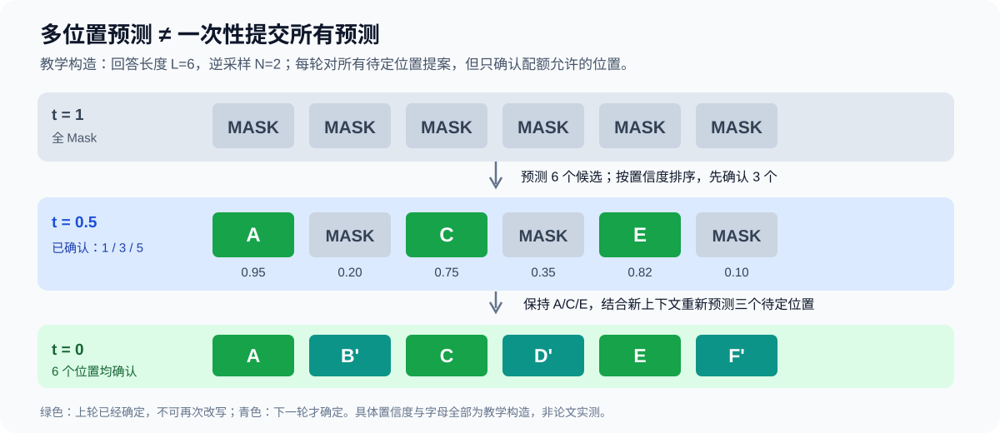

# LLaDA：不做 Next-Token Prediction，怎样从头预训练一套 8B 语言模型？

> **原始模型论文**：Shen Nie 等，**Large Language Diffusion Models**，NeurIPS 2025 正式版。[正式论文 PDF（39 页）](https://proceedings.neurips.cc/paper_files/paper/2025/file/48b383b24230e0e6e649d9c98dae4d8c-Paper-Conference.pdf) · [NeurIPS 论文主页](https://proceedings.neurips.cc/paper_files/paper/2025/hash/48b383b24230e0e6e649d9c98dae4d8c-Abstract-Conference.html) · [作者代码与权重](https://github.com/ML-GSAI/LLaDA) · [项目演示](https://ml-gsai.github.io/LLaDA-demo/)。
>
> **版本界限**：本文讨论 2025 年 NeurIPS 正式出版的 **LLaDA 8B Base / Instruct 原始方法**。不是 LLaDA 1.5、LLaDA-MoE，也不是 2026 年后续 iLLaDA。必要的概率基础：[D3PM](../../A/11-discrete-diffusion/A065-d3pm.md) → [MDLM](../../A/11-discrete-diffusion/A066-mdlm.md)；对照 [Transformer](../../A/03-transformer/A013-transformer-attention-is-all-you-need.md) 与 [Qwen2.5](B012-qwen2.5.md)。

## 一个必须先纠正的直觉：LLaDA 的神经网络还是 Transformer

听到“Diffusion LLM”，很容易以为论文在 Attention/FFN/Normalization 上发明了全新模型骨架。LLaDA 的主要变化不是换掉 Transformer，而是**换掉概率分解方式和训练/生成程序**。

自回归语言模型把序列概率写为从左到右的条件概率乘积：

$$
p_\theta(x_{1:L})=\prod_{i=1}^{L}p_\theta(x_i\mid x_{<i}).
$$

模型通过 Causal Attention Mask 保证位置 $i$ 只能读到此前 Token。因此生成时天然一枚一枚往右追加。LLaDA 则训练一个**无需 Causal Mask 的双向 Transformer**：输入一整条带随机 Mask 的句子，网络在同一次前向中为所有 Mask 位置预测原始 Token 的概率分布。

那么关键问题是：**一个能够看到左右文的 Mask-Predictor，为什么可以成为能够独立生成整条文本的概率模型？** 这不能只回答“它和 BERT 差不多”；必须定义从全 Mask 开始的逆扩散概率链，并让训练目标与其 Likelihood Bound 对应。

LLaDA 延续了 [MDLM](../../A/11-discrete-diffusion/A066-mdlm.md) 所属的 Absorbing-Mask 扩散框架。作者的模型研究贡献是：能否将这个框架规模化到现代 LLM 的参数、预训练 Token、SFT 和通用任务，并验证 In-Context Learning、Instruction Following、复杂推理是否一定依赖 AR 方向性。

## 先从 Figure 2 看完整模型：预训练、SFT、生成不是同一步操作

[NeurIPS 正式 Figure 2（PDF 第 3 页）](https://proceedings.neurips.cc/paper_files/paper/2025/file/48b383b24230e0e6e649d9c98dae4d8c-Paper-Conference.pdf) 被明确分为三栏：

- **(a) Pre-training**：随机 $t\in(0,1]$，每个真实 Token 独立以概率 $t$ 变 Mask，整个输入在双向 Transformer 中同时处理；
- **(b) SFT**：Prompt 保留，**只对 Response 的 Token 随机 Mask**，损失只在 Response Mask 位计算；
- **(c) Sampling**：Prompt 固定不变，Response 初始全 Mask，再沿时间 $1\to0$ 预测、保留、重新 Mask，逐步完成整段回答。

Figure 2 不是“训练时自动生成若干完整回答再排序”的自训练流程图。预训练和 SFT 的目标都是**已知 Ground Truth 的监督去噪损失**；只有生成阶段才需要真正执行 Reverse Sampling。

~~~{mermaid}
flowchart TD
 DATA["预训练：完整序列 x0"] --> M["随机 t；每位置独立 Mask"]
 M --> NET["双向 Transformer / Mask Predictor"]
 NET --> LOSS["只对 Mask 位置计算加权 CE"]
 PAIR["SFT：Prompt p + Response r"] --> M2["仅 Mask Response r"]
 M2 --> NET
 LOSS --> UPD["优化模型参数 θ"]
 PROMPT["推理：原样保留 Prompt"] --> INIT["Response: [MASK] × L"]
 INIT --> DEN["双向模型预测所有当前 Mask"]
 DEN --> REM["按时间预算随机/低置信 Remask"]
 REM --> DEN
 REM --> OUT["全部确认 / 遇到 EOS 后截断"]
~~~

*自制架构与训练/采样关系图，非论文 Figure。箭头表示同一模型在不同阶段承担不同概率任务，不意味着推理阶段仍执行梯度更新。*

## 正向“扩散”真的有连续噪声吗？没有，只有离散 Mask 事件

定义干净句子 $x_0=(x_0^1,\ldots,x_0^L)$。LLaDA 的噪声强度为连续时间 $t\in[0,1]$，但每个位置的实际取值始终是**离散 Token 或专用 Mask**：

$$
q_{t|0}(x_t\mid x_0)=\prod_{i=1}^{L}q_{t|0}(x_t^i\mid x_0^i),
$$

$$
q_{t|0}(x_t^i\mid x_0^i)
=
\begin{cases}
1-t,&x_t^i=x_0^i,\\
t,&x_t^i=M.
\end{cases}
$$

这对应 [原文 Appendix A Eq.(7)(8)](https://proceedings.neurips.cc/paper_files/paper/2025/file/48b383b24230e0e6e649d9c98dae4d8c-Paper-Conference.pdf)。$t=0$ 时没有 Mask；$t=1$ 时所有位置必为 Mask。**这是一条随机遮盖路径，不是 Token Embedding 上的 Gaussian Diffusion**。

假设一个长度为 4 的句子，$x_0=$“机器 / 能够 / 理解 / 指令”，在 $t=0.5$ 抽样一次，可能变成：

$$
x_{0.5}=[\text{机器},M,\text{理解},M].
$$

网络的任务是根据所有可见 Token（包括左侧和右侧），对位置 2、4 分别输出正确词的分布。每一步通过全句双向信息做条件预测，但输出位置仍存在并行预测的条件独立近似；**并行输出不意味着输出联合分布没有任何相关性**，相关性可由网络上下文与多轮逆采样逐步建立。

### 从 Token 到 Logits：扩散 LLM 的完整 Forward Shape

令 Batch 为 $B$、Sequence Length 为 $L$、Vocabulary 为 $V$、Hidden Dimension 为 $d$。Mask Predictor 输入仍是 Token ID 张量 $X_t:[B,L]$，而不是高斯噪声向量；查 Embedding 后成为 $E(X_t):[B,L,d]$。双向 Attention 对每个 Head 构造 $[L,L]$ 的注意力权重，**没有传统自回归的下三角 Causal Mask**。经历多层 Residual/Norm/Attention/FFN 后，LM Head 返回 $Z_\theta(X_t):[B,L,V]$。

一次 Forward 为**全部 $L$ 个位置**产生 Vocabulary Logits，但损失只发生在 Mask 位置。SFT 阶段还须把 Prompt/Response 的允许改变范围与 Loss Mask 严格分开：

| Token 区域 | 能被模型读到？ | 随机遮盖？ | 参加 CE？ |
|---|---|---|---|
| Prompt 的真实 Token | 是 | 否 | 否 |
| Response 被抽中遮盖的位置 | 是（输入为 Mask） | 是 | 是 |
| Response 未被抽中遮盖的位置 | 是 | 否 | 否 |
| Padding | 根据 Padding Attention Mask | 不应抽中 | 否 |

若 Batch 中混入长度不同的 Prompt/Response，仅凭位置 $i$ 的固定范围很可能出错，数据管道必须创建逐 Token 的 Boolean Eligible Mask。模型虽然输出了 Prompt 和非 Mask Response 的 Logits，也**不应在这些位置做下一词 Shift CE**，否则算法已经变成另一个训练目标。

### 与论文 Eq.(3)/(5) 对齐的最小 PyTorch 代码

下面是教学级损失实现；假定双向模型输出全词表 Logits，不包括 LLaDA 的大规模并行训练等工程代码：

~~~python
import torch
import torch.nn.functional as F

def diffusion_loss(model, tokens, eligible, mask_id):
    # tokens [B,L]; eligible bool[B,L]
    batch, length = tokens.shape
    t = torch.rand(batch, 1, device=tokens.device).clamp_min(1e-4)
    is_masked = (torch.rand(batch, length, device=tokens.device) < t)
    is_masked &= eligible
    corrupted = tokens.masked_fill(is_masked, mask_id)
    logits = model(corrupted)                        # [B,L,V]
    ce = F.cross_entropy(logits.transpose(1, 2), tokens,
                         reduction="none")           # [B,L]
    weighted = ce * is_masked / t
    return (weighted.sum(dim=1) / length).mean()
~~~

预训练时 Eligible 对所有有效 Token 为真；SFT 时仅 Response 的有效 Token 为真。这里为了对应论文的整句平均选择除以 $L$；若 Batch 中 Prompt/Response 长度变化，实际 Loss Reduction 还应核对作者的长度加权约定。**有效掩码、长度归一化以及 $\frac1t$ 是三件不同的事**，擅自变更就会影响短/长回答的相对样本权重。

此实现也特意防止 $t=0$ 导致除零。极小 $t$ 下某一短序列可能完全没有 Mask，此时该样本贡献是 0，而不是程序错误。这是 Bernoulli Forward 的 Monte Carlo 情形；用“强行保证每句至少有一个 Mask”的变种可能降低方差，但须说明它已改变抽样分布。

## 为什么损失是 $1/t$，而不是 BERT 任意固定 15% Mask？

[原文 §2.1 Eq.(3)](https://proceedings.neurips.cc/paper_files/paper/2025/file/48b383b24230e0e6e649d9c98dae4d8c-Paper-Conference.pdf)：

$$
\boxed{
\mathcal L(\theta)=-
\mathbb E_{t,x_0,x_t}\left[
\frac1t\sum_{i=1}^{L}
\mathbf1[x_t^i=M]\log p_\theta(x_0^i\mid x_t)
\right].
}
$$

这个 $1/t$ 不是为了“鼓励模型特别关注小噪声”，而是由吸收态扩散的连续时间**Negative ELBO** 推导得来（详见 [MDLM 的证明](../../A/11-discrete-diffusion/A066-mdlm.md)）。对固定位置 $i$，在 $t$ 时刻被 Mask 的概率是 $t$，因此 $1/t$ 抵消了它参与损失的抽样机会；不过实际条件预测误差仍依赖其它 Token 的 Mask Pattern。

论文在 Appendix A 证明

$$
-\mathbb E_{x_0\sim p_{\rm data}}\log p_\theta(x_0)
\ \le\ \mathcal L(\theta).
$$

因而最小化 $\mathcal L$ 是在最小化一个负对数似然**上界**；不能说它每一次 SGD 实际上都计算了完整的精确 $\log p_\theta(x_0)$。也不能说这只等价于在一个干净句子上“取所有位置 Mask 的 CE”，因为不同 $t$ 的 Mask Pattern 与权重共同构成目标。

实践中原论文 Algorithm 1 把这个 Loss 除以 Token 长度 $L$ 做平均，以保持训练尺度；正文 Eq.(3) 按求和写的是未归一化的整句数学目标，二者的总体常数与优化学习率约定不同。**同一个目标的尺度选择可以不同，但不能把 Batch 和 Token Reduction 无条件省略**。

### 用长度 4 的样本检查一次训练项

假设抽到 $t=0.25$，某次随机 Mask 恰好仅遮住位置 2，其真实类别概率为 $p_\theta=0.4$。这个位置 Cross-Entropy 为

$$
\ell=-\log0.4\approx0.91629.
$$

不做 Token Mean 时，本样本计算的加权项是 $\ell/t=4\ell\approx3.66516$；若按 Algorithm 1 再除以 $L=4$，得到 $0.91629$。因为这个位置在 $t=0.25$ 仅有四分之一概率被 Mask，$1/t$ 不等于凭空把 Loss 放大 4 倍的任务偏好，而是在 Monte Carlo 意义上为 Mask 抽样概率作补偿。这里的概率数值是教学构造，不是作者实际训练 Batch 的输出。

## 从 Pre-training 到 SFT，必须改变的到底是哪部分条件变量？

Jamba/Transformer 等模型把 Prompt-Response 训练转为前缀预测 Response。LLaDA 也必须使模型学到**在 Prompt 条件下生成 Response**，但训练不通过左到右 Label Shift 实现。

设 Prompt 为 $p_0$、正确回答为 $r_0$，回答长度 $L'$。令 $r_t$ 为**只对回答部分**随机遮盖后的内容，则 [原文 §2.3 Eq.(5)](https://proceedings.neurips.cc/paper_files/paper/2025/file/48b383b24230e0e6e649d9c98dae4d8c-Paper-Conference.pdf)：

$$
\mathcal L_{\rm SFT}(\theta)=-
\mathbb E_{t,p_0,r_0,r_t}
\left[
\frac1t\sum_{i=1}^{L'}
\mathbf1[r_t^i=M]\log p_\theta(r_0^i\mid p_0,r_t)
\right].
$$

模型实际输入是序列 $[p_0;r_t]$，可以将所有 Prompt 位置直接作为可见条件；只有 $r_t$ 的 Mask 位置贡献 Loss。

**为何不能把 Prompt 也遮住？** 如果训练也让 Prompt 随机缺失，就在学更一般的无条件文本恢复，而不是明确训练测试时需要的“Prompt 固定、生成 Response”的条件分布。虽然双向 Transformer 能同时读取 Prompt 和 Response，训练的 Mask Policy 仍规定哪些位置允许变化。

原文 §2.3 用 **4.5M Prompt–Response Pairs** 做 SFT，训练 3 Epoch。对于较短回答，通过 EOS Padding 到 Batch 对齐长度；训练时 EOS 是普通 Token，采样后将首个 EOS 后面的内容截断。这说明它虽然开始生成前要指定 Response 的 Mask 长度，但可以通过 EOS 预测实现近似的输出长度控制，不能把它当作无需任何长度参数的原生无限长生成算法。

## Reverse Sampling：为什么从全 Mask 开始还能生成连贯文本？

令回答 $r_{t=1}=[M,\ldots,M]$。在反向时间 $t\to s<t$，先对所有 Mask 位置并行预测：

$$
\hat r_0^i=\arg\max_x p_\theta(x\mid p_0,r_t),\qquad
i\text{ 为当前 Mask 位置}.
$$

对于 Absorbing Mask 的合法祖先采样，如果当前为 Mask，则：

$$
P(\text{保留 Mask 到 }s\mid M\text{ at }t)=\frac st,
\qquad
P(\text{解除 Mask})=\frac{t-s}{t}.
$$

注意这和“每步重新 Mask 掉已确认的所有普通 Token”并不是同一回事。原始概率模型里**已经非 Mask 的位置在后续逆过程不应该再改写**。LLaDA 默认 Low-Confidence Remasking 会对这一步网络提出的候选 Token 依据 Confidence 选择哪些**继续处于 Mask 状态**，主要是选择提交时机而非修改此前已确认的内容。

### 真正复原 Appendix Algorithm 5：为什么只是“按置信度排序”还不够？

[正式论文 Appendix A、Algorithm 5（PDF 第 27 页）](https://proceedings.neurips.cc/paper_files/paper/2025/file/48b383b24230e0e6e649d9c98dae4d8c-Paper-Conference.pdf) 明确输入四个对象：Mask Predictor、固定 Prompt、预先选定的回答长度 $L$、采样步数 $N$。从 $t=1$ 开始，对每步 $s=t-1/N$：

1. 对当前仍为 Mask 的位置，同时预测其词表分布，按 Argmax 提出 Clean Token 候选，并记录该候选的 Softmax Probability。
2. 对已经非 Mask 的位置，**不重新预测**；候选就是原词，并将它的 Confidence 强制设为 1。
3. 目标被确认的数量为 $n_{\rm un}=\lfloor L(1-s)\rfloor$，其余 $L-n_{\rm un}$ 个位置应保持为 Mask。
4. 在全部 $L$ 个位置中选择 Confidence 最低的 $L-n_{\rm un}$ 个重新设为 Mask，其余提交；进入下一轮。

这里最容易漏的是第 2 步。若已经提交的 Token 被重新预测并赋予很低概率，那么后来可能被错误地遮回去，违背 Absorbing Reverse Chain 的 Carry-Over。原论文 Algorithm 5 特地让已提交 Token 的 Confidence 为 1 以保证不可倒退。严格实现遇到 Confidence 1 的 Tie 时，还须明确优先保护先前提交的 Token。

设 $L=6,N=2$，从全 Mask 开始：

| 时间 | 本轮之前已确认 | 本轮后应确认 | 操作 |
|---|---:|---:|---|
| $1\to0.5$ | 0 | 3 | 给六个位置提案，只提交三枚最高置信 Token |
| $0.5\to0$ | 3 | 6 | 前三枚保持，剩余三枚重新预测后全部提交 |

这个过程与 Appendix Algorithm 4 的 **Random Remasking** 不同：后者对每个待定 Token 独立以 $s/t$ 概率继续遮盖，因而某步实际确认数具有随机波动；Algorithm 5 每一步明确控制剩余 Mask 配额。它们不是同一个随机采样分布的两个等价版本。

### Table 9：采样规则本身的受控实验

[正式论文 Appendix B.4、Table 9（PDF 第 31 页）](https://proceedings.neurips.cc/paper_files/paper/2025/file/48b383b24230e0e6e649d9c98dae4d8c-Paper-Conference.pdf) 固定 **LLaDA 8B Base、答案长度 256、采样 256 Steps**：

| 采样方式 | BBH | GSM8K | Math | HumanEval | MBPP |
|---|---:|---:|---:|---:|---:|
| Random Remasking | 32.1 | 21.3 | 9.2 | 11.6 | 21.0 |
| Low-Confidence Remasking | **45.0** | **70.0** | **30.3** | **32.9** | **40.2** |

这项消融控制了模型和长度，是“按置信度选择确认位置会影响回答质量”的直接证据，而不是“低置信算法优化了训练时 ELBO”的证明。低置信策略引入 Argmax 和排序决策，已经不等于原始随机逆转移。Table 10 还表明不同 Benchmark 的最佳答案长度（256/512/1024）不一样：**生成长度、采样步数和模型能力不能缩成一个“单 Forward 并行预测 Token 数”的指标**。

### 两轮手算：同一次模型前向如何确定多个位置？

*自制解释图，非 LLaDA 原论文 Figure：绿色位置已经被提交，青色位置在下一轮才确认；概率和字母是教学示例。核心约束是已经确认的 Token 不再被低置信排序重新遮回去。*

假设当前有 6 个待补位置且 $t=1\to s=0.5$，模型同时输出：

| 位置 | 候选 | 最大概率 |
|---|---|---:|
| 1 | A | 0.95 |
| 2 | B | 0.20 |
| 3 | C | 0.75 |
| 4 | D | 0.35 |
| 5 | E | 0.82 |
| 6 | F | 0.10 |

从全 Mask 到 $s=0.5$，预期应确认约 3 个位置。采用论文的**低置信再遮盖启发式**，可以先提交位置 1、3、5，而保留 2、4、6 为 Mask。下一次模型已经能看见 A、C、E，因而能根据这三个已确认 Token 调整 B、D、F 的条件预测；当 $s=0$，完成全部位置。

**这就是双向联合修订的正确理解**：多个位置在一个前向中提出草案，只有部分位置被提交；其余位置在下一轮吸收新的全局上下文。它不保证一轮推理就产出全句，也不等于网络真正计算了 Token 全排列的精确 Joint Distribution。

~~~{mermaid}
flowchart LR
 P["Prompt 固定可见"] --> T1["时间1：回答全 Mask"]
 T1 --> PR["整句双向预测"]
 PR --> CONF["按位置置信度挑已确认 Token"]
 CONF --> T2["时间0.5：部分词已确定，仍有 Mask"]
 T2 --> PR2["在新上下文下预测剩余 Mask"]
 PR2 --> T0["时间0：回答完成 / EOS 截断"]
~~~

*自制采样轨迹，非原论文 Figure 2；示意 Low-Confidence 策略而非原始时间连续随机过程的逐次样本。*

## 一个被文章标题遮住的训练结构：8B 的网络不只是“原样 LLaMA3 删掉 Causal Mask”

原文 §2.2 明确说它使用接近普通 LLM 的 Transformer 结构，但是**没有 Causal Attention Mask**。8B 版本还基于 LLaMA3 8B 进行近似结构比较，同时作了实际修改：

1. 为求实现简单，采用原生 Multi-Head Attention，而不是 LLaMA3 常用的 Grouped-Query Attention。
2. 因为 Attention 层增加了参数，调整 FFN Width，维持大致可比较的模型规模。
3. 词表/Tokenizer 随其训练数据做了相应改变。
4. 将同一 BackBone 作为 Mask Predictor，而不是让它输出标准 Next-Token Shift 目标。

所以“LLaDA 与 LLaMA3 8B 结构逐层完全一致，唯一差别是 Loss”也是错误的。除 Attention Mask 外，还有 Head Sharing、FFN 宽度、Tokenizer 与训练数据的差异。

更重要的是，LLaDA 的多轮双向 Forward 不具备普通 AR Decoder 在经典 Decode 中使用的那种直接复用**固定历史 KV Cache**的条件：每轮 Mask Pattern 会改变，先前 Token 的表示也可能因为双向上下文更新。论文原始代码因此没有把 Transformer 推理写成和 AR 一样高效的 Prefix KV 增量追加。理论上的**并行 Token Prediction**并不等于实际 GPU 单 Token Latency 必定更低。

## 训练多少数据之后，它才有资格与大型自回归模型对照？

[NeurIPS 正式论文 §2.2、Figure 3（PDF 第 6 页）](https://proceedings.neurips.cc/paper_files/paper/2025/file/48b383b24230e0e6e649d9c98dae4d8c-Paper-Conference.pdf) 给出关键训练约束：8B 从头训练 **2.3T Token**、标准长度 4096，其中 1% 随机用 1 到 4096 的可变长度；约 130K H800 GPU-Hours；数据混合包括通用文本、代码、数学和多语种。SFT 再使用前述 4.5M Pairs。**这些是研究规模及训练配方，不是作者宣称该模型使用了更少计算完成所有任务**。

Figure 3 横轴是从 $10^{20}$ 到 $10^{23}$ 的 Pre-training FLOPs，纵轴是六类下游任务准确率。作者自己训练 ARM Baseline 并尽量控制 Data Mix，比较 LLaDA 随算力增加的趋势：MMLU、GSM8K 等增长明显；PIQA、HumanEval 等并非全段优于 ARM。作者明确**没有强行拟合一个通用 Scaling Law 指数**，避免 Outlier 造成误解。因此不能由散点图声称“LLaDA 的 Scaling Exponent 严格比所有 AR Model 更好”。

### Table 1 实际给出了支持和反证，不能只选胜出的项目

[NeurIPS 正式 Table 1（PDF 第 7 页）](https://proceedings.neurips.cc/paper_files/paper/2025/file/48b383b24230e0e6e649d9c98dae4d8c-Paper-Conference.pdf) 选取同论文可比的模型：

| 预训练 Base 模型 | 训练 Token | MMLU（5-shot） | GSM8K（4-shot） | HellaSwag（0-shot） | HumanEval（0-shot） |
|---|---:|---:|---:|---:|---:|
| **LLaDA 8B Base** | **2.3T** | 65.9 | 70.3 | 70.5 | 35.4 |
| LLaMA3 8B Base | 15T | 65.4 | 48.7 | **79.1** | 34.8 |
| LLaMA2 7B Base | 2T | 45.9 | 13.1 | 76.0 | 12.8 |

在这几项中，LLaDA 在 GSM8K、MMLU 接近或优于 LLaMA3，但 HellaSwag 明显更弱。因此**“它证明 AR 不再需要”不成立**。模型训练 Token 预算与数据集合不同，原文 Table 1 的结论更谨慎：Masked Diffusion 是一个可以训练到大型语言模型能力范围的替代生成范式。

作者另在 Table 2 汇报 Post-trained Instruct 的分数，**LLaDA 只采用 SFT，而多个 AR 对照还使用 RL Alignment**；即便同一 Benchmark 也不能把差异严格解释为扩散模型相对于 AR 结构本身的优劣。

### EOS：即使网络、权重都一样，解码规则也可能改变数学题正确率

[原论文 Appendix B.4](https://proceedings.neurips.cc/paper_files/paper/2025/file/48b383b24230e0e6e649d9c98dae4d8c-Paper-Conference.pdf) 提到一个实际失败模式：Instruct SFT 为 Batch 对齐而引入大量 EOS Padding，Pure Diffusion 时模型容易在多个位置过早提出 EOS，导致回答被第一次 EOS 截断，后续推理尚未发生就结束。

对一部分数学、代码任务，作者在 Low-Confidence 策略中**把 EOS 候选的 Confidence 人为置零**，令它较晚才被提交。这不是一个神经架构创新，而是纠正训练数据与采样机制不匹配的实际策略。

作者还报告，Instruct 默认纯扩散策略下 GSM8K/Math 为 69.4/31.9，而某些 Block-Diffusion 采样下为 78.6/42.2。差异来自**采样配置**而非再次训练了模型参数。仅凭“LLaDA-8B Instruct”一个模型名，不注明 EOS 规则、Block Size、Answer Length、Steps，就无法保证可复现的成绩。

## “打破 Reversal Curse”究竟测了什么？

[原论文 §3.3 / Table 4（PDF 第 9 页）](https://proceedings.neurips.cc/paper_files/paper/2025/file/48b383b24230e0e6e649d9c98dae4d8c-Paper-Conference.pdf) 以 496 组著名中文诗句为数据，分别提出：

- Forward：给出上句，预测下句；
- Reverse：给出下句，预测上一句。

标准左到右 LM 的 Pretraining Target 只要求从左到右预测 Next Token，未必鼓励学习条件方向反转。Mask Diffusion 允许在双向可见 Context 下预测任意 Mask 位置，可能减少这种训练方向性造成的偏差。

原文在选定 Poem Completion 上报告 LLaDA 比 Qwen2.5、GPT-4o 有更均衡的 Forward/Reverse 能力，这是**任务限制非常强**的一项证据。它不能直接推出“任意事实关系都不存在方向依赖”或“扩散推理天生比人类和任意 ARM 更擅长逆推理”。例如从“A 是 B 的父亲”恢复反向事实涉及语言、背景知识、逻辑、错误实体记忆，并非只受 Left-to-Right 因子分解决定。

Figure 2 与 Table 3 还展示了多轮对话和单个回答的不同 Token 提交顺序。**图中深浅色代表更早或更晚被确认的 Token**，不是模型对该 Token 的概率可信度。它说明采样不必按从左到右完成，却不能单凭示例判断生成质量整体更高。

## 为什么作者不把“Diffusion 推理一定更快”写成结论？

原论文 Appendix B.7 明确将吞吐作为速度/质量取舍研究：在单张 A100 80GB、Batch 1 等设置下，LLaDA 可以减少 Sampling Steps、让多个 Token 每步被确认，从而提高输出 Token/s，但通常会改变质量。默认模型没有为多轮全序列更新引入与 AR Prefix KV Cache 完全同样的推理优化。

**采样步数**、**生成长度**、**Context Length** 必须独立记录。假设长度 256 的回答用 32 Steps 去噪，平均每步可能提交 8 个 Token，但这不是 8 倍于自回归的实际加速定理：每一步 Denoiser 需要对整段 Prompt+Response 做双向前向，Cost 与具有 KV Cache 的 AR 单 Token Forward 不同。

而且在模型的 Mask 式 Likelihood 估计中，不能简单使用 AR 的逐 Token Teacher Forcing PPL；作者以抽样 Mask 数量、加权损失形式评价 Conditional Likelihood（原文 Eq.(6) 与 Appendix Algorithm 3），报告的是模型的生成概率相关上界。与 AR 直接比较需要注明这一统计差异。

## 从研究方法看 LLaDA 的主要价值和边界

1. **概率范式**：不是按位生成下一 Token，而是通过一条已知 Forward Mask Chain 与学到的 Reverse Chain 建立联合概率模型。只有真实满足该构造和目标时，才能谈 Variational Likelihood。
2. **网络架构**：仍然是 Transformer，但采用双向 Attention 与独立的 Mask-Predictor 分布。不能把它误画成连续高斯图片扩散 UNet。
3. **大规模训练**：8B / 2.3T Pretrain / 4.5M SFT 说明可以将此范式扩展到大型语言任务，**不是由一个 110M MDLM 的 PPL 自动外推来的**。
4. **生成行为**：同一轮可以预测多个 Mask Token，并通过低置信保留策略按内容顺序提交；但多轮前向和长度超参数带来新的延迟/一致性选择。
5. **能力结论**：在一组数学、中文、通用语言和反向诗句任务上表现具有竞争力，同时在 HellaSwag 等项目上明显落后，说明这项研究展示了**替代 AR 的可行性**而不是所有指标的支配地位。

如果只要记住这一条演化脉络：**[D3PM](../../A/11-discrete-diffusion/A065-d3pm.md) 建立有限类别的扩散概率与后验 → [MDLM](../../A/11-discrete-diffusion/A066-mdlm.md) 把 Mask 吸收态简化为带 $1/t$ 权重的 CE → LLaDA 使用双向 Transformer 从头预训练大规模 Mask-Predictor，再沿相同逆扩散过程完成回答生成与指令微调**。三篇分别回答“数学上能否这样建模”“怎样得到简单可训练目标”“这样训练能否获得现代 LLM 的核心能力”，贡献不可互相混淆。
