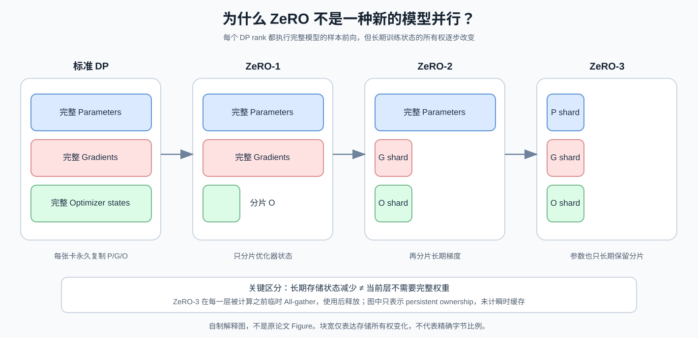
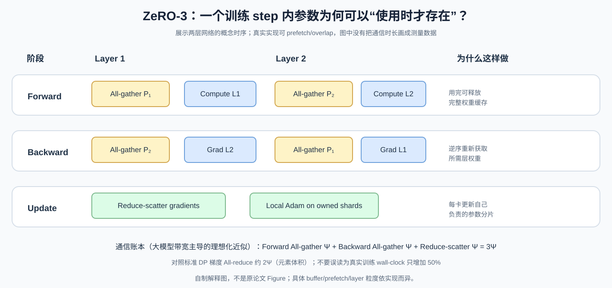
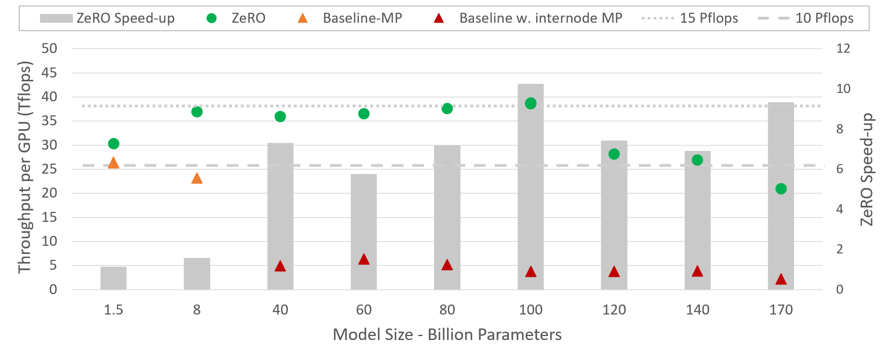

# ZeRO：既然每张 GPU 都算完整模型，为什么不能只存一部分训练状态？

> **原始论文**：Samyam Rajbhandari, Jeff Rasley, Olatunji Ruwase, Yuxiong He，[ZeRO: Memory Optimizations Toward Training Trillion Parameter Models](https://arxiv.org/abs/1910.02054)，SC20（2020）；本文对照仓库内原论文源包 `sources/C001-zero/src/` 的方法、通信分析与实验段落。
> **论文类型**：C · 大规模分布式训练系统。
> **核心问题**：把 *存储所有权* 和 *执行计算时需要的数据* 分开，能否既保留数据并行的计算粒度，又避免每张 GPU 永久复制完整的训练状态？

## 从上一站接过来的问题

上一站 [4D Parallelism](C001-4d-parallelism.md) 已经把大模型训练分成 TP、PP、CP 和 DP/FSDP 四条正交轴。在那里，我们知道 FSDP 可以避免数据并行副本的状态冗余，却还没有认真回答一件事：**各 GPU 都需要完成完整模型的前向与反向，怎么可能不在本地长期保存完整参数？**

再把镜头切回 [FlashAttention-3](../../A/10-gpu-operators/A057-flashattention3.md)：FA3 利用“**什么数据在什么时候真正被使用**”组织 Hopper 内部的异步流水。ZeRO 虽然工作的硬件尺度更大，思考方法却非常相似：

> 不要把“计算时会用到”误认为“整个训练 step 必须始终持有”。

与 [Adam](../../A/01-foundations/A002-adam.md) 和 [AdamW](../../A/01-foundations/A003-adamw.md) 的关系也需要分清：Adam/AdamW 决定参数如何更新，**ZeRO 不发明新的优化目标或参数更新公式**；它改变训练状态在哪个 rank 保存，以及怎样按需通信。

阅读这篇论文，真正要解决的不是“记住 ZeRO-1/2/3”，而是从一个最基本的显存账本推导出：

$$
\text{完整计算语义}
\quad+\quad
\text{分片持久化状态}
\quad+\quad
\text{按需通信}
$$

为什么三者能够同时成立？代价又是什么？

*自制解释图，非原论文 Figure。上图描述的是每张 DP GPU **长期持有**哪些状态，不等于任一时刻的显存峰值；ZeRO-3 执行某层时仍可能短暂收集完整的该层权重。*

## 一、先做最朴素的训练显存账本：参数只占了五分之一还不到

假设模型有 $\Psi$ 个可训练参数，训练使用原论文讨论的混合精度 Adam 路线。每个参数可能需要：

| 训练状态 | 数据类型 | 字节/参数 | 用途 |
|---|---|---:|---|
| 前向/反向使用的权重 | FP16 | 2 | Tensor Core 计算 |
| 梯度 | FP16 | 2 | 反向输出 |
| Master weight | FP32 | 4 | 稳定地更新权重 |
| Adam 一阶矩 | FP32 | 4 | 动量 |
| Adam 二阶矩 | FP32 | 4 | 自适应尺度 |
| **总计** | | **16** | 尚未计算 activation、workspace、碎片 |

因此：

$$
M_{\rm states}^{\rm DP}
=(2+2+4+4+4)\Psi
=\boxed{16\Psi\ {\rm bytes}}.
$$

这是一种**与原论文内存分析严格对应的工作假设**，并非说所有现代 PyTorch、BF16、8-bit optimizer 或 fused optimizer 都必须占 16 bytes/parameter。

例如，模型只有 $1.5$B 参数：

$$
M_{\rm FP16\ weights}
=1.5\times10^9\times2
=3\ {\rm GB},
$$

但这份 Adam 账本已经是：

$$
M_{\rm states}
=1.5\times10^9\times16
=24\ {\rm GB}.
$$

再加上 activations、临时 fused buffers、碎片以及 CUDA runtime，32 GB 显存不一定装得下训练过程。这正是原论文 `III “Where Did All the Memory Go?” 的切入点。

**第一个知识转折**：模型参数量和训练显存不是一回事。你如果只做推理，可以不需要 gradient / Adam states；但训练显存至少要把这些东西分开算。

## 二、为什么增加 Data Parallel GPUs 也不能解决“单卡装不下”？

设数据并行度：

$$
N_d=8.
$$

标准 Data Parallel (DP) 的含义是，每张 GPU：

1. 持有**同一个完整模型**及其训练状态；
2. 对**不同** mini-batch shard 计算 forward/backward；
3. 对梯度做 collective，使下一步模型参数在各个 rank 保持一致。

如果单张卡训练状态需要 $M$ 字节，那么八张 GPU：

$$
M_{\rm cluster}=8M,
\qquad
M_{\rm per\ rank}=M.
$$

注意第二个式子。增加 GPU 数量提高了 aggregate memory 和可以处理的数据副本数，但**单卡模型状态的占用不变**。

假设每张 GPU 的完整 Adam states 都占 120 GB，哪怕再加 64 张 32 GB 的 GPU，标准 DP 仍然无法让**任何一个 rank**装下 120 GB 状态。

朴素修法是提高 [Tensor Parallelism](C001-4d-parallelism.md) 或 Pipeline Parallelism：把模型本身的矩阵或深度分开。但这会引入更细粒度的跨设备计算与通信，尤其可能使一个原本完整的大 GEMM 被分成多块小 GEMM。

因此 ZeRO 想保住两件事：

- DP 的**计算语义**：每个 rank 对自己的数据做完整 forward/backward；
- 模型并行的**存储优势**：GPU 之间不重复长期保存同一份状态。

它不是取消通信，而是**改变通信发生的时机**。

## 三、原论文 Figure 1：三个 Stage 不是不同模型，而是依次取消三种复制

*原论文 Figure 1，源文件 `memory-consumption-v4.PNG`。图中 $\Psi$ 为参数数量，$N_d$ 为 DP degree，$K$ 为 optimizer-state multiplier；示例采用 $\Psi=7.5$B、$N_d=64$、混合精度 Adam 的 $K=12$。请先看不同阶段公式，随后再看样例数字。原图中的“通信开销”基于论文特定 collective 体积模型，不是 wall-clock latency 的测量。*

观察上图最重要的一点：**ZeRO 不是同时把参数、梯度和 optimizer 一次性除以 $N_d$**。它是累计分片：

- $P_{\rm os}$：只分片 optimizer states，对应通常说的 ZeRO-1；
- $P_{\rm os+g}$：再分片 gradients，对应 ZeRO-2；
- $P_{\rm os+g+p}$：再分片 parameters，对应 ZeRO-3。

当你把三类张量分别写在纸上，公式就不需要背了。

### 3.1 Stage 1：先只分片最贵的 optimizer states

将 master weights、Adam 一阶矩和二阶矩按参数索引划分成 $N_d$ 个不重叠的 shard。第 $r$ 张 GPU 只保存并更新自己负责的 $1/N_d$。

但每张 GPU 的低精度 weights 和 gradients 仍保持完整。

因此：

$$
\boxed{
M_1=4\Psi+\frac{12\Psi}{N_d}
}.
$$

这里的 $4\Psi$ 是未分片的 FP16 weights + FP16 gradients；后面的 $12\Psi/N_d$ 是 optimizer states。

令 $N_d\to\infty$：

$$
M_1\to4\Psi,
\qquad
\frac{16\Psi}{M_1}\to4.
$$

所以所谓“Stage 1 约 4 倍节省”指的是此模型的**理论极限**，不是所有 $N_d$ 下都恰好减少四倍。

**关键时序问题**：既然每卡只更新自己的参数 shard，下一轮 forward 怎么让每卡得到一致的完整权重？

答案是：更新后交换参数分片，让所有 DP ranks 恢复完整低精度权重。这里可以采用 all-gather 的通信思路。

这一操作**没有改变 Adam 的数学公式**，只改变了谁负责更新哪些参数索引。

### 3.2 Stage 2：反向时无需永久收集完整 gradients

再往下一步想：第 $r$ 张 GPU 只持有参数 shard $r$ 的 optimizer states，也只会执行该 shard 的更新。那它为什么要存储其余所有参数的完整聚合 gradient？

如果计算梯度聚合时采用 reduce-scatter，那么每个 rank 只接收自己负责的那部分**已聚合梯度**。

于是，长期 gradient footprint 也可按 $N_d$ 分片：

$$
\boxed{
M_2=2\Psi+\frac{14\Psi}{N_d}
}.
$$

前面的 $2\Psi$ 是仍然复制的 FP16 weights；$14\Psi/N_d$ 包括：

$$
2\Psi/N_d \quad\text{(gradients)}
$$

与

$$
12\Psi/N_d \quad\text{(optimizer states)}.
$$

极限：

$$
M_2\to2\Psi,\qquad
\frac{16\Psi}{M_2}\to8.
$$

**注意这里的“gradient partitioning”不是说每张卡只反向计算模型的某一部分。** 每张 DP GPU 仍要对自己的样本计算完整模型的本地梯度，随后仅将需要保留的全局聚合结果 reduce-scatter 到所属 rank。短生命周期的本地梯度与通信 buffer 仍会形成峰值，占用未必完全等于上面的持久化公式。

### 3.3 Stage 3：最后连 parameters 都按需持有

此时只剩 FP16 weights 仍长期完整复制。

既然一个 Transformer layer 的权重只有在该层 forward/backward 时才被使用，为什么让所有层的所有参数在整个 step 都常驻？

ZeRO-3 让每个 GPU 长期保留：

$$
P_r,\quad G_r,\quad O_r
$$

这三个参数索引对应的 shard。

计算第 $\ell$ 层前，临时收集该层所需的完整参数：

$$
W_\ell
=\operatorname{AllGather}(W_{\ell,1},\dots,W_{\ell,N_d}).
$$

该层计算完便可以根据执行策略释放、再分片。反向到这一层时，再按需要重建。

因此原论文的理想 model-state footprint：

$$
\boxed{
M_3=\frac{16\Psi}{N_d}
}.
$$

这种“按需物化”并不意味着同一时刻内存里绝不存在完整 layer weight：**真实 peak memory** 还要加通信中的 transient weights、prefetch buffer 和 activation。这是实际工程 sizing 时最容易漏掉的部分。

## 四、拿一组参数把公式全部算出来

原论文 Figure 1 使用：

$$
\Psi=7.5\times10^9,\qquad N_d=64,\qquad K=12.
$$

在论文的 GB 十进制单位下：

| 训练状态方案 | 每 GPU 理想模型状态内存 | 相比标准 DP |
|---|---:|---:|
| 标准 DP | $16\Psi=120$ GB | $1\times$ |
| ZeRO-1 | $4\Psi+12\Psi/64\approx31.41$ GB | $3.82\times$ |
| ZeRO-2 | $2\Psi+14\Psi/64\approx16.64$ GB | $7.21\times$ |
| ZeRO-3 | $16\Psi/64=1.875$ GB | $64\times$ |

这是**本地按照论文公式重新计算的理论值**，不是四种配置真实峰值显存的实测表。

它可以解释一个有趣的事实：

> ZeRO-2 在 $N_d$ 很大时依然至少长期保留一份完整权重；ZeRO-3 的长期模型状态则继续随 $1/N_d$ 降低，但开始要求更频繁的参数通信。

因此 Stage 3 不是“Stage 2 的无条件升级”。**它换来的显存收益是真实的，换来的通信代价同样真实。**

## 五、为什么 Reduce-scatter + All-gather 还能保持相同的训练结果？

这里必须同时讨论两个问题：**数学结果是否一致**，以及**通信量是否增加**。它们不是一个问题。

假设 $N_d$ 个 DP ranks，各持有同一模型的不同 mini-batch。rank $r$ 得到本地梯度：

$$
g^{(r)}=\nabla_\theta L_r(\theta).
$$

若各 rank 的梯度具有相同的数据加权，标准 DP 要形成：

$$
\bar g=\frac{1}{N_d}\sum_{r=0}^{N_d-1}g^{(r)}.
$$

标准 all-reduce 的结果是在**所有 rank** 都产生完整 $\bar g$。

但把参数索引集合划成不交叠部分：

$$
\mathcal I_0,\mathcal I_1,\ldots,\mathcal I_{N_d-1},
$$

满足：

$$
\bigcup_r\mathcal I_r=\{1,\ldots,\Psi\},
\quad
\mathcal I_i\cap\mathcal I_j=\emptyset\;(i\ne j).
$$

由于同一参数的梯度聚合在参数索引上可以独立进行，所以完全可以先对每个 $\mathcal I_r$ 做跨 rank 求和，把聚合结果只交给 rank $r$：

$$
\boxed{
\bar g_{\mathcal I_r}
=\frac1{N_d}
\sum_{k=0}^{N_d-1} g^{(k)}_{\mathcal I_r}.
}
$$

这就是 reduce-scatter 的核心语义。

随后 rank $r$ 用自己的 Adam state 更新：

$$
\theta'_{\mathcal I_r}
=\operatorname{AdamUpdate}
(\theta_{\mathcal I_r},\bar g_{\mathcal I_r},m_{\mathcal I_r},v_{\mathcal I_r}).
$$

只要优化器是按参数元素可分的（如这里的经典 Adam 核心更新），并且 collective、学习率、weight decay、梯度缩放、global norm clipping、随机状态等语义一致，各 rank 的 shard update 拼起来便与完整更新对应。**跨参数耦合的操作必须在分片前后额外同步所需全局统计量**，不能仅凭“梯度可分片”便认定任何 optimizer 都天然等价。

下一轮如果需要每张卡拥有完整 weights，再 all-gather 更新后的参数 shards：

$$
\theta'=\operatorname{AllGather}
(\theta'_{\mathcal I_0},\ldots,\theta'_{\mathcal I_{N_d-1}}).
$$

这就把原本：

> 所有人都聚合完整梯度 → 所有人都更新完整模型

改造成：

> 不同人负责不同梯度分片 → 各自更新对应权重 → 按需交换更新结果。

这一步的价值并非“多了一种 collective API”，而是**证明训练更新没有必要让每个 rank 保留每种完整训练状态**。

## 六、ZeRO 最关键的工程账：模型状态降下去，通信是否反而爆炸？

原论文 `VII 专门对这个问题推导，极其值得细读。

记 $\Psi$ 为参数元素数量，先用**单个 DP rank 的归一化通信元素量**近似衡量大规模 bandwidth-bound collective，忽略消息 latency、网络拥塞、重叠与精度差异。有限 rank 的 ring collective 通常还含 $(N_d-1)/N_d$ 因子，这里遵循原论文的大规模近似。

### 6.1 标准 DP：All-reduce 为什么近似 $2\Psi$？

一个典型的 ring all-reduce 可以分成：

$$
\operatorname{AllReduce}
=
\operatorname{ReduceScatter}
+
\operatorname{AllGather}.
$$

每部分每 rank 数据移动量近似 $\Psi$，所以：

$$
\boxed{
V_{\rm DP}\approx2\Psi.
}
$$

这里的“通信体积”并不直接等同于耗时，因为实际时间还取决于 bandwidth、collective 算法和拓扑。

### 6.2 ZeRO-2：我们不是凭空增加一次 All-gather

ZeRO-2 用 reduce-scatter 汇聚梯度分片：

$$
V_{\rm grad}\approx\Psi.
$$

然后对更新后的权重 all-gather：

$$
V_{\rm weight}\approx\Psi.
$$

因此：

$$
\boxed{
V_{\rm ZeRO2}\approx\Psi+\Psi=2\Psi.
}
$$

它与标准 DP 在该理想通信量模型下近似相同。ZeRO-1 也可以用恰当的 collective 调度达到类似体积，但不应把**具体实现**和**理论可达到的方案**混淆。

### 6.3 ZeRO-3：额外通信从哪里来？

参数也分片后，无法像 ZeRO-2 那样在每一步之间让各 rank 长期保留全部权重。只在对应 layer 被执行时收集权重。

一个训练 step 的抽象时序：

*自制解释图，非论文 Figure。画的是两层网络的**示意时序**：前向收集层权重、反向时按需再收集、梯度 reduce-scatter 后本地更新。真实实现可 pipeline/prefetch、可能保留部分缓存，并非所有 collective 必须完全串行。*

按原论文 `VII 的模型：

- forward 参数 all-gather：$\Psi$；
- backward 参数 all-gather：$\Psi$；
- gradient reduce-scatter：$\Psi$。

因此：

$$
\boxed{
V_{\rm ZeRO3}\approx3\Psi.
}
$$

相对标准 DP：

$$
\frac{V_{\rm ZeRO3}}{V_{\rm DP}}
\approx\frac{3\Psi}{2\Psi}
=\boxed{1.5}.
$$

这只证明：**在论文抽象通信模型中，传输的元素体积约增加 50%。**

绝不能直接推出：

> ZeRO-3 的训练时间一定比标准 DP 慢 50%。

因为后者涉及真实 latency、通信重叠、buffer、batch size 与 GEMM 利用率；反过来，模型如果本来 OOM，标准 DP 根本无法执行，直接拿时间做比值就没有意义。

## 七、原图如何读：120 GB → 31.4 GB → 16.6 GB → 1.875 GB，与“50% 通信增量”是同一笔交易

此时再回看 [Figure 1](../../../figures/C002/fig1-original-memory-stages.png)，会发现真正的系统设计不是越省显存越好，而是有一个成本曲线：

$$
\text{Memory redundancy reduction}
\quad\leftrightarrow\quad
\text{Communication / transient buffer cost}.
$$

ZeRO-1/2 在很大 DP degree 下留下完整低精度 weights；ZeRO-3 进一步消除其**持久化复制**，需要额外的层权重收集。

这正是作者论文组织的合理性：他们先谈内存，再谈通信；否则“理论上训练万亿参数”只是一句缺少成本模型的口号。

## 八、ZeRO-R：把 Model States 分片以后，为什么还会 OOM？

如果只读 ZeRO-1/2/3，很容易漏掉原论文中**另一条和 ZeRO-DP 并列的技术主线：ZeRO-R**。

原论文把训练显存划分为：

$$
M_{\rm peak}
=
M_{\rm model\ states}
+
M_{\rm residual},
$$

其中：

$$
M_{\rm residual}
=
M_{\rm activations}
+
M_{\rm temporaries}
+
M_{\rm fragmentation}
+\cdots.
$$

ZeRO-DP 主要减少模型状态冗余；ZeRO-R 处理剩下的那一半。

### 8.1 Activation：不仅可以 checkpoint，还可以分片 checkpoint

[4D Parallelism](C001-4d-parallelism.md) 已说明 TP 通常会分片矩阵，但**某些输入 activation 仍被多个 TP ranks 完整复制**。

在 activation checkpointing 下，网络不会保存所有中间激活，却需要保存少量 checkpoints，供 backward 时重新计算。

若 TP group 有 $p$ 张 GPU，一个 checkpoint $A$ 原本每张卡都保存：

$$
A^{(0)}=A^{(1)}=\cdots=A^{(p-1)}=A.
$$

ZeRO-R 的 partitioned activation checkpointing（原文记作 $P_a$）改成：

$$
A=A_0\oplus A_1\oplus\cdots\oplus A_{p-1},
$$

每张卡常驻存一份 $A_r$，需要重算时再 all-gather 重建完整 checkpoint。

这样节省的是：

> **模型并行 ranks 之间冗余的 activation checkpoints。**

这里一定要与 ZeRO-1/2/3 的 DP 参数状态分片区分：二者作用的集合和通信时序不一样。

原论文对一个 100B 模型、batch 32、seq 1024、MP degree 16 的特定配置分析，activation checkpoint footprint 从约 33 GB/GPU 降到约 2 GB/GPU。这个数字依赖模型、checkpoint 粒度和配置，不能当成任何网络的通用倍率。

### 8.2 Constant-size buffers：为什么“大 collective”会在大模型上反过来拖垮显存？

collective 通常喜欢把许多小 tensor 融成大 buffer，减少调用开销、提高带宽利用率。但如果一个 fused buffer 的大小按模型参数量 $\Psi$ 增长，模型规模继续上升就会制造新的 OOM。

例如，3B 参数的一个 FP32 flat buffer：

$$
3\times10^9\times4=12\ {\rm GB}.
$$

单一个临时 buffer 就可能超过留给计算的显存余量。

ZeRO-R 因此使用**性能足够好但容量有上界**的 communication buffers。这和 FlashAttention 的 tile 思想在逻辑上接近：不要为了让执行方便而物化一个随着全局问题规模无限膨胀的临时张量。

### 8.3 Memory fragmentation：空闲显存加起来足够，不代表有合适的连续块

activation checkpoint 长期存在，而中间计算 buffer 经常分配、释放；反向时长期持有的参数梯度与短生命周期 activation gradient 交错。

这样 allocator 看到的是大量生存期不同的对象。它可能拥有可观的空闲总字节，却缺少满足某次大块申请所需的连续区域。

ZeRO-R 的思路是预分配连续区，将要长期保存的 checkpoints、gradients 组织到确定的 buffer 中，减少碎片化。

**不要把这三项全叫“ZeRO optimizer state sharding”。** ZeRO 原论文的完整贡献确实包括：

$$
\boxed{\text{ZeRO-DP}+\text{ZeRO-R}}.
$$

## 九、实验中的“已经运行”和“只是理论容量”必须拆开

原论文对 100B+ 训练的系统实现主要是 **$P_{\rm os+g}$（optimizer + gradient sharding）结合 ZeRO-R**。它将该实现称为 ZeRO-100B。

这和作者在 Figure 1 中分析的 full $P_{\rm os+g+p}$ **理论容量**不是同一件事。

### 9.1 先看 Figure：吞吐性能为何随模型变大反而可能提高？

*原论文 `Implementation and Evaluation，对应源文件 `model_size_and_speedup.PNG`。读图时必须看图注条件：ZeRO 的 model-parallel partition 尽量保持在单节点内；baseline 为容纳大模型需要跨节点模型并行。它能支持“组合状态分片与更合理 MP placement 有系统级收益”，却不能单独测出 ZeRO-3 的增益，因为论文此实验并未启用完整 Stage 3。*

作者在 400 张 V100、25 个 DGX-2 节点的训练环境中报告，结合 ZeRO-100B 与模型并行能训练到 170B 参数，并在若干 8B–100B 配置下获得约 15 PFLOPs/s 的持续吞吐，以及相对其选定 Megatron-LM baseline 的最高约 10 倍加速。

**注意这里变动的系统条件不止“某个 optimizer 开关”**。在该对照中，较大模型的 baseline 需要让 MP 横跨服务器，而 ZeRO 支持把 MP 留在节点内；跨节点带宽与通信拓扑差异是收益的重要组成部分。

因此“ZeRO 本身让所有网络快 10 倍”不是这张图能得出的结论。

### 9.2 什么叫 super-linear scaling？它不是违反任何并行定律

*原论文对应源文件 `hyperscale_60B_model_v2.PNG`，展示论文讨论的 60B 模型规模扩张实验。请留意坐标、集群配置与每卡 batch 的变化，不要将曲线直接解读为等固定工作量的强扩展定律。*

如果增加 GPU 数不仅使 model-state shard 变小，还允许每 GPU 使用更大的有效 batch，原本太小的 GEMM 可以变得更接近高效计算形态，从而产生“GPU 更多、单卡吞吐也提高”的现象。

这不是同一个固定 kernel 忽然超越计算下界，而是**原来的内存约束限制了 batch/计算粒度**。解除约束后，实际 workload 的可执行配置改变了。

因此文章里的 system performance 必须拆出：

- 模型能否放得下；
- 同条件的 step time；
- 每 GPU 利用率；
- 集群总体吞吐；
- baseline 的跨节点通信是否公平可比。

### 9.3 “万亿参数”是什么等级的证据？

原论文给了完整 ZeRO-DP 三阶段的**理论内存/通信分析**，据此推论采用足够多 GPU 可能承载万亿级训练状态。

但已报告实现与实测主要是 $P_{\rm os+g}$ + ZeRO-R 下的百亿/千亿参数模型。不能把 Figure 1 的万亿参数理想容量计算误写成“这篇论文已经完整训练了一个 1T 参数模型”。

这个边界正是技术报告阅读中必须保留的科学语义。

## 十、原文论证为什么从“Where Did All the Memory Go?”开始，而不是先介绍 Stage 1/2/3？

阅读原论文的 `III → `IV → `V → `VII → `Implementation`，会发现它有一个非常完整的推理路径：

**第一步：先追踪显存去哪里。**

作者没有一开始就说“做分片”。因为如果不知道模型训练显存分成哪几类，就无法知道要分片什么，以及 stage 的边界为什么放在 optimizer / grad / param 三处。

**第二步：先从 DP 和 MP 的矛盾里提出一个更抽象的性质。**

DP 的计算粒度好，状态复制浪费；MP 的状态分配好，却增加跨设备细粒度通信。作者的关键想法是**训练时“使用数据”和“长期保存数据”不必绑定**。

**第三步：用相同的模型状态方程比较 Stage 1/2/3。**

$$
16\Psi
\rightarrow
4\Psi+\frac{12\Psi}{N_d}
\rightarrow
2\Psi+\frac{14\Psi}{N_d}
\rightarrow
\frac{16\Psi}{N_d}.
$$

这些式子证明的是**存储上界如何缩小**，不是训练性能已经提高。

**第四步：单独给通信分析。**

这是论文最重要的可信性补充：不单讲 memory savings，也承认 full parameter sharding 需要额外通信。

**第五步：拿真实系统实验验证可执行性，但不混淆理论与已部署实现。**

作者论文的成果可以归纳成：

> 通过状态分片与训练时序重排，可以接近 DP 的大块计算粒度，同时显著降低持久化显存；但带宽、瞬时缓存、activation、碎片与 topology 的代价必须同时计入。

## 十一、把 ZeRO 接回今天常用的 FSDP

在 [4D Parallelism](C001-4d-parallelism.md) 中，我们已经见过 PyTorch FSDP 的 module-level 参数收集与 gradient reduce-scatter。

这不是偶然相似：

- ZeRO 提供了**分片训练状态与按需重建**的核心系统思想；
- FSDP 是 PyTorch 体系里实现全分片数据并行的一条工程路线；
- DeepSpeed ZeRO 当前的 Stage 1/2/3 名称，与原论文的递进状态划分直接对应。

但不能把这些工具在不同年份的 API / buffer 策略 / prefetch 行为 / optimizer offload / distributed checkpointing 全部混成原始 SC20 论文的内容。

例如 CPU/NVMe 参数 offload、ZeRO-Infinity 及更新的分布式 checkpointing 是后续系统发展，应阅读独立论文/实现文档，而不是无来源地归因于 ZeRO 2019/SC20 首篇。

## 十二、工程里该怎么选择 ZeRO-1/2/3？先诊断瓶颈，不要盲目上 Stage 3

假设你在配置一个真实训练任务。

**情形 A：optimizer states 很重，参数与梯度仍装得下。**

Stage 1 是自然的第一候选，因为它优先清掉 Adam state 冗余，通常不需要频繁按层重构参数。

**情形 B：Stage 1 之后，常驻梯度仍使训练 OOM。**

Stage 2 通过梯度 reduce-scatter 继续压常驻状态，通信账本在合适的 collective 组织下与标准 DP 近似同量级。

**情形 C：单卡连完整 FP16 weights 都装不下。**

Stage 2 的 $2\Psi$ 下界无法继续解决这一点，考虑 Stage 3 / fully sharded 参数。与此同时要检查单层 all-gather 的瞬时内存峰值、网络带宽和 prefetch。

**情形 D：模型状态公式明明没超，仍在长序列训练时 OOM。**

优先分析 activations / checkpointing / CP / temporary buffers / fragmentation。单纯提高 ZeRO stage 未必针对真正瓶颈。

### 一个数量级诊断

设你的模型 $20$B 参数，采用论文的 16 bytes/parameter 混合精度 Adam 假设：

$$
M_{\rm standard}=20\times16=320\,{\rm GB}.
$$

假设分成 $N_d=16$ 张 GPU：

$$
M_1=20(4+12/16)=95\,{\rm GB},
$$

$$
M_2=20(2+14/16)=57.5\,{\rm GB},
$$

$$
M_3=20(16/16)=20\,{\rm GB}.
$$

这里的单位是 GB，数值仅是 **model states 的持久化账本**。真实系统若每 GPU 只有 24 GB 显存，ZeRO-3 的 20 GB 仍可能因 activation 和临时 all-gather buffer 触发 OOM。于是**需要留足 peak headroom**，不能拿模型状态均摊值当显存配置的最终依据。

## 十三、ZeRO 与此前论文的真正共同点：优化“状态驻留时长”

现在把这篇论文放回当前技术树：

~~~text
FlashAttention-1
  → 不让全量注意力中间矩阵落 HBM

FlashAttention-2
  → 重新划分 SM / warp 计算所有权

FlashAttention-3
  → TMA / Tensor Core / Softmax 的异步执行重叠

4D Parallelism
  → TPU/GPU 集群级切 tensor、layer、sequence、data

ZeRO
  → 在 Data Parallel 维度切持久化训练状态
  → 用时 All-gather / Reduce-scatter
  → 将存储所有权与计算语义解耦
~~~

它们共同描述的不是单一的“加速技巧”，而是一个系统设计问题：

$$
\boxed{
\text{某份数据由谁拥有？}
\;\land\;
\text{它在何时必须可用？}
\;\land\;
\text{为了获得它要付出什么数据移动成本？}
}
$$

后续顺着分布式训练主线，可先读 [GPipe：为什么需要同步 micro-batch pipeline](C003-gpipe.md)，再读 [Megatron-LM：TP/PP 调度与计算通信重叠](C004-megatron-lm.md)；若转到稀疏模型，则可以将此理解迁移到 DeepSeek-V3 的 EP/All-to-all、DualPipe，以及训练与推理完全不同的 expert placement。

## 参考文献与技术依赖

- [ZeRO 原论文](https://arxiv.org/abs/1910.02054)：Rajbhandari et al., *ZeRO: Memory Optimizations Toward Training Trillion Parameter Models*, SC20。论文中的 `III–V、`VII–Implementation` 是本文主证据。
- [DeepSpeed ZeRO 官方教程](https://github.com/deepspeedai/DeepSpeed/blob/master/docs/_tutorials/zero.md)：Stage 1/2/3 的现代工程语义，不能替代 SC20 原始贡献分析。
- [4D Parallelism](C001-4d-parallelism.md)：完整的 TP/PP/CP/DP/FSDP 维度关系。
- [Adam](../../A/01-foundations/A002-adam.md)、[AdamW](../../A/01-foundations/A003-adamw.md)：ZeRO 分片的 optimizer states 具体保存哪些数学量。
- [Llama 3](../../B/05-moe-complete-llm/B011-llama3.md)：结合大模型数据工程与多维并行讨论真实训练配置。

如果想检验自己是否真正掌握，可以尝试不看本文证明：**为什么 ZeRO-2 的理论 communication volume 可以仍是 $2\Psi$，而 ZeRO-3 变成 $3\Psi$？** 只要能从 gradient ownership、parameter ownership 与 forward/backward 的实际需求推出来，就不必死记 Stage 表格。