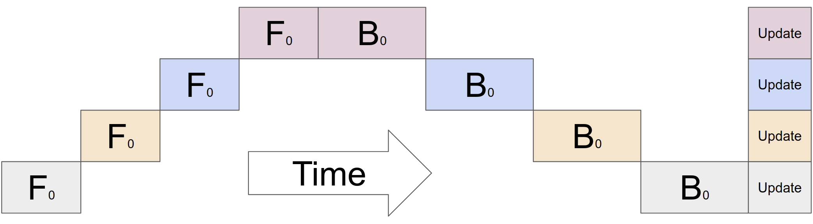
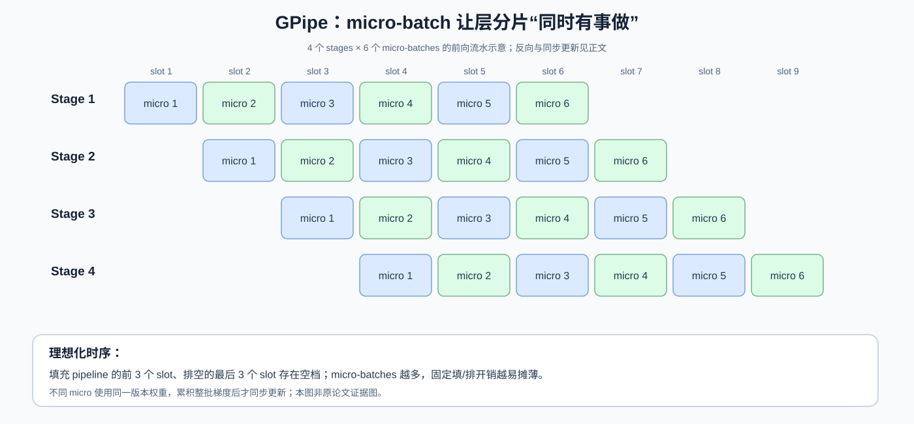
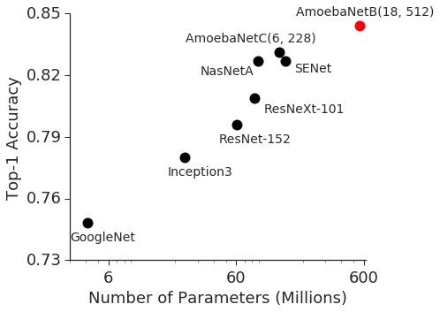

# GPipe：把网络分到多张卡后，为什么还必须把一个 batch 切得更碎？

> **原论文**：[GPipe: Easy Scaling with Micro-Batch Pipeline Parallelism](https://arxiv.org/abs/1811.06965)，Huang 等，NeurIPS 2019；本篇以仓库内 `sources/C001-gpipe/src/main.tex` 对应的原始论文版本及图示为依据。
> **类型**：C · 分布式训练系统原始方法。
> **本文研究的问题**：模型的层可以分布到多张加速器，却仍然依赖上一层输出。如何让多张加速器同时执行有用工作，而且不牺牲一个 mini-batch 内**同步参数更新**的语义？

## 阅读导航：从“显存不够”进入“设备为什么在等”

如果刚读完 [ZeRO](C002-zero.md)，你已经知道一种节省显存的方式：相同模型在 DP ranks 上运行，但不必让每张卡永久保存全部模型状态。GPipe 走的是另一条路：**把不同的层放到不同设备上**，使单设备承担的网络深度下降。

本篇与 [4D Parallelism](C001-4d-parallelism.md) 中的 PP 对应，但这一页要追的不是术语 PP，而是**如何把一次训练迭代排成真正并行的时间表**。读完后，顺着 [Megatron-LM](C004-megatron-lm.md) 比较 GPipe 的 all-forward/all-backward 与 1F1B/interleaved 调度；如果你更关心长上下文跨卡处理，可以转 [Ring Attention](C005-ring-attention.md)。

## 一、最简单的层分片，为什么显存省了却不一定加速？

假设一个网络有 $L=16$ 个顺序层。单 GPU 装不下，我们把它切成四段：

$$
f(x;\theta)=
f_{4}\circ f_{3}\circ f_{2}\circ f_{1}(x),
$$

这里 $f_k$ 是一组连续层的组合函数，不是网络中单独的一层。把它们分配到 $K=4$ 张 GPU：

~~~text
GPU 0: layers  1–4
GPU 1: layers  5–8
GPU 2: layers  9–12
GPU 3: layers 13–16
~~~

单条样本的执行仍是：

$$
x\overset{f_1}{\longrightarrow}h_1
\overset{f_2}{\longrightarrow}h_2
\overset{f_3}{\longrightarrow}h_3
\overset{f_4}{\longrightarrow}\hat y.
$$

这意味着 GPU 1 必须等 GPU 0 交出 $h_1$；GPU 2 又要等 GPU 1 交出 $h_2$。如果一次只处理**一个整体 batch**，四张设备事实上像接力棒一样轮流工作。模型容量问题解了，设备利用率仍然低。

原论文 Figure 2(b) 展示的就是这种 naive model parallelism：

*原论文的朴素调度示意。读图时观察每一时刻究竟有多少 accelerator 同时工作：虽然各卡持有不同层，但单条依赖链不能凭空制造并行。*

你可能会想到：让 GPU 0 在 GPU 1 处理第一个输入时，转而处理**第二个输入**。这正是 GPipe 的突破口——不是推翻模型的顺序依赖，而是利用**不同数据子批次之间相互独立的前向计算**。

## 二、Micro-batch 到底是什么？不能把它和“更多优化步骤”混淆

设一次优化 step 的 mini-batch 包含 $N$ 个样本。将它拆成 $M$ 个 micro-batches；假设能够整除，则：

$$
b=\frac{N}{M}.
$$

GPipe 让 GPU 0 执行完 micro-batch 1 的第一段后，把它的中间 activation 交给 GPU 1；GPU 0 随即执行 micro-batch 2。于是不同 GPU 可以处理**不同 micro-batches 的不同网络段**：

*原论文的微批流水示意。蓝/绿计算与数据传递应结合原论文图例阅读；关键不是同一 micro-batch 被并行计算了四个相依层，而是不同 micro-batches 占据流水线不同阶段。*

*自制解释图，非原论文 Figure。每一斜列的方块属于同一个 micro-batch；同一时间多张卡运行的是不同 micro-batches。图只展示 forward 填充与排空机制，尚未加入 backward。*

这里必须把三个词分清：

- **Mini-batch**：决定一个 optimizer step 聚合哪些样本。
- **Micro-batch**：只决定流水线的执行颗粒度。
- **Pipeline stage**：模型的一段连续层及其负责的设备。

例如 $N=128,\ M=8$，每个 micro-batch 有 16 个样本。**这不是训练 8 次、每次 batch=16**，而是把一次 batch=128 的优化步，拆成 8 段计算，再统一更新。

如果把 micro-batch 的处理过程当成单独的 optimizer step，模型就会在后续 micro-batches 到来前发生参数变化：那已经是另一种训练算法，不能再声称等价于 GPipe 的同步 minibatch SGD。

## 三、同步梯度到底怎样保持数学语义？

训练损失若按每个样本求均值，可写成：

$$
\mathcal L_{N}(\theta)
=\frac1N\sum_{i=1}^{N}\ell(x_i;\theta).
$$

将数据划分为互不重叠的集合 $\mathcal B_1,\ldots,\mathcal B_M$，大小均为 $b$：

$$
\mathcal L_{N}(\theta)
=\sum_{j=1}^{M}
\frac{b}{N}
\underbrace{\left(
\frac1b\sum_{x_i\in\mathcal B_j}\ell(x_i;\theta)
\right)}_{\mathcal L_j(\theta)}.
$$

对 $\theta$ 求梯度，利用微分的线性性：

$$
\boxed{
\nabla_\theta\mathcal L_{N}(\theta)
=\frac1M\sum_{j=1}^{M}\nabla_\theta\mathcal L_j(\theta)
}.
$$

这就把 GPipe 的同步参数更新从一句工程描述，变成一条明确的数学恒等式。

假设一个 batch 内所有 micro-batches 的 forward/backward 都使用**同一个权重版本 $\theta_t$**，那么可以累积：

$$
G_t=\sum_{j=1}^{M}\frac1M\nabla_\theta\mathcal L_j(\theta_t),
$$

再执行**一次**：

$$
\theta_{t+1}
=\operatorname{OptimizerUpdate}(\theta_t,G_t).
$$

这里的 `OptimizerUpdate` 可以是 SGD，也可以是 Adam，只要其状态更新在整批梯度聚合**之后**执行；Adam 绝不能对 8 个 micro-batch 分别更新 $m_t,v_t$，否则便不等价。

这段结论有条件：

1. micro-batch loss 的 reduction 和权重必须正确；如果最后一块长度不同，要按真实样本数加权，而不是盲目平均。
2. 不允许同一 step 内不同 micro-batches 使用不同参数版本。
3. BatchNorm 等依赖 batch statistics 的层会引入边界：GPipe 原论文明确对 micro-batch 统计量及移动平均作特殊处理；不能简单声称改变分批绝不会影响模型数值。
4. dropout 随机采样、浮点归约次序也会造成数值差异，因此说的是指定假设下的**优化目标与梯度语义等价**，而不是逐位 bitwise-identical。

这也是 GPipe 非常值得注意的一点：**它把调度并行与优化算法区分开**，不靠给出有延迟的梯度来换吞吐。

## 四、Pipeline bubble 可以从哪里推出来？

现在让每个 stage 处理一个 micro-batch 的计算时间近似为 $\tau$，假设四个 stage 工作量平衡，先只研究 forward。

第一批需要经过所有 $K$ 段才完成，后面每个 slot 可以完成一批。因此处理 $M$ 个 micro-batches 共需：

$$
T_{\rm pipe}^{F}\approx(M+K-1)\tau.
$$

如果总计算理想地被并行分配到各张 GPU，forward 只需：

$$
T_{\rm ideal}^{F}\approx M\tau.
$$

额外的填充与排空开销：

$$
T_{\rm bubble}^{F}\approx(K-1)\tau.
$$

于是，两种经常被混用的分数实际**分母不同**。

若和**实际流水线 makespan** 相比，空闲时间占比是：

$$
\boxed{
\beta_{\rm actual}
=\frac{K-1}{M+K-1}
}.
$$

这与原论文给出的 $O((K-1)/(M+K-1))$ 一致。

而相对**理想有用计算时间** 的 overhead 为：

$$
\boxed{
\beta_{\rm ideal}
=\frac{K-1}{M}
}.
$$

后面 [Megatron-LM](C004-megatron-lm.md) 的论文把 pipeline bubble size 写成 $(p-1)/m$，指的是后一种标准化口径；它不是矛盾，而是**量的定义不同**。

代入 $K=4,M=6$：

$$
\beta_{\rm actual}
=\frac{3}{9}\approx33.3\%,
\qquad
\beta_{\rm ideal}=\frac36=50\%.
$$

如果把 $M$ 增加到 $24$：

$$
\beta_{\rm actual}
=\frac3{27}\approx11.1\%.
$$

因此原论文建议实践中令 $M$ 显著大于 $K$，并报告其试验中 $M\ge4K$ 时 bubble 通常相对较小。但**这不是保证所有系统都最佳的定理**。通信延迟、各段不均衡、GEMM 粒度会影响最佳选择。

更严重的情况是有一张卡特别慢。例如四段每 micro-batch 用时：

$$
\tau_1=1,\;\tau_2=1,\;\tau_3=3,\;\tau_4=1.
$$

理论流水线最终受 $\max_k\tau_k=3$ 的吞吐瓶颈约束。仅通过增加 micro-batches 并不能消除 stage imbalance，因此 GPipe 会根据估计层代价把相邻层分配到各 partition，尽量均衡执行时间。

## 五、显存怎么变化：GPipe 为什么还需要 Re-materialization？

把层分到不同 GPU，首先减少每卡的**参数存储深度**；但如果有 $M$ 个 micro-batches 在 pipeline 内飞行，我们仍可能需要保留许多 activation，直到 backward 才能算梯度。

原论文采用 **re-materialization（重计算）**。做法是 stage forward 时只保留必要的边界 activation；backward 进入这一 stage 之前，再把其中的 forward 计算一遍来恢复内部中间状态。

如果模型层数 $L$、pipeline 分段数 $K$、mini-batch 样本数 $N$、micro-batches 数 $M$，论文给出激活存储量级：

$$
\boxed{
M_{\rm act}
=O\left(N+\frac{L}{K}\frac{N}{M}\right)
},
$$

这里省略了每个 activation 的 shape 与字节因子，是针对论文所述 checkpoint 方案的**量级式**，不是可直接代入 GPU 显存的 GB 精确值。

两项可以这样看：

- $O(N)$：必须长期保留各 micro-batches 的一些边界信息；
- $O((L/K)(N/M))$：重计算某个 micro-batch 的 stage 内部所需的临时 activation。

原本全层缓存可能接近 $O(NL)$。节省内存的代价是 backward 前多做一次部分 forward。

这意味着 GPipe 并非一个孤立的 scheduling 方法，而是**model partition + microbatch pipeline + synchronous update + recomputation** 的组合。它的实验收益不能全部归因给单个流水线开关。

## 六、原始实验证明了什么？

原论文用两种差异较大的模型作为证据：AmoebaNet（图像分类）以及 128 层 Transformer（多语言翻译）。作者报告：

- 557M 参数的 AmoebaNet 在 ImageNet-2012 上达到 84.4% top-1；
- 一个 6B 参数、128 层 Transformer 参与跨 100 多语言的翻译实验；
- 显存容量研究中，在所述 TPU 条件下，采用 re-materialization 与流水分段，可承载明显大于单设备 baseline 的网络。

此外，容量表中还展示使用 **128 partitions** 时能容纳到约 **83.9B 参数** 的 Transformer 配置。**能容纳的最大模型**与论文正文着重训练、评测效果的 **6B 模型**不是同一实验，不能把两者合成“论文端到端训练并评测了 83.9B 翻译模型”。

*原论文 Figure 1(a)，源文件 `size_vs_accuracy.png`。它展示代表性视觉模型的参数规模与 top-1 accuracy 关系，并标出 GPipe 训练的 AmoebaNet 成绩；这张图用于交代“为什么要让大模型能训练”，**并不直接测量 GPipe 的 throughput**。真正的性能论证应回到论文 Performance Analyses 中以 $K$、$M$ 为控制变量的 normalized training throughput 表，避免拿跨模型性能相关性当流水线加速的因果证据。*

讨论结果时还需要考虑当时的硬件：GPipe 在 Cloud TPU 上的大规模实验，并不能直接当作今天 A100/H100 上某套 PyTorch 实现的精确性能承诺。

## 七、为什么 Megatron-LM 后来还要改 pipeline 调度？

GPipe 让多个 micro-batches 同时穿过不同 stage，但默认调度仍常见：

~~~text
F1, F2, ... , FM     # 先把所有 micro 的 forward 推过去
B1, B2, ... , BM     # 再执行整批 backward
optimizer.step()      # 每批只更新一次参数
~~~

这个调度的好处是概念直观、权重版本清楚。缺点是在很多 stage 上，过早执行完 forward 的 micro-batch 需要长时间等待相应 backward，从而保留较多 checkpointed activations。

你可能会问：

> 如果先做几个 forward 让流水线充满，接着交替做一个 forward、一个 backward，岂不是能让已经不再需要的 activation 更早释放？

这个想法就是 **1F1B** 的动机；而交错让每台设备持有多个逻辑 model chunks，则是 Megatron-LM 更进一步的方向。

要注意：**1F1B 与 interleaved 1F1B 不是 GPipe 首篇原论文的创新**，也不应把 Megatron-LM 使用的 PipeDream-Flush 原始调度全部误归功于 Megatron。

这条谱系是：

$$
\text{GPipe: 同步 microbatch pipeline}
\longrightarrow
\text{1F1B: 降低 outstanding activations}
\longrightarrow
\text{Megatron: interleaved chunks 减少 bubble}.
$$

下一篇：[Megatron-LM：为什么只做 TP 或 PP 都不够？](C004-megatron-lm.md)。

## 论文细读：作者的逻辑不是“做了个 pipeline，所以更快”

原文 Introduction 首先提出**系统使用门槛**：许多高效模型并行方式高度依赖具体架构，不够通用。因此 GPipe 的目标同时包含 capacity、training efficiency 和架构通用性。

方法部分没有直接给调度公式，而先规定模型必须能够表达为**一列有序 layer 的组合**。这个限制既带来通用性，也暴露适用范围：任意带分支/跨 stage 复杂图，并不自动拥有理想的 pipeline 切分。后续 GraphPipe 等工作正是对这一范围继续扩展。

在 Algorithm 与性能分析之间，论文插入了两个容易被忽视的条件：**整批结束同步更新**，以及**re-materialization 让更大 $M$ 不至于无限推高激活存储**。前者保证训练数学语义，后者保证设备真的装得下。

所以从第一性原理看，GPipe 回答的是：

> 能否把一次参数更新的计算，分解成可以流水执行的小任务，而不改变这一更新要使用的整体训练目标？

能，但需要对**权重版本、梯度归约、activation 生命周期和流水线阶段均衡**四件事同时负责。

## 相关原始资料与技术网络

- Huang et al., [GPipe 原始论文](https://arxiv.org/abs/1811.06965)，NeurIPS 2019；Figure 2、Algorithm、Performance Optimization、表格与实验部分。
- [Google Research 官方 GPipe 介绍](https://research.google/pubs/gpipe-efficient-training-of-giant-neural-networks-using-pipeline-parallelism/)。
- [4D Parallelism：TP / PP / CP / FSDP](C001-4d-parallelism.md)：放回完整分布式训练维度。
- [ZeRO](C002-zero.md)：对照“沿 layer 切计算”和“沿 DP ranks 切持久化训练状态”。
- [Megatron-LM](C004-megatron-lm.md)：继续研究 1F1B、interleaved 和集群拓扑。
