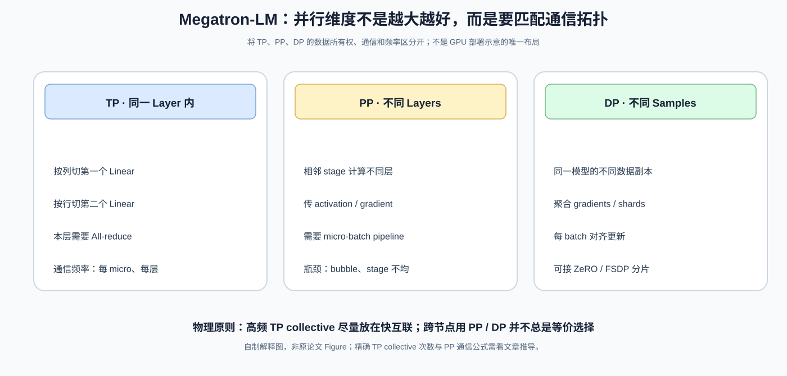
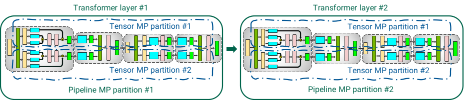
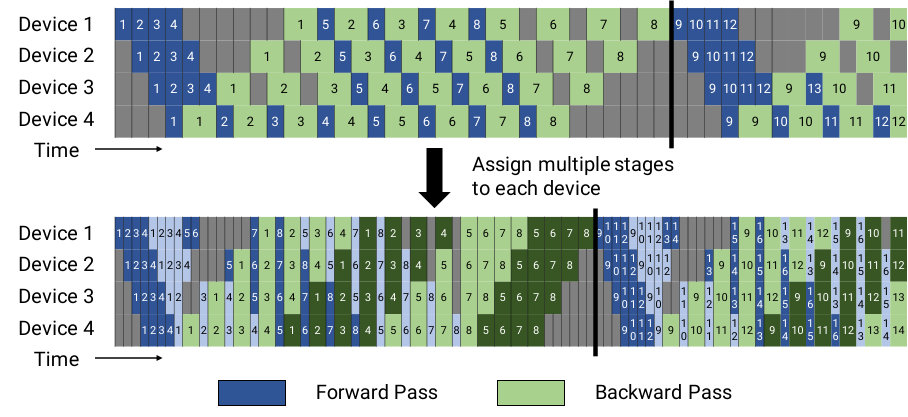
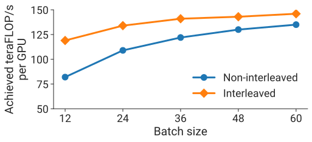

# Megatron-LM：模型能分到上千张 GPU，为什么组合 TP、PP、DP 仍然是一道优化题？

> **原论文**：Narayanan 等，[Efficient Large-Scale Language Model Training on GPU Clusters Using Megatron-LM](https://arxiv.org/abs/2104.04473)，SC21（2021）。重点对照仓库 `sources/C001-megatron/src/tex/` 中 `model_parallelism.tex`、`parallelization_dimensions.tex` 和 `evaluation.tex`。
> **类型**：C · 分布式训练系统论文。
> **本文真正需要回答**：给定固定 GPU、模型规模与 global batch，怎样选择 TP、PP、DP 的组合、micro-batch 大小和 pipeline schedule，使高频通信尽量留在快互联，同时不让 GPU 在等待 pipeline 中空转？

## 从 GPipe 的流水线走到 GPU 集群

[GPipe](C003-gpipe.md) 用 micro-batches 填满分层模型并行的执行空档。[ZeRO](C002-zero.md) 则说明同一数据并行组里，parameter、gradient、optimizer state 无须总是完整复制。我们在 [4D Parallelism](C001-4d-parallelism.md) 里已经从资源维度列出 TP/PP/CP/DP，但仅把名字罗列出来，并不能决定一个真实集群该怎样训练模型。

2021 年的 Megatron-LM 论文更接近一个**系统配置与调度问题**：如果某个模型需要 1024 张 GPU，为什么不能随便取：

$$
t=16,\qquad p=8,\qquad d=8,
\qquad tpd=1024,
$$

然后就宣布训练方案完成？

原因是每一种拆分都留下不同的代价：

- TP 保留完整层语义，但会触发**高频 layer 内 collectives**；
- PP 跨层少量点对点传输，但会产生**pipeline bubble 与 activation 生命周期**；
- DP 在每组上跑不同样本，但扩大 DP degree 可能改变每个 pipeline 的 microbatch 数，并引入跨组梯度同步。

真正重要的不是“乘积等于 GPU 数”，而是**每一类通信在哪里发生、多久一次、能否与计算重叠**。

*自制解释图，非原论文 Figure。将并行切分与其通信类型并排：TP 的 all-reduce、PP 的 activation/gradient send/recv、DP 的 gradient aggregation，不是同一种通信。*

## 一、先把 TP 切清楚：为什么 MLP 需要“先列切，再行切”？

考虑一个典型 Transformer MLP，在省略 dropout、bias 与残差的情况下：

$$
Y=\operatorname{GeLU}(XA),\qquad Z=YB.
$$

设输入：

$$
X\in\mathbb R^{S\times h},
$$

其中 $S=b\,s$ 是本地 microbatch 的总 token 数、$h$ 是 hidden dimension。假设 MLP 展开维是 $4h$：

$$
A\in\mathbb R^{h\times4h},
\qquad
B\in\mathbb R^{4h\times h}.
$$

如果把整个层放单卡，第一层 GEMM 的输出 $Y$ 有 $S\times4h$ 元素。

Megatron 的思想是**将第一个矩阵 A 按列分**。以两张 GPU 为例：

$$
A=[A_0\ A_1],\qquad
A_i\in\mathbb R^{h\times2h}.
$$

在两个 TP ranks 上分别计算：

$$
Y_0=\operatorname{GeLU}(XA_0),
\qquad
Y_1=\operatorname{GeLU}(XA_1).
$$

由于 GeLU 是逐元素非线性：

$$
\operatorname{GeLU}([XA_0\ XA_1])
=
[\operatorname{GeLU}(XA_0)\ \operatorname{GeLU}(XA_1)].
$$

所以**GeLU 之前不需要先通信拼回完整 $XA$**。这不是靠工程经验猜的，而是由激活函数按元素作用决定的。

接着把 $B$ 按行切：

$$
B=
\begin{bmatrix}
B_0\\B_1
\end{bmatrix},
\qquad
B_i\in\mathbb R^{2h\times h}.
$$

那么：

$$
Z=YB=[Y_0\ Y_1]
\begin{bmatrix}
B_0\\B_1
\end{bmatrix}
=Y_0B_0+Y_1B_1.
$$

每张 GPU 都可以独立计算自己的：

$$
Z_i=Y_iB_i,
$$

最后做一次**求和归约**得到 $Z$。实现上可根据是否需要所有 ranks 拿到完整 $Z$，选择适当的 all-reduce/reduce-scatter 形式。

最重要的第一性结论是：

> 一次恰当的列切 + 行切，把“第一个 GEMM、GeLU、第二个 GEMM”都保持成局部计算，只把同步留到末尾。随便在中间切另一维，并不能保证非线性和线性代数都按这个方式分解。

Self-Attention 的 Q/K/V heads 也有适合分片的维度。不同 heads 在注意力 softmax 阶段可局部处理，而输出 projection 则需要把各部分结果组合。原论文 Figure 展示了此思路在 Attention 与 MLP 之间的完整组合。

*原论文源图 `tensor_plus_pipeline_model_parallelism.pdf`。先看每个 pipeline stage 内如何做 TP，再看 stage 与 stage 之间跨设备传递 activation。这张图支持“两个维度能够组成同一个执行图”，但不能凭结构图推出最佳 TP/PP 比例。*

## 二、为什么 TP 的总通信可能比 PP 更难受？

标准大模型的一个 Transformer layer 包含多次 GEMM。TP 不仅要分片这些矩阵，**还必须在 layer 内重新组合某些结果**。

原论文在其 tensor-parallel layout 下，对每个 microbatch、每层、每 GPU 的 TP 通信数据量给出近似：

$$
\boxed{
V_{\rm TP,layer}
=8bsh\frac{t-1}{t}
}
$$

这里 $b$ 是 microbatch 样本数、$s$ 为 sequence length、$h$ 为 hidden dimension、$t$ 为 TP degree；公式按论文通信分析的元素量口径，来自 forward/backward 中若干次 all-reduce，而不应随意跨精度直接认作网络传输 GB 数。

更值得注意的是通信**频率**：TP 发生在大量 layer、micro-batches 的前向与反向路径中。

相比之下，PP 在相邻 stage 的边界传 activation/gradient。对于一次边界上的 microbatch，activation 的元素规模约是：

$$
V_{\rm PP,boundary}\sim bsh.
$$

即使 TP 的单次通信大小与 PP 不相差几个数量级，TP 也可能因为**调用次数更多**变成关键瓶颈。

这就解释了论文一个核心选择：

> TP 尽量安排在 NVLink/NVSwitch 互联良好的单服务器内部；需要将模型继续铺到更多服务器时，再使用 PP 延伸层深度。

这个结论是基于所用集群层级带宽形成的**经验配置原则**，不是任意网络拓扑下都唯一正确的数学定理。

## 三、PP 其实还有两个问题：怎么填满流水线？激活要在显存里等多久？

回到 [GPipe](C003-gpipe.md)。把模型沿 $p$ 个 stage 切，给每个 pipeline 输入 $m$ 个 micro-batches。

GPipe 风格调度：

~~~text
Forward F1, F2, ..., Fm
Backward Bm, ..., B2, B1
Update once, at the flush
~~~

同一 batch 内各 microbatches 用同一权重版本；先整批 forward，再 backward，能够保证同步更新语义。但不少 microbatches 的 activation 必须长期保存。

GPipe 之后的 PipeDream-Flush 调度将阶段拆成三段：

1. **Warm-up**：各 stage 先做数量不同的 forward，填满流水线。
2. **Steady 1F1B**：每个 stage 交替处理 forward/backward。
3. **Cool-down**：不再注入新 microbatches，将余下 backward 排空；在 batch flush 后统一 optimizer update。

1F1B 最大好处并不必然是减少总体 bubble 时间，而是**缩短已经完成 forward、尚未完成 backward 的在途 microbatches 数量**。

原论文解释：在一个平衡且有定期 flush 的 pipeline 中，1F1B 的待保存 activation 数量可受 pipeline depth 限制，而 GPipe all-forward/all-backward 往往需要随着整个 $m$ 增长。

这里贡献归属要划清：Megatron-LM 论文采用并分析的基本 1F1B flush 调度来自先前工作。本文最值得单独学习的论文贡献是**interleaved scheduling 与多并行维度的联合成本分析**。

## 四、为什么普通 1F1B 还有 Bubble？从计算时间推导

设每个 stage 对一个 microbatch 的 forward 和 backward 时间分别是：

$$
t_f,\quad t_b.
$$

在论文的理想化均衡假设下，完成一个 batch 的有用计算时间尺度：

$$
T_{\rm useful}=m(t_f+t_b).
$$

pipeline warm-up 与 flush 留下的空档尺度：

$$
T_{\rm bubble}=(p-1)(t_f+t_b).
$$

因此相对于**理想有用计算时间** 的 bubble overhead：

$$
\boxed{
\beta_{\rm useful}=\frac{T_{\rm bubble}}{T_{\rm useful}}=\frac{p-1}{m}.
}
$$

如果要计算**总 makespan 中的空闲比例**，应另用 $T_{\rm bubble}/(T_{\rm useful}+T_{\rm bubble})$；不能把 $(p-1)/m$ 直接写成真实所有 GPU 时间中闲置的百分比。

设 $p=8,\ m=32$：

$$
\beta_{\rm useful}=\frac7{32}=21.875\%.
$$

即使采用 1F1B、activation 更节约，**这个总 bubble 规模仍然存在**。

最直接的修法是增大 $m$。但如果固定 global batch $B$，则每个 microbatch size $b$ 会变小：

$$
m=\frac{B}{bd},
$$

其中 $d$ 是 DP degree。$b$ 太小可能导致 GEMM 颗粒过细、GPU Tensor Core 利用率下降。

因此“增大 microbatch 数减少 bubble”与“足够大 microbatch 提高单次 GEMM 效率”之间出现了一次很典型的系统矛盾。

## 五、Megatron-LM 的 Interleaved Pipeline 到底改了什么？

想象有 4 个物理 GPU、每张负责 4 个连续 Transformer layers：

~~~text
GPU 0:  1, 2, 3, 4
GPU 1:  5, 6, 7, 8
GPU 2:  9, 10,11,12
GPU 3: 13,14,15,16
~~~

在默认 PP 中，一个物理 GPU 只持有**一个连续 model chunk**。

如果每卡改成两个较小的逻辑 chunks，可以重新分配为：

~~~text
GPU 0: 1,2  |  9,10
GPU 1: 3,4  | 11,12
GPU 2: 5,6  | 13,14
GPU 3: 7,8  | 15,16
~~~

你会发现：**模型的数学层序没有改变**，每个 microbatch 仍按 layer 1→16 执行。变化的是 pipeline stage 的虚拟颗粒度与物理 device 的映射：执行会再次经过一张之前使用过的 GPU。

定义每张 GPU 有 $v$ 个 model chunks。如果每个 chunk 的计算时间缩小至约 $t_f/v$、$t_b/v$，作者构造的 interleaved 1F1B 调度让理想 bubble 时间变成：

$$
T_{\rm bubble}^{\rm interleaved}
=\frac{p-1}{v}(t_f+t_b).
$$

于是：

$$
\boxed{
\beta_{\rm interleaved}
=\frac{p-1}{vm}.
}
$$

例如：

$$
p=4,\quad m=16,\quad v=2,
$$

默认：

$$
\beta_{\rm default}=\frac3{16}=18.75\%,
$$

交错：

$$
\beta_{\rm interleaved}=\frac3{32}=9.375\%.
$$

请注意：**这个优势有前提**。论文的具体 interleaved schedule 对 microbatch 数有可整除要求，并且假设 chunks 尽量平衡；更复杂的 runtime 和不同策略可改变约束，不能将公式当成所有版本的实现契约。

*原论文源图 `interleaved_schedule.pdf`。深浅色区分同一 GPU 上不同 model chunks。比较两种调度何时 flush、如何交错 forward/backward，比死记“interleaved faster”更有价值。*

真正的代价是：**chunk 变多，stage boundary 也变多**。论文指出通信量近似增加 $v$ 倍；如果跨节点链路较慢，通信开销会吞掉 bubble 降低的收益。

这就是 Megatron 的关键系统认识：

> 减小 bubble，并不自动减小 step time。必须把新增的通信与 microbatch GEMM 效率一起算进去。

## 六、把 TP、PP、DP 放到同一个优化约束里

定义：

- $t$：TP degree；
- $p$：PP degree；
- $d$：DP degree；
- $n$：总 GPU 数；
- $B$：global batch；
- $b$：每 rank 的 microbatch samples；
- $m$：每个 pipeline 每次 optimizer step 处理的 microbatch 数。

那么：

$$
\boxed{n=t\,p\,d},
$$

$$
\boxed{m=\frac{B}{b\,d}},
$$

故：

$$
\beta
=\frac{p-1}{m}
=\frac{(p-1)bd}{B}.
$$

如果暂时固定 $n,t,B,b$，通过 $p=n/(td)$ 消元：

$$
\boxed{
\beta=\frac{(n/t-d)b}{B}.
}
$$

此式说明：在模型还能放得下的条件下，提高 $d$、降低 $p$ 往往有利于减少 PP bubble。

但做这样的改变又会加大 DP group，增加数据副本之间的聚合压力；而改变 $t$ 也会改变**每层 TP collective 体积与频率**。

因此最优化问题不是单独：

$$
\min \beta,
$$

而是更接近：

$$
\boxed{
\min_{t,p,d,b,v}
T_{\rm step}
}
$$

其中：

$$
T_{\rm step}
=
T_{\rm compute}
+T_{\rm uncovered\ communication}
+T_{\rm bubble}
+T_{\rm runtime},
$$

受单卡显存、模型 shape、global batch、网络拓扑以及微批整除条件制约。这个式子是**帮助读者组织工程目标的概念成本模型**，并非 Megatron-LM 原论文提供的可直接替代 profiler 的精确闭式公式。

### 一个算得出来的比较

假设有 $n=128$ GPU、global batch $B=256$，每个 microbatch $b=2$。

方案 A：

$$
t=8,\ p=8,\ d=2,\quad m=256/(2\cdot2)=64.
$$

默认 1F1B 的 bubble overhead：

$$
\beta_A=7/64\approx10.9\%.
$$

方案 B：

$$
t=4,\ p=8,\ d=4,\quad m=32,
\quad
\beta_B=7/32\approx21.9\%.
$$

在**只比较 bubble**的假设下 A 较好；但 B 用较小 TP degree，可能减少某些 layer 内同步开销。它们是否能让对应模型放进内存、GEMM 是否足够大、跨 GPU 互联如何，都还没有评估。

也就是说，**仅凭 bubble 更小，不能宣告 A 更快**。这正是作者用大量实测去修正理论直觉的原因。

## 七、原始实验：作者到底证明了多大规模、什么意义的效率？

论文在 NVIDIA Selene 集群的 A100 GPU 环境进行实验，节点内通过 NVLink/NVSwitch 互联，节点间通过 InfiniBand 等网络层次通信。

作者报告：在 **3072 张 A100 GPU** 上完成 **1T 参数 GPT-like 模型的训练迭代**，系统吞吐达到 **502 PFLOP/s**，每 GPU 约达到所用精度理论峰值的 **52%**。<https://arxiv.org/abs/2104.04473>

*原论文源图 `gpt_175b_interleaved_vs_default.pdf`。这是一组特定模型/设备/批次配置下的系统吞吐对照；不能将其改写成 interleaved 在全部硬件上严格快一个固定比例。*

还有一个特别容易被误述的结论：

> 论文确实展示了 1T 参数模型的大规模**训练迭代执行与吞吐**，但论文中若干“训练多少天”的数字是依据吞吐与 token budget 推算的端到端**时间估计**，不是已经完成完整语言预训练的陈述。

论文使用包含 activation recomputation FLOPs 的计数近似：

$$
F\approx
96Bslh^2
\left(1+\frac{s}{6h}+\frac{V}{16lh}\right),
$$

并根据模型参数量 $P$ 与所需训练 token $T$，在其适用近似下给出：

$$
T_{\rm train}\approx\frac{8TP}{nX},
$$

其中 $X$ 是每 GPU 实测有效 FLOP/s。若不了解 **X 是有效吞吐而非理论峰值**，或将这一时间估计当成已执行的训练日志，就会错误理解原论文证据边界。

原文还给出 PTD-P 与 ZeRO-3（**不包含额外模型并行的配置**）的对照。作者明确承认 ZeRO-3 可以与模型并行组合，所以这些实验可以比较选定 baseline，不能证明任何 TP+PP 组合在所有配置下必然优于 ZeRO。

## 八、什么才是这篇论文的主要贡献？

从技术谱系看，这里有三类概念容易混在一起：

1. **模型层 TP 方案**：前代 Megatron-LM 已经研究 Transformer 的 tensor partition，论文采用并扩展其工程组合。
2. **GPipe / PipeDream 系列调度**：microbatch pipeline 与 1F1B/flush 不是本文凭空发明。
3. **本文自己的系统贡献**：提出 interleaved schedule，量化 TP/PP/DP、batch、microbatch、通信拓扑之间的联合权衡，并展示其大规模训练运行表现。

原论文甚至先在方法节解释 default 1F1B，再给 interleaved，之后才展开多维配置分析。这种次序非常合理：

> 不先知道“一条 pipeline 为什么空”，就无法解释“虚拟 model chunks 为什么可能减少空闲”；不先知道“为什么增加 chunk 会多通信”，就无法理解最后为什么需要跨节点拓扑分析。

最具有通用性的知识，反而不是某条实验曲线的峰值，而是：

$$
\boxed{
\text{并行切分选择}
\Rightarrow
\text{collective / p2p 通信类型与频率}
\Rightarrow
\text{硬件互联中的暴露成本}
\Rightarrow
\text{实际 step time}.
}
$$

你在设计 [DeepSeek-V3](../../B/05-moe-complete-llm/B009-deepseek-v3.md) 的 expert parallel 与 DualPipe，或者分析 [Llama 3](../../B/05-moe-complete-llm/B011-llama3.md) 中 TP/PP/CP/FSDP 的组网时，会再次遇到同一逻辑，只是通信对象、模型结构和调度工具已经发生变化。

## 九、从 Megatron 向 Ring Attention 过渡：为什么长上下文不能只加 TP？

以上讨论的主要是 **hidden dimension** 与 **layer depth** 的拆分。但当 sequence length 从 8K 增长到 128K 或百万级时，即使单层权重已经分片，activation 也可能按 $bsh$ 增长，Attention 还需要跨全部 token 的 KV interaction。

继续提高 TP 会拆碎 GEMM，继续提高 PP 不会天然让单个 stage 的 context 变短。于是出现新问题：

> **既然序列本来就是一维排列，为什么不让每个 GPU 只长期拥有其中一段 Query，并把其他 Key/Value 分块传过来？**

这就是下一篇 [Ring Attention](C005-ring-attention.md) 的起点。它的“ring”不表示 Attention 变成局部窗口，而是让**精确全局 Attention**按 Query ownership 和 KV circulations 完成。

## 参考原始资料

- Narayanan et al., [Megatron-LM / PTD-P 原始论文](https://arxiv.org/abs/2104.04473)，SC21；本文公式与图直接核对 ``Modes of Parallelism`、`Performance Analysis`、`Evaluation`。
- [GPipe](C003-gpipe.md)，NeurIPS 2019：同步 microbatch pipeline 的前代方法。
- [ZeRO](C002-zero.md)，SC20：DP 训练状态分片与按需收集。
- [Ring Attention](C005-ring-attention.md)，ICLR 2024：序列维度的精确分块和通信重叠。
- [4D Parallelism](C001-4d-parallelism.md)：从全局视角回看多个 parallel process groups。
