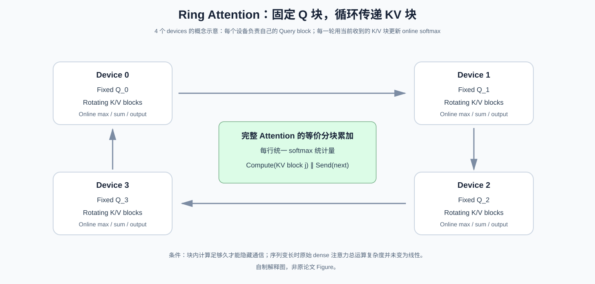
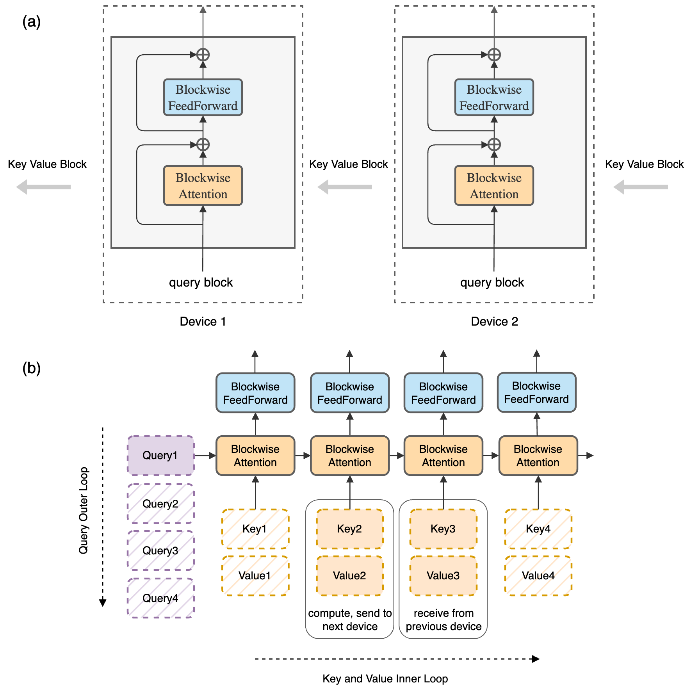
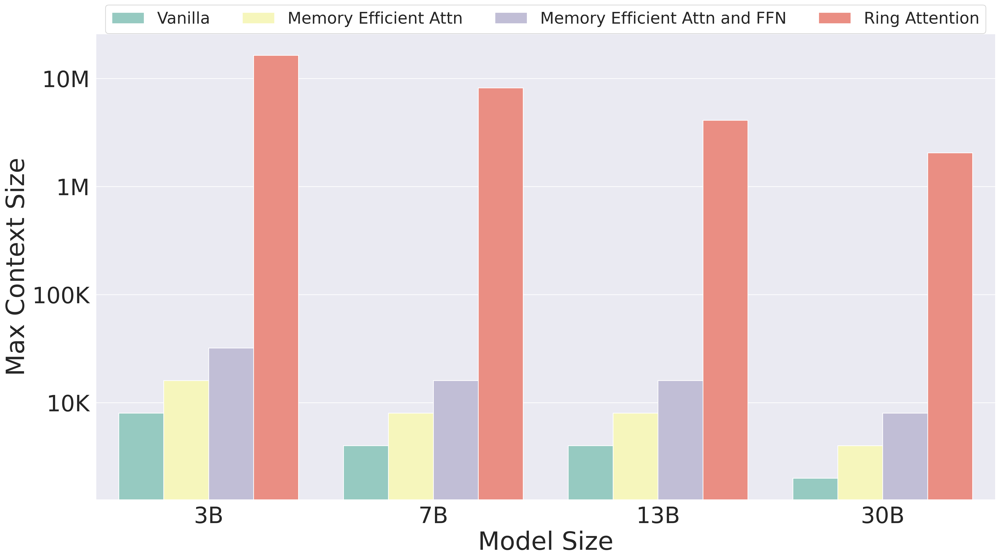

# Ring Attention：不丢掉任何 Key，为什么还能把“超长上下文”分布到多张设备上？

> **原论文**：Hao Liu、Matei Zaharia、Pieter Abbeel，[Ring Attention with Blockwise Transformers for Near-Infinite Context](https://arxiv.org/abs/2310.01889)，ICLR 2024；本文核对仓库内 `sources/C001-ring-attention/src/main.tex` 的方法、公式、图表与实验。
> **论文类型**：C · 长上下文分布式系统 / Blockwise Exact Attention 原始方法。
> **核心问题**：FlashAttention 已经避免物化完整 $S\times S$ attention matrix，为什么超长序列仍会受到单张 GPU/TPU 的 activation memory 限制？是否可以将序列分配到不同设备，同时**不改变全局 Attention 的数学结果**？

## 阅读导航：前面解决的不是这个瓶颈

### 原论文 Figure 1 的“百万上下文”到底意味着什么？

[Ring Attention ICLR 2024 PDF 第 2 页 Figure 1](https://arxiv.org/pdf/2310.01889) 的横轴是**模型大小（3B、7B、13B、30B）**，纵轴是对数坐标的**最大可训练上下文长度**，硬件前提为 **TPUv4-1024**。四种柱形对照 Vanilla Transformer、仅有 Memory Efficient Attention、Attention 与 FFN 都采用 Blockwise 的方案，以及 Ring Attention。橙色 Ring Attention 柱明显更高，体现的是在统一大规模 TPU 设备预算下，可承载的**序列长度容量**；它不是生成式推理的 Token/s 横轴，也不是单卡部署的 100 万 Token 成绩。

论文正文还将“可扩大训练上下文”分解为两个必要条件：局部 Blockwise Attention 限制一张设备一次持有的 Q/K/V 与中间激活大小，Ring 在设备之间逐次传递 KV 块，使每个 Query 块最终看到**完整全局合法 Key 集合**。假设总长度 $S$、设备数 $P$、每设备本地块长 $S/P$，本地 KV 存储规模可由 $O(Sd)$ 下降到 $O(Sd/P)$，但 Attention 总逻辑点积数量在 Dense Exact Attention 下依旧是 $O(S^2d)$。因此**内存可扩展**不等于**计算复杂度从平方变线性**。

对一个两卡玩具例子，设备 0 持有 Query 块 $Q_0$，设备 1 持有 $Q_1$，二者先分别计算 $Q_0K_0^\top$ 和 $Q_1K_1^\top$，随后交换 KV 再分别计算跨块 $Q_0K_1^\top$ 与 $Q_1K_0^\top$（因果 Mask 时只处理合法三角部分）。每卡在两轮之后都聚合了自己的 Query 对完整合法 Key 的贡献；若简单对两轮单独 Softmax 输出做算术平均，则会破坏全局 Softmax 归一化，这也是全文后续 Online Softmax 合并推导必须解决的问题。

Figure 1 可以支持**系统容量改进**，却不能单独证明计算与通信完美重叠。论文关于 Overlap 的结论还必须核查每轮 Block Attention 计算时间能否覆盖 Ring KV 传输时间；当 Block 过小、链路较慢或设备负载不均衡时，Ring 通信依旧可能进入关键路径。

[FlashAttention](../../A/10-gpu-operators/A055-flashattention.md) 首先避免了将完整 attention score/probability matrix 写入 HBM。[FlashAttention-2](../../A/10-gpu-operators/A056-flashattention2.md) 和 [FlashAttention-3](../../A/10-gpu-operators/A057-flashattention3.md) 则继续解决同一设备内的并行与异步执行。

在 [Megatron-LM](C004-megatron-lm.md) 里，我们通过 TP/PP/DP 对矩阵维度、网络深度和数据样本进行切分；[4D Parallelism](C001-4d-parallelism.md) 已引入一个新的维度——**CP（Context Parallelism）**。

这里要进入 CP 背后最值得学的一种技术实现：**每张设备保持自己的 Query block，让全部 Key/Value blocks 沿 ring 轮流经过设备，在线积累精确 Softmax 结果**。

若只想回答“Ring 的数据怎么走”，看本篇第 2–4 节；若你更关注 FlashAttention 为什么不需要 $S^2$ 存储，可以回到上面的原始方法文章。

*自制解释图，非原论文 Figure。每张设备只负责某个 Query block 的输出，却最终要见到全部 Key/Value blocks。传的是 K/V，不是每轮交换整个模型参数。*

## 一、FlashAttention 已经省去 $S^2$ 矩阵，为什么还不够？

回忆一个 Attention head：

$$
Q,K,V\in\mathbb R^{S\times d_h},
$$

$$
O=\operatorname{softmax}
\left(\frac{QK^\top}{\sqrt{d_h}}\right)V.
$$

常规写法的 score matrix：

$$
QK^\top\in\mathbb R^{S\times S}
$$

让显存需求随 $S^2$ 增长。FlashAttention 通过在 SRAM 中分块计算并在线维护行级 Softmax 统计量，不用在 HBM 中完整保存这个矩阵。

但算完某层之后，我们仍得到：

$$
O\in\mathbb R^{S\times d_h},
$$

随后整层 Transformer 的输出：

$$
H^{\ell+1}\in\mathbb R^{b\times S\times h}.
$$

下一层需要对整个序列继续处理；即使单次 Attention 不再存 $S^2$ scores，**层输出与训练 activation 仍然随序列长度 $S$ 增长**。单设备总显存也依然有限。

比如只考虑一个 $b=1,\ S=10^8,\ h=1024$、BF16 的 hidden tensor，它就需要：

$$
1\times10^8\times1024\times2\ {\rm bytes}
=204.8\ {\rm GB}.
$$

这只是一个 tensor 的存储量，未计 layer checkpoints、其他 activations、optimizer states 和模型权重。论文 Introduction 用类似的数量级问题论证：即使能省掉 attention matrix，超长上下文仍需将**输出与工作状态**跨设备分布。

最直觉的改进是：把这个 $S$ 维平均切给 $N$ 张设备，每张只保存自己的 $S/N$ 个 token hidden states。

新问题出现了：对于其中一张设备上的 Query token，它的**全局 Attention** 仍需要访问其他设备上的全部历史或全序列 Key/Value。只把 Q/K/V 各自切分而不让它们交换信息，就从数学上丢掉了交叉块的注意力。

## 二、最关键的区分：分片 Query 的“计算所有权”不等于只能看本地 Key

设 4 个设备分别持有序列连续切片：

$$
Q=
\begin{bmatrix}
Q_0\\Q_1\\Q_2\\Q_3
\end{bmatrix},
\qquad
K=
\begin{bmatrix}
K_0\\K_1\\K_2\\K_3
\end{bmatrix},
\qquad
V=
\begin{bmatrix}
V_0\\V_1\\V_2\\V_3
\end{bmatrix}.
$$

设备 $i$ 负责的输出：

$$
O_i
=\operatorname{softmax}
\left(
\frac{Q_i K^\top}{\sqrt{d_h}}
\right)V.
$$

这个表达式意味着：

- $Q_i$ 必须在设备 $i$ 上可用；
- 全部 $K_j,V_j$ 必须**在计算过程中**以某种方式被设备 $i$ 访问到；
- 但无需在**同一时刻**把所有历史 $K_j,V_j$ 长期缓存到设备 $i$。

第二条和第三条并不冲突！计算可以分成：

$$
(Q_i,K_0,V_0),
(Q_i,K_1,V_1),
\ldots,
(Q_i,K_3,V_3)
$$

四个 block interactions，每次更新输出的统计量。

于是可以设计：

~~~text
Device 0: 固定 Q0，先看 KV0，再 KV3、KV2、KV1
Device 1: 固定 Q1，先看 KV1，再 KV0、KV3、KV2
Device 2: 固定 Q2，先看 KV2，再 KV1、KV0、KV3
Device 3: 固定 Q3，先看 KV3，再 KV2、KV1、KV0

每完成一轮，各设备把当前 KV block 传给环上的下一个设备。
全部轮次结束，每张卡得到了自己负责的 O_i。
~~~

传输顺序可以因 ring 方向而不同；只要所有需要的 key blocks 都被纳入，且对应 mask/位置语义一致，数学上得到的就是同一个全局 Attention。

原论文总图讲的就是这种 **Query ownership + KV rotation**：

*原论文 Figure 对应 `figures/merged.png`。上半图看设备之间哪些 tensor 移动，下半图看每个 query block 如何依次与多个 KV blocks 组合。原图并不意味着 Attention 只计算环上两个邻居之间的关系；邻居负责**转送**，不是唯一可见 token。*

## 三、公式推导：为什么 Softmax 可以跨 KV Blocks 更新，而不需要收齐全部 Scores？

许多人知道线性层可以做分块矩阵乘法，却担心：

> Softmax 要先对所有 Key 算出分母，怎么能只看一部分 Key 就把 Attention 结果累加起来？

问题关键就在于：**不能简单地把每个 block 单独 Softmax 后的结果求平均**。因为每个 block 的归一化分母不同。

先固定一个 Query row。设对第 $j$ 个 KV block 算出 scores：

$$
s_{j,k}
=\frac{q^\top k_{j,k}}{\sqrt{d_h}}.
$$

理想的 Attention 输出为：

$$
o=
\frac{
\sum_{j,k} e^{s_{j,k}}v_{j,k}
}{
\sum_{j,k} e^{s_{j,k}}
}.
$$

如果直接求指数可能发生溢出，所以要引入全局行最大值：

$$
m=\max_{j,k}s_{j,k}.
$$

则同一表达式等价为：

$$
o=
\frac{
\sum_{j,k} e^{s_{j,k}-m}v_{j,k}
}{
\sum_{j,k} e^{s_{j,k}-m}
}.
$$

现在定义每次处理完一些 KV blocks 后缓存三个状态：

$$
m_{\rm old}=\text{当前已见 scores 的最大值},
$$

$$
\ell_{\rm old}
=\sum_{\text{已见}}e^{s-m_{\rm old}},
$$

$$
u_{\rm old}
=\sum_{\text{已见}}e^{s-m_{\rm old}}v.
$$

注意第三个是**尚未除以分母的向量分子**，不是已经归一化的最终 output。

当一个新的 KV block 到达，先算：

$$
m_b=\max_k s_{b,k},
$$

$$
\ell_b=\sum_ke^{s_{b,k}-m_b},
$$

$$
u_b=\sum_ke^{s_{b,k}-m_b}v_{b,k}.
$$

新旧最大值合并：

$$
\boxed{m_{\rm new}=\max(m_{\rm old},m_b)}.
$$

但旧统计量 $\ell_{\rm old}$ 是以 $m_{\rm old}$ 为参考尺度，不能直接与以 $m_b$ 为尺度的 $\ell_b$ 相加。必须先重新标定：

$$
\ell_{\rm new}
=
e^{m_{\rm old}-m_{\rm new}}\ell_{\rm old}
+
e^{m_b-m_{\rm new}}\ell_b,
$$

$$
u_{\rm new}
=
e^{m_{\rm old}-m_{\rm new}}u_{\rm old}
+
e^{m_b-m_{\rm new}}u_b.
$$

所有 blocks 合并完成：

$$
\boxed{o=\frac{u_{\rm final}}{\ell_{\rm final}}.}
$$

**这就是 Ring Attention 可以按照任意 KV block 顺序流动的数学依据。** 正确的 log-sum-exp 统计量具有可组合的代数结构；在实数算术中按块合并不改变最终 Attention 定义。实际浮点计算会因为归约顺序不同而有舍入差异，通常说“exact attention”是指**没有稀疏近似或截断 Key**，而不是 bitwise identical。

这部分也是为什么 Ring Attention 与 [FlashAttention](../../A/10-gpu-operators/A055-flashattention.md) 深度相关：它沿用了已有的块状在线归一化能力，再把 Key/Value block 的“送达”搬到**设备间通信层面**。

### 一个手算例子证明不能平均各 block 输出

取同一个 Query，只有两个 Key，每个 block 各一个：

$$
s_1=0,\quad v_1=1;
\qquad
s_2=\ln 3,\quad v_2=5.
$$

正确的 Softmax：

$$
o=\frac{e^0\cdot1+e^{\ln3}\cdot5}{e^0+e^{\ln3}}
=\frac{1+15}{1+3}
=\boxed{4}.
$$

如果各个单元素 block 自行 Softmax，则输出分别是 1、5；盲目取均值：

$$
(1+5)/2=3,
$$

**错误**。

用在线统计量合并时：

$$
m=\ln3,\qquad
\ell=\frac13+1=\frac43,
$$

$$
u=\frac13\cdot1+5=\frac{16}{3},
$$

$$
u/\ell=4.
$$

这说明 Ring Attention 的“块顺序可交换”并不等于“各块结果可以不加权平均”。这一步的理解直接决定你能否正确实现 blockwise attention。

## 四、Ring 的时间表：为什么通信有可能被完全隐藏？

Ring 操作在一轮中做两件相互独立的事情：

1. 使用**当前** KV block 与本地 Query block 计算一个 Attention 更新；
2. 同时将 KV block 发送到邻居，并接收下一轮需要的 KV block。

两个工作路径若能 overlap，则该轮的耗时近似：

$$
T_{\rm step}
\approx
\max(T_{\rm compute},T_{\rm transfer}).
$$

如果：

$$
T_{\rm compute}\ge T_{\rm transfer},
$$

通信原则上可被完整隐藏在计算后面。这里的“零额外 overhead”是**满足条件且流水线实现合理时**的 critical-path 结论，并不是说网络真的传输了零字节。

原论文给出一个很优雅的算术强度推导。令：

- $c$：单个 block 的 token 数；
- $d$：head/隐藏维度的分析量；
- $F$：设备计算吞吐 FLOP/s；
- $B$：有效邻居间链路带宽 bytes/s。

对于一个 $c\times c$ 的 QK score tile：

$$
\text{QK FLOPs}\approx2dc^2.
$$

再乘以对应的 V：

$$
\text{PV FLOPs}\approx2dc^2.
$$

因此一次 block interaction 的主干 GEMM：

$$
\boxed{W_{\rm compute}\approx4dc^2}.
$$

按原论文的 BF16 通信设定，KV 两个块分别约 $2cd$ bytes，因此一次传送：

$$
\boxed{V_{\rm transfer}\approx4cd\ {\rm bytes}}.
$$

对应时间：

$$
T_{\rm compute}\approx\frac{4dc^2}{F},
\qquad
T_{\rm transfer}\approx\frac{4cd}{B}.
$$

令前者不少于后者：

$$
\frac{4dc^2}{F}\ge\frac{4cd}{B}
\quad\Rightarrow\quad
\boxed{c\ge\frac{F}{B}}.
$$

这不是抽象的口号。它说明**设备越快而网络越慢，越需要大的块才能隐藏 KV 传输**。

例如采用论文 Table 所用 A100 的近似参数：

$$
F=312\ {\rm TFLOP/s},
\qquad
B=300\ {\rm GB/s},
$$

得到：

$$
\frac FB\approx1040.
$$

所以块长需要在约一千 token 的量级，才可能隐藏该简化模型下的邻居 KV transfer。若节点间只有约 $12.5$ GB/s，门槛便接近：

$$
\frac{312\times10^{12}}{12.5\times10^9}
\approx24960
$$

token。原论文表格给出接近这一数量级的结论。

这也揭示了 Ring Attention 实践中的重要限制：**它对网络拓扑高度敏感**。现代不同代 GPU/TPU、不同链路、flash-kernel 实际效率与 block overhead 会改变该阈值。论文的 $F/B$ 是粗略建模，不是开箱即用的参数默认值。

## 五、为什么它的本地 Activation 内存不随总 Sequence Length 无限上升？

在原论文采用的块状 Attention + FFN 框架中，一张设备需要维护：

- 本地 Query block；
- 当前 Key block 与 Value block；
- 下一轮接收所需的 Key/Value 双缓冲；
- 当前 Query 对应的 Attention/FFN 输出块。

论文由此给出近似峰值 activation memory：

$$
\boxed{
M_{\rm act,block}\approx6bch\ {\rm bytes}
}
$$

（原文使用 BF16 对部分 block 的内存口径展开；这里继承其统计约定，实际其他 dtype、额外 buffers 和 backward 保存状态需要另计。）

重要的是式子中出现 $c$，而没有出现模型处理的**总序列长度 $S$**。

如果 $c$ 固定、总序列切成更多 blocks 分布到更多设备，每张设备在执行该层的某一轮时仅需要常量个 blocks，就无需将全部 $S$ 个 token 的激活同时物化在同一张设备 HBM。

这正是原论文声称上下文长度可随着设备数扩展的基础。

但必须谨慎区分**这部分 per-layer working activation bound**和**整个模型/完整训练 step 的绝对显存**：模型参数、optimizer states、layer checkpoints、通信 buffers 等不会因为这条公式自动消失。

## 六、它为什么是“Exact Attention”，却仍不代表 $O(S)$ 算法？

这是本文最关键的科学边界之一。

对全部 Query 和 Key 进行 Attention，本来就包含接近 $S^2$ 对 token pair 的交互：

$$
W_{\rm global}\sim O(S^2d_h).
$$

Ring Attention 没有丢掉这些交互，也没有把远距离 token 替换成近邻窗口。因此**总计算量不会神奇地变成 $O(S)$**。

假设 $N$ 张设备，均匀分配 Query rows，每张拥有 $S/N$ 行 Query，但要与全部 $S$ 行 Key 交互：

$$
W_{\rm per\ device}
\sim O\left(\frac{S^2d_h}{N}\right).
$$

这里的 $1/N$ 是**把计算在设备之间并行分摊**，不是算法渐近总工作量降低。

如果要让 Context 增加 $N$ 倍，而 GPU 数也增加 $N$ 倍，那么总 pair 数增长 $N^2$，每 GPU 仍可能增长 $N$ 倍计算量。因而不能从“容量随设备数线性扩展”推断“固定单卡算力下处理时间保持不变”。

此外，对于 causal decoder：

$$
\operatorname{Attention}_{i,j}
\quad\text{只允许}\quad j\le i.
$$

Query block 与 KV block 的绝对位置必须决定 mask。若 KV block 完全位于未来，则可跳过或屏蔽；如果只部分处于未来，则在 tile 内应用正确的 causal mask。否则虽然 Ring 转满了一圈，却没有保持正确的因果注意力语义。

所以这项技术实质上优化的是：

$$
\boxed{\text{单设备容量与通信调度，而非稀疏近似下的总 FLOPs}}.
$$

想继续研究真正减少需要计算多少 QK pairs 的路线，应回到 [MInference](../../A/04-efficient-attention/A054-minference.md) 的动态稀疏 Attention 专题——那又是不同的系统问题。

## 七、实验该怎么读：“百万上下文”与“近乎无限”是怎么界定的？

*原论文源图 `context_len.png`。图中研究的是指定 TPUv4 规模、模型和 memory-efficient baseline 下的最大可支持 context；不同 baseline 的实现条件必须对齐，不能将柱高直接解释成“模型已经学会有效理解所有百万 token”。*

原论文报告在其多设备系统实验中，Ring Attention 可显著延长可训练的序列，部分配置展示过极长（包括超过一亿 token 量级）的序列规模。这里的读法需要非常谨慎：

1. **能够执行非常长的序列**，证明的是系统处理容量；
2. **模型是否有效利用整个上下文中的相关信息**，需要另外看任务设计、测试样本与性能曲线；
3. **语言建模 / RL 特定任务的收益**，不能自动泛化为任意生产环境的长文本检索质量；
4. 所谓 “near-infinite” 是随硬件扩容的工程描述，**不是数学意义上任何有限设备都能运行无限上下文**。

如果论文中展示注意力容量扩展、token 数扩大以及某些 benchmark 的表现提升，三者是不同的 evidence claim：**容量、系统吞吐、模型质量不可互相替代**。

作者还特别把结果放在 blockwise memory-efficient baselines 之上；如果拿普通 naive Transformer 当唯一 baseline，容易夸大“Ring 独有”的收益。原论文对已有 blockwise attention/FFN 的继承关系必须保留。

## 八、论文作者究竟改了哪一层？

下面这条技术归属关系值得专门明确。

- [Transformer](../../A/03-transformer/A013-transformer-attention-is-all-you-need.md) 提供完整全局 Attention 的数学定义。
- [FlashAttention](../../A/10-gpu-operators/A055-flashattention.md) 等块状精确 Attention 方法避免物化全量 $S^2$ attention matrix。
- Blockwise Parallel Transformers 等先前工作把 Attention 与 FFN 的激活处理做得更分块、更加省内存。
- Ring Attention **在此前提上**，让不同设备分别拥有序列切片，并把 KV blocks 在环上轮转；最重要的新系统点是**在计算一个 block 时预取/发送下一个 block，隐藏跨设备通信**。

因此如果有人把 Ring Attention 的贡献写成“第一次提出在线 Softmax”“第一次做 blockwise Attention”“通过近似将注意力变成线性复杂度”，都不符合原始论文。

这和此前 [Megatron-LM](C004-megatron-lm.md) 的讨论有相似之处：原论文并非所有下层技术都从零发明，但真正的贡献在于**调整计算与数据驻留/移动的关系**。

## 九、从原文组织读出“先证明正确，再谈重叠条件”的顺序

原论文先讲 Large Context Memory Constraint，让读者看到：即使已经采用 memory-efficient attention，整个网络的输出与激活仍然压在单张设备上。

紧接着在方法开头引入两件事：

1. 每台设备自己的 Query output 与所有 Key/Value 的关系；
2. Blockwise 统计量对 Key block 顺序的组合不变性。

**有了这两条，环上传 KV 才不是一个凭空画出来的拓扑图，而是有数学正确性支撑的调度方式。**

随后作者才证明：

$$
T_{\rm compute}\ge T_{\rm transfer}
$$

时通信有机会被隐藏，并通过：

$$
c\ge F/B
$$

把直觉约束写成可按硬件估算的条件。

这是系统论文相当好的叙事顺序：**功能正确性 → 资源驻留 → 通信代价 → 条件化性能承诺 → 实验**。

如果颠倒顺序，只说“环形通信很快”，读者既不知道它有没有漏掉 Key，也不知道什么时候性能才会改善。

## 十、怎么把它接回多模态、长视频与机器人序列？

语言模型处理的 token 序列可以是一整篇长文档；多模态模型还可能处理长视频帧、视觉 patches、历史状态、动作 token 等。

此时有两层完全不同的问题：

**第一层：系统能否完整处理非常长的序列？**

Ring Attention 提供一个精确计算实现候选：按序列切片到设备，保留全局 KV 可见性，尽可能隐藏通信。

**第二层：模型是否真的能利用这些 token 作决策？**

这是表示学习、位置编码、数据分布、训练目标、有效记忆机制等另一个问题。系统能跑一亿 token 不代表策略能恰当地调用十万步前的动作。

对机器人来说还要考虑实时推理、动作生成延迟和部署设备限制。Ring Attention 的跨设备传输与适合高算术强度的 block 大小，不一定适合低 batch、低时延、单 NPU 的在线控制端。

换句话说：

> **能实现 exact long context，是能力上限的计算基础；能不能在任务中利用 long context，是模型训练与评估要回答的问题。**

这正是为什么后续读世界模型、VLA 的长时序建模时，也应把“运行规模”和“有效记忆”分开判断。

## 从这里继续

如果卡在“为什么 Softmax 能跨块准确合并”，回到本文第 3 节，再对照 [FlashAttention](../../A/10-gpu-operators/A055-flashattention.md) 的 online softmax 证明；如果卡在“各 GPU 怎样组织 process group 与拓扑”，回到 [4D Parallelism](C001-4d-parallelism.md)；如果卡在“减少总 QK work”而不是“如何分布精确 Attention”，去读 [MInference](../../A/04-efficient-attention/A054-minference.md)。

到这里，前面的系统主线便形成了两条并行认识：

$$
\text{训练状态：ZeRO → GPipe → Megatron-LM}
$$

与：

$$
\text{长上下文：FlashAttention → Ring Attention → CP}.
$$

真正贯穿这两条线的，是一个第一性问题：

$$
\boxed{
\text{谁负责计算？}
\quad
\text{谁保存数据？}
\quad
\text{数据何时必须移动？}
}
$$

## 原始资料

- Liu, Zaharia, Abbeel，[Ring Attention 原论文](https://arxiv.org/abs/2310.01889)，ICLR 2024；`Large Context Memory Constraint`、`Ring Attention with Blockwise Parallel Transformers`、`Arithmetic Intensity` 与 Appendix。
- [ICLR 2024 论文正式入口](https://proceedings.iclr.cc/paper_files/paper/2024/hash/1119587863e78451f080da2a768c4935-Abstract-Conference.html)。
- [FlashAttention](../../A/10-gpu-operators/A055-flashattention.md)：在线 Softmax 与 IO-aware tiling。
- [Megatron-LM](C004-megatron-lm.md)：TP/PP/DP 的训练时序和网络通信。
- [MInference](../../A/04-efficient-attention/A054-minference.md)：以真正减少部分注意力计算为目标的动态稀疏路线。
