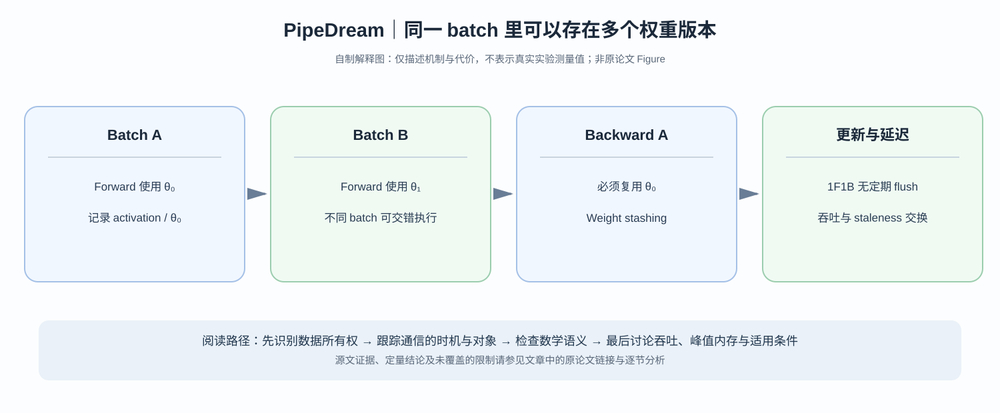

# PipeDream：为什么流水线不必每批都停下来，却必须保存旧版本权重？

> **论文**：[PipeDream: Generalized Pipeline Parallelism for DNN Training](https://www.microsoft.com/en-us/research/publication/pipedream-generalized-pipeline-parallelism-for-dnn-training/)，Narayanan / Harlap 等，SOSP 2019；早期 arXiv 版本为 [1806.03377](https://arxiv.org/abs/1806.03377)。
> **类型**：C · 异步流水线训练系统。**核心问题**：如何取消每个 batch 之间的 pipeline flush，同时保证反向传播使用前向传播时的权重？

## 阅读入口

### 原论文 Figure 1/2 证明了哪一种“必须流水化”的瓶颈？

[PipeDream 原始 PDF 第 3 页 Figure 1](https://arxiv.org/pdf/1806.03377) 对 VGG16、ResNet50、Inception v3、AlexNet、S2VT，在 K80、Titan X、V100 和不同数据并行 Worker 数下，统计**通信占整个训练时间的比例**。一些网络/并行规模的通信耗时甚至超过一半；随 GPU 从 K80 变快到 V100，网络通信相对于 GPU 计算的占比可能变大。它证明的是“同步跨 Worker 的数据并行通信可成为瓶颈”，**并不证明所有模型在任何集群都适合流水线模型并行**。

同页 Figure 2 的四台机器构成数据并行 Worker，右下时间线用 F/B/C 区分 Forward、Backward、Communication Stall。后续 PipeDream 通过按 Layer 切分模型、让不同输入 Micro-batch 同时分布在不同流水 Stage，减少某些同步等待；但必须为模型 Pipeline 提供 Staleness/Weight Stashing 的一致性语义。流水线降低空转的代价不是“通信消失”，而是**将等待与计算在不同请求和不同 Stage 上重叠**。

最短的因果模型是：若单卡每批计算为 $T_c$、梯度同步需 $T_n$，无法重叠时一次同步更新需 $T_c+T_n$；若执行期能有效重叠比例 $r\in[0,1]$ 的通信，时间可抽象成 $T_c+T_n-r\min(T_c,T_n)$。这里不是 PipeDream 原论文性能模型，只用来说明**“同步摊在关键路径”与“流水化改变关键路径”之间的关系**。原文 Figure 1 的百分比不能直接代入这一式计算具体 Speedup，因为 PipeDream 同时改变了 Partition、Weight Version 和 Micro-batch 调度。

从 [GPipe](C003-gpipe.md) 读到此处，已经知道 GPipe 以 micro-batch 填充流水线，但在整批 forward/backward 之后统一更新模型参数。它换来了清晰的同步优化语义，也制造了定期的 pipeline bubble。[Megatron-LM](C004-megatron-lm.md) 采用 flush 以保持严格同步更新；PipeDream 则尝试另一条取舍：**容许多个输入批次的不同模型版本同时处于流水线中**。

*自制解释图，非论文原图。原文 Figure 与实验图见 [SOSP 正式页面](https://www.microsoft.com/en-us/research/publication/pipedream-generalized-pipeline-parallelism-for-dnn-training/)；此图不表达具体模型的 GPU timing。*

## 一、什么情况下 GPipe 的同步边界会造成大量空转？

用 $p$ 个流水线 stages 处理 $m$ 个 microbatches。假设每 stage 的 forward/backward 总计算时长接近 $\tau$，同步 flush 的理想开销是：

$$
\beta_{\rm ideal}=\frac{p-1}{m}.
$$

这种开销在 $m$ 远大于 $p$ 时会被摊薄。可是增大 $m$ 也可能使 microbatch size 太小，影响 GEMM 效率；而 GPipe 的 all-forward/all-backward 还使许多 activation 在等待 backward。

一个自然想法是：让 stage 1 刚完成某条样本的 backward，就用最新参数开始处理下一条样本的 forward。这样最前面的 GPU 不必等最后一个 stage 的全部 backward 完成后才开始新任务。

问题随之变成：**同一输入曾用 $W^{(t)}$ 执行 forward，轮到 backward 时设备上可能已经是 $W^{(t+1)}$。**

## 二、为什么不能直接拿新版本权重反传？

考虑两层网络：

$$
h=\sigma(W_1x),\qquad y=W_2h.
$$

给定损失 $\ell(y)$，正确的第二层梯度是：

$$
\nabla_{W_2}\ell=\frac{\partial\ell}{\partial y}h^\top.
$$

第一层反向还依赖由**同次 forward** 计算的 $W_2$：

$$
\frac{\partial\ell}{\partial h}=(W_2)^\top\frac{\partial\ell}{\partial y}.
$$

假设 forward 使用 $W_2^{(t)}$，backward 却读取 $W_2^{(t+1)}$，那么你计算的就不是此次 forward 损失函数在原参数状态下的梯度。非线性层的 Jacobian 也必须与那次 forward 的激活状态一致。

PipeDream 的 **weight stashing** 就是把每条在途任务使用的版本记录下来，使 backward 可以读到正确版本。形式上，对 microbatch $u$：

$$
y_u=f(x_u;\theta^{[v(u)]}),
$$

$$
g_u=\nabla_\theta\ell(f(x_u;\theta^{[v(u)]})).
$$

它修复的是**前后向版本不匹配**，并不保证整体训练轨迹等价于严格 BSP/同步 SGD。

## 三、1F1B 调度和“更新语义”是两个独立决定

PipeDream 在稳定状态让各 stage 交替做 forward/backward（1F1B），降低 flush 与长期保留 activation 的开销；同时 stage 可使用**不同权重版本**。

~~~text
Stage 0: F(A) → B(A) → F(C) → B(C) …
Stage 1:       F(A) → B(A) → F(B) → B(B) …
                                      ↑
                      同一时刻各层可能处于不同 weight age
~~~

上面的字符时间线只是局部顺序示意，真实任务依赖、warm-up 与不同 stage 的交错必须满足数据因果关系。1F1B 是在**调度层**解决设备等待，weight stashing 则是在**梯度正确性层**保证输入的同一次 forward/backward 版本对应。

### Vertical synchronization 为什么还要讨论？

即使某 stage 内前后向版本相同，**不同 stages 的参数可能来自不同更新时刻**。一个样本经过的并非某个单一全局时刻的 $\theta$。PipeDream 研究了把各层参数版本沿流水线更好对齐的策略，并对训练收敛效果进行实验；这仍不等于严格同步 SGD。

因此有三种完全不同的“正确”：

1. 数据流因果正确：后一个 stage 不在收到 activation 之前运行。
2. 局部梯度计算正确：反向使用前向的参数版本与必要 activations。
3. 同步优化轨迹等价：整批全局梯度在同一 $\theta_t$ 计算后再更新。

PipeDream 重点保护前两项，而**允许第三项偏离**来换吞吐。

## 四、Model partitioning 为什么也必须是论文的一部分？

如果流水线有四张卡，工作量分别是 $(1,1,4,1)$ 单位时间，即使有足够多 microbatches，其吞吐也被第三张卡卡在每四个时间单位只能完成一批。

于是需要同时选择层边界与硬件位置：

$$
\min_{\mathcal P}
\max_{k} T_{\rm stage,k}(\mathcal P)
\quad\text{subject to memory and network costs}.
$$

这里的式子是**理解自动 partitioner 的简化概念模型**，不代表作者实现只优化这个单独目标。原论文还测量 operator compute time、相邻 stage activation 传输、链路带宽，并允许部分 stages 结合 data parallel 的 worker replication。

把模型按参数个数平均切四段通常不等于按执行时间平均，更不等于通信量最小。特别在跨机器运行时，相同 activation tensor 在 NVLink 与 InfiniBand 上的移动成本会不同。

## 五、实验如何证明“更快”，又没有证明什么？

正式 SOSP 2019 版本报告不同模型任务和硬件配置中，PipeDream 对所选 intra-batch baseline 的**time-to-target-accuracy** 最高约 $5.3\times$ 改善。这个指标比仅比较训练 samples/s 更严格：如果异步权重导致训练需要更多 steps，吞吐提升不一定带来更快的目标质量。

但是它仍是**给定模型与调参协议**的实证结论，不意味着异步更新对所有 loss landscape 同样安全。较大的 learning rate、更深 pipeline、更多延迟版本与分布偏移会改变稳定性。

**论文原图读法**：阅读正式论文调度图时，要逐个标出 forward/backward 任务及其 weight version；阅读 time-to-accuracy 结果时，区分 throughput、iteration 数和达到目标指标的 wall-clock time。只看吞吐表是不足以支持统计效率结论的。

## 六、把 PipeDream 放回路线，为什么还需要 PipeDream-2BW？

Weight stashing 需要为不同在途 microbatches 保存多个历史版本，显存消耗与 pipeline 深度有关。对于更大的 Transformer，参数状态本身就非常昂贵，可能使这个策略不可用。

于是下一个问题出现：

> 能不能保留部分不停机流水线收益，又不必为大量在途任务保留多份完整权重？

这就是 [PipeDream-2BW](C007-pipedream-2bw.md) 的问题；它选择 *gradient coalescing + double-buffered weights*，重新设计版本生命周期，目标不再完全等同于 PipeDream 的即时分阶段更新。

### 论文论证的关键转折

PipeDream 先从传统 intra-batch parallelization 的通信与扩展瓶颈切入，再强调**训练与推理流水线不同：训练存在反向依赖和权重更新**。版本 stashing 不是实现细节，而是让无 flush 调度合理的必要条件。之后才谈 partitioner 与测得的 time-to-accuracy。这样的顺序值得沿用：先确保数值语义，再讨论设备利用率。

**返回与继续**：[GPipe](C003-gpipe.md)（严格同步语义）、[Megatron-LM](C004-megatron-lm.md)（采用 flush 的 1F1B 与 interleaving）、[PipeDream-2BW](C007-pipedream-2bw.md)（减少权重版本显存）。

**主要来源**：[PipeDream, SOSP 2019](https://www.microsoft.com/en-us/research/publication/pipedream-generalized-pipeline-parallelism-for-dnn-training/)、[原始 arXiv](https://arxiv.org/abs/1806.03377)。
