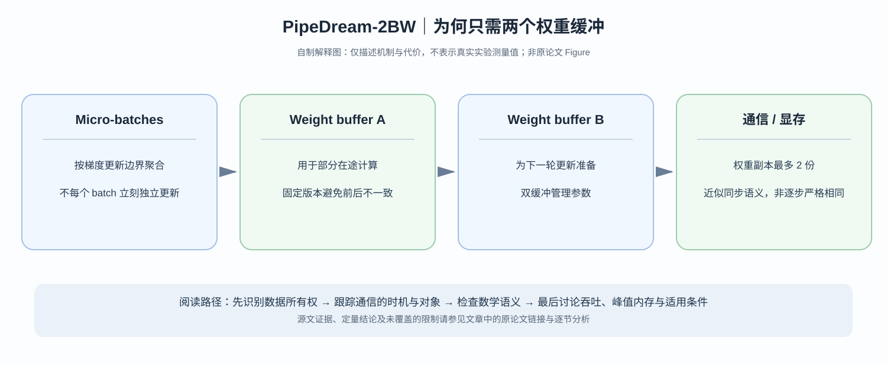

# PipeDream-2BW：能否把流水线权重历史从很多份压到两份？

> **原论文**：Narayanan 等，[Memory-Efficient Pipeline-Parallel DNN Training](https://proceedings.mlr.press/v139/narayanan21a.html)，ICML 2021（arXiv [2006.09503](https://arxiv.org/abs/2006.09503)）；论文中系统方法称为 **PipeDream-2BW**。
> **类型**：C · 流水线时序与显存优化。**核心问题**：同时避免 GPipe 的 flush 空转和 PipeDream 保存多个历史参数版本造成的内存成本，需要在哪个维度上妥协？

## 阅读导航

### 原论文 Figure 2 为什么可以只保留两份权重？

[PipeDream-2BW ICML 2021 原始 PDF 第 4 页 Figure 2](https://arxiv.org/pdf/2006.09503) 画出四个 Worker 的 1F1B Timeline，蓝色 Forward 与绿色 Backward 交错；浅色方框标记**产生新版本权重**的更新事件。Figure 2 的 Caption 明确强调：每个 Worker **只缓存两份 Weight Version**，避免 PipeDream 随在途 Micro-batch 数量增加而保留多个历史版本。

论文在同页 **Semantics** 段给出延迟一轮的简化 SGD 更新：

$$
W^{(t+1)}=W^{(t)}-\nu\,\nabla f(W^{(t-1)}).
$$

这里 $\nabla f(W^{(t-1)})$ 来自上一版本计算的梯度，与同步 SGD 的 $\nabla f(W^{(t)})$ 不同；因此 2BW 并非数学上“完全没有陈旧梯度”，而是将重量级的多份 Weight Stashing 控制为有界双缓冲，并分析一轮 Staleness 对优化的影响。它必须以适当的更新时序、梯度合并和正确 Forward/Backward Weight Version 配对为前提。

Figure 3 又对比 GPipe 与 PipeDream-Flush：后者在稳定段更常交替 F/B，降低同时保留的 Activation 数；代价是仍需要在权重更新点周期性 Flush。图中灰色区域为空闲，**能用来解释 Pipeline Fill/Drain 与显存占用，不能被当作收敛性证据**。收敛必须回到论文 SGD/Adam 的 Staleness 分析与实测 Training Loss。

先读 [GPipe](C003-gpipe.md) 的同步 micro-batch 梯度恒等式，再读 [PipeDream](C006-pipedream.md) 的 weight stashing，否则“双缓冲”容易被误以为普通的 DMA prefetch。后面还会回到 [Megatron-LM](C004-megatron-lm.md) 比较 flush 与 interleaved 1F1B。

*自制解释图，非论文 Figure。图示简化权重版本的持有与梯度聚合；实际哪个 microbatch 绑定哪个版本，由原论文的 2BW schedule 决定。论文时间线与实测在 [ICML/PMLR 正式页面](https://proceedings.mlr.press/v139/narayanan21a.html)。*

## 一、三个方案的内存–空闲矛盾

回顾三个问题：

- GPipe：一整个 batch 用同一版本权重，到 flush 才更新。**版本只有一份**，但必须排空流水线，而且 activation 暂存开销可能较大。
- PipeDream：持续注入任务，各个 stage 通过 1F1B 减少空闲。**不同在途 microbatches 需要历史权重版本**，否则反向梯度会用错 $\theta$。
- PipeDream-2BW：尝试把不同 microbatches 的梯度更新先**合并**成更粗粒度的更新，再让流水线仅保留两份相关权重。

为什么单纯“所有 stage 只保留最新版”不够？给出二层网络：

$$
y=W_2\sigma(W_1x).
$$

在 forward 使用 $W_2^{(a)}$ 的样本，其第一层梯度应涉及 $(W_2^{(a)})^\top$。如果 backward 改用 $W_2^{(b)}$，得到的是另一个函数的链式法则结果。版本配对关系不能因为优化显存而取消。

## 二、Double Buffering 与 Gradient Coalescing 各自负责什么？

**Double buffering**：不是缓存任意数量旧版本，而是让某段计算使用一个稳定 weight buffer，另一个 buffer 为新版本更新/切换准备。它将*同时存在的权重版本数量*限制为 2，缓解深流水线带来的存储放大。

**Gradient coalescing**：不对每个微批立即产生一个独立的模型版本，而是将若干 microbatches 的梯度聚合后再做一次参数更新。这减少参数版本产生的频率。

假设模型参数为 $\theta$，同一版本上的 $m$ 个 microbatch 平均损失为：

$$
\mathcal L(\theta)=\frac1m\sum_{i=1}^m \ell_i(\theta).
$$

如果这 $m$ 条都**在同一版本**执行 forward/backward，则：

$$
g(\theta)=\frac1m\sum_{i=1}^m\nabla\ell_i(\theta)
$$

在数学上对应一次 mini-batch 梯度。但当 2BW 调度让某些 microbatch 使用有界过时的版本时，不能把它无条件写成“完全等价于同步数据并行”。论文使用的是 **similar weight update semantics**，并通过收敛实验比较，而非宣称所有时刻严格同轨迹。

一个核心工程交换是：

$$
\underbrace{\text{更少 flush}}_{\text{提高流水线设备利用率}}
+
\underbrace{\text{固定双缓冲权重}}_{\text{限制 GPU memory}}
\quad\leftrightarrow\quad
\underbrace{\text{更新延迟和调度限制}}_{\text{影响优化轨迹}}.
$$

这三件事任何一件不讨论，就不能理解系统为什么有效。

## 三、仅靠“有两份 weights”就够了吗？

不够，因为 activation checkpointing 和 stage 切分仍影响峰值显存。

设总模型有 $L$ 层、划成 $p$ 个 stages，stage $k$ 持有权重数量 $P_k$。以 $b_w$ 字节每参数表示某种权重 dtype，仅 weight double-buffer 的近似存储成本是：

$$
M_{{\rm weight},k}\approx 2b_wP_k.
$$

但实际训练还要计：

$$
M_k^{\rm peak}
=
M_{{\rm weight},k}
+
M_{{\rm gradients},k}
+
M_{{\rm optimizer},k}
+
M_{{\rm activations},k}
+
M_{{\rm workspace},k}.
$$

双缓冲可以控制第一项的历史版本开销，却不让其余项消失。对于 Transformer，这也解释了为什么论文的 planner 需要联动考量 **stage partition、batch size、recomputation 和真实硬件链路**。

### 为什么需要自动 partitioner？

设 GPU 各 stage 计算时间为 $t_1,\dots,t_p$。稳定流水线吞吐受 $\max_k t_k$ 约束；不同层间 activation shape 可能差很大，而跨主机与机内通信带宽也不同。让每个 stage 都分到相同层数不意味着最小 step time。

因此规划必须平衡：

1. 计算负载；
2. stage 对应的参数与 activation 峰值；
3. 相邻 stage 的通信与拓扑；
4. in-flight microbatch 与参数缓冲寿命。

## 四、怎么读原论文的对照实验？

ICML 2021 论文报告在选定 GPT/BERT 模型上，相对于若干优化模型并行基线最高有 **$20\times$** 的训练加速，并报告模型质量相近。请特别检查所选 baseline 是否本来存在严重模型并行瓶颈——大倍率往往离不开这一前提。

对比 GPipe 时，应把三条观察分开：

- **Throughput**：硬件一秒钟处理多少样本/token；
- **Peak memory**：能否装下对应模型/批次；
- **Convergence**：由于版本延迟改变，达到同等质量需要多少 optimizer steps。

作者实测较好的结果可支持其**指定场景**中的方案；不能仅凭最终同等精度，推断所有学习率和优化器下 2BW 的梯度估计完全等价。

### 论文结构里最值得精读的点

作者没有把 double buffering 当成“提升带宽的双缓冲”，而是直接从**权重更新的时机**引出两份版本为何足够。随后才讨论 activation recomputation 与 planner。这提醒我们：系统论文中的“buffer”可以是为了正确性和版本管理，而不仅仅为了 async memory copy。

## 五、原论文究竟比 PipeDream 多做了什么？

[PipeDream](C006-pipedream.md) 重点保证每个 backward 能找到 forward 版本，但持续更新导致可能需要更多历史 weights；2BW 将**更新的微批边界和版本生命周期一起重排**，从而把参数版本峰值控制在两个。

这并不意味着经典 PipeDream 被完全取代。是否优先使用 GPipe-style flush、PipeDream 还是 2BW，应由显存裕量、允许的异步/滞后语义、pipeline depth 与网络条件共同决定。

对于生产训练配方，最先确定的是：

> 是否需要严格的每 step 同步梯度语义？

需要则应优先采用 flush 或能证明等价的同步机制；若可接受实验验证过的受控 staleness，才考虑更激进的无 flush 调度。

**下一跳**：[ZeRO-Offload](C008-zero-offload.md) 会把焦点转出时间维度：除了版本存储，还能不能让 GPU 不再承担所有 optimizer states 的常驻显存？

**主要来源**：[ICML 2021 / PMLR](https://proceedings.mlr.press/v139/narayanan21a.html)、[arXiv 2006.09503](https://arxiv.org/abs/2006.09503)。
