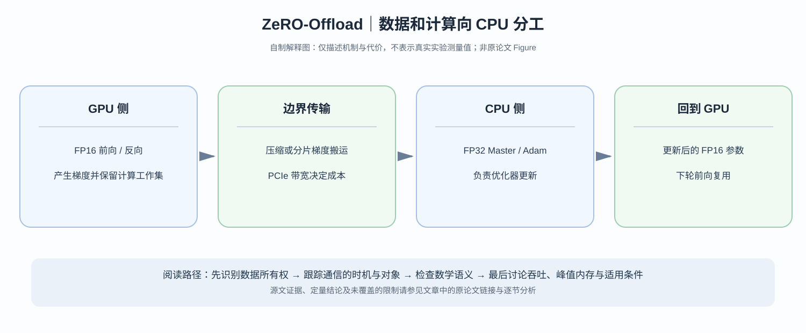

# ZeRO-Offload：既然 Adam 主要做向量更新，为什么还要占用最贵的 GPU HBM？

> **论文**：Ren 等，[ZeRO-Offload: Democratizing Billion-Scale Model Training](https://arxiv.org/abs/2101.06840)，USENIX ATC 2021；[USENIX 正式论文](https://www.usenix.org/conference/atc21/presentation/ren-jie)。
> **类型**：C · 异构计算与训练状态管理。**问题**：在单 GPU 或小型集群训练大模型时，能否让 GPU 专注于高吞吐矩阵计算，让 CPU 承担更重的 FP32 optimizer state 与更新，同时避免 PCIe 传输吃掉所有收益？

## 阅读导航

优先回到 [ZeRO](C002-zero.md) 的 $16\Psi$ bytes/parameter 混合精度 Adam 账本。ZeRO 主要把训练状态在 DP ranks 之间分片，而 Offload 改变的是**同一份状态驻留的内存层级和执行处理器**。前面两篇 [PipeDream](C006-pipedream.md) 和 [2BW](C007-pipedream-2bw.md) 探索时间流水线；Offload 改成在 GPU 与 CPU 之间建立**计算功能分工**。

*自制解释图，非原论文 Figure；请在 [USENIX 正式论文](https://www.usenix.org/conference/atc21/presentation/ren-jie) 对照其设备/状态分区图。*

## 一、训练时显存到底花在哪里？

按原始 ZeRO 分析采用的 FP16 前向/反向 + FP32 Adam 设定，每个参数：

| 状态 | 字节/参数 |
|---|---:|
| FP16 forward weight | 2 |
| FP16 gradient | 2 |
| FP32 master weight | 4 |
| FP32 Adam first moment | 4 |
| FP32 Adam second moment | 4 |
| 合计 | **16** |

所以拥有 $\Psi$ 个参数的训练状态：

$$
M_{\rm states}=16\Psi\text{ bytes}.
$$

以 10B 参数为例：

$$
M_{\rm states}=160\ \text{GB},
$$

这远超过单张 32 GB V100 HBM。哪怕计算本身利用重计算技术减少 activation，也解决不了 FP32 Adam states 本身的 120 GB。

你可以尝试分片给更多 GPU——但单 GPU 没有可用 DP peers 时无从分片，且更多加速器并不总可得。更直观的思路是将 FP32 master weight 和 Adam states 放到容量更大但带宽更低的 CPU DRAM。

### 朴素 CPU offload 为什么不一定快？

最糟实现是每个算子都反复把 master weight 与 optimizer states 从 CPU 拉到 GPU 做更新，再送回 CPU。这相当于把已经在 CPU 上的大数组来回搬运。原本的瓶颈是 HBM capacity，现在可能变成 PCIe IO time。

因此必须同时回答两个问题：**什么驻留 CPU？什么实际在 CPU 上计算？**

## 二、Offload 不只“把 optimizer state 放 CPU”

ZeRO-Offload 的关键在于按照真实计算特性划分：

- GPU：适合 tensor-core GEMM 的前向/反向主干；
- CPU：持有 FP32 master weights、Adam states，承担相应 optimizer 更新；在对应实现中通过 CPU optimizer 和并行技术控制 CPU 更新开销；
- 设备互联：在梯度和更新后权重的适当表示与阶段之间传输必要数据。

如果只把 FP32 states 放 CPU，却在 GPU 上执行 optimizer update，就仍然需要频繁搬回状态。真正减小通信的办法，是让 CPU 能用已在本地的 states 完成更新。

以一轮简化模型为例：

~~~text
1 GPU 处理 FP16 weights 的 forward/backward
2 CPU 获得用于对应 shard 更新的 gradients
3 CPU 用 FP32 master / m / v 更新参数
4 需要参与下一次 forward 的低精度 weights 回到 GPU
~~~

这只是解释持有与计算关系的**概念顺序**，真正系统会按 bucket/shard/stream 组织通信和重叠，不要求所有 GPU kernels 静态串行地等待整个 CPU optimizer。

## 三、用通信账本判断值不值得 Offload

设模型参数数量 $\Psi$，FP16 张量每元素 2 bytes。若每一步从 GPU 传回一次 FP16 gradients，又从 CPU 传回一次 FP16 updated weights，那么**未经进一步压缩/重叠的简化下界规模**为：

$$
V_{\rm PCIe}\sim(2+2)\Psi=4\Psi\text{ bytes/step}.
$$

对于 $\Psi=10^{10}$，即约 40 GB 双向总移动量；假设单方向有效带宽约 12 GB/s，且不存在完美 overlap，这种开销就不可能忽略。注意这不是原论文某段性能公式的原样复刻：具体传输次数、大小、双向并发与精度由实现决定。

若 GPU 一步计算时间为 $T_{\rm comp}$，CPU 更新与数据转移时间为 $T_{\rm CPU}, T_{\rm PCIe}$，则设计目标不是让：

$$
T_{\rm step}
=T_{\rm comp}+T_{\rm CPU}+T_{\rm PCIe}
$$

无条件成立，而是尽可能安排流水：

$$
T_{\rm step}
\gtrsim
\max(T_{\rm comp},T_{\rm CPU},T_{\rm PCIe})
$$

（理想重叠下的下界，不是实际必达等式）。

论文还利用分片思想减少重复传输及 CPU 更新负担。重要的是不同层的计算和数据使用时间不同，不必等整块模型完全计算后才开始任何数据流动。

## 四、训练语义有没有变化？

只要 CPU 完成的 Adam 更新按原计划使用正确聚合的 gradient、master weight 和两阶 moment，其核心优化器公式没有变：

$$
m_t=\beta_1m_{t-1}+(1-\beta_1)g_t,
$$

$$
v_t=\beta_2v_{t-1}+(1-\beta_2)g_t^2,
$$

$$
\theta_t
=\theta_{t-1}
-\eta\frac{\hat m_t}{\sqrt{\hat v_t}+\epsilon}.
$$

但是 PyTorch fused/foreach/AMP 和 CPU optimizer 使用的舍入、溢出处理、梯度缩放等细节可能不同，不能据此声称 CPU/GPU 两套工程实现 bitwise identical。

Offload 不是通过减小模型参数量、随机丢弃梯度或更换损失来适配小显存，而是通过**重新分配计算与驻留位置**改变系统资源需求。

## 五、论文中的结果与限制

论文报告可在**单 V100 GPU**上训练超过 13B 参数的模型，并在其设置下实现相对某些常用训练框架约 10 倍的可训练规模扩展；还报告在特定 10B 模型任务上约 40 TFLOP/s GPU 吞吐，以及组合模型并行后在 DGX-2 节点处理更大模型的能力。此处需要分别理解：

1. **可容纳规模**：相对无 offload 实现的参数数量；
2. **GPU 计算吞吐**：不是 CPU/GPU 所有操作总 wall-clock 的单一解释；
3. **质量**：系统级内存优化不应改变预定学习目标，但原论文实证只覆盖其任务；
4. **延迟和成本**：CPU 频率、内存带宽、PCIe、pinning、NUMA、CPU/GPU overlap 决定真实性能。

它并没有证明所有模型在 CPU 上做 optimizer 必然更快。假设 CPU 很弱、PCIe 很慢、参数规模不大，Offload 可能根本不值。

### 论文细读：为什么论文特别强调 Partitioning & Computation Placement？

如果把贡献写成“把 Adam 状态扔到 CPU”，不仅太粗糙，也无法解释其性能结果。原文设计同时关注**尽量少的数据移动、选择适合 CPU 的计算、保持 GPU 高利用率**。真正的系统洞见是把存储容量和计算吞吐看成可以在不同硬件间互补的资源，而非每一轮让所有数据都回 GPU 执行。

下一篇 [ZeRO-Infinity](C009-zero-infinity.md) 会把这条路线从 GPU+CPU 扩成 **GPU+CPU+NVMe**，并解决单条 PCIe 路径可能成为瓶颈的问题。

**主要依据**：[arXiv 原论文](https://arxiv.org/abs/2101.06840)、[USENIX ATC21 正式页面](https://www.usenix.org/conference/atc21/presentation/ren-jie)、[ZeRO](C002-zero.md)。
