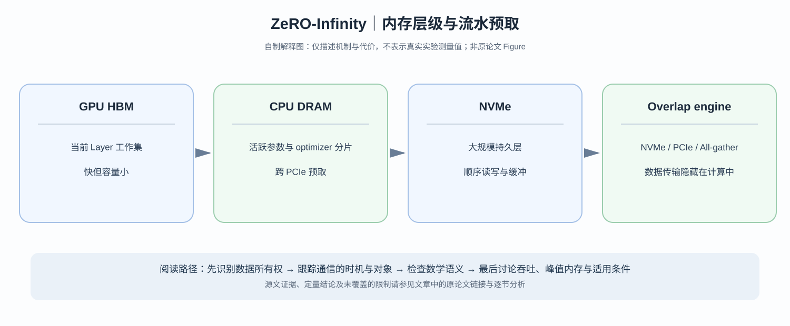

# ZeRO-Infinity：NVMe 容量很大，为什么超大模型训练仍然需要一套跨存储层的流水线？

> **原论文**：[ZeRO-Infinity: Breaking the GPU Memory Wall for Extreme Scale Deep Learning](https://arxiv.org/abs/2104.07857)，Rajbhandari 等，SC21；[Microsoft Research 的作者技术解读](https://www.microsoft.com/en-us/research/blog/zero-infinity-and-deepspeed-unlocking-unprecedented-model-scale-for-deep-learning-training/)。
> **类型**：C · GPU/CPU/NVMe 异构训练系统。**问题**：让低速存储提供容量的同时，怎样不让它成为训练的关键路径？

## 阅读导航：从 ZeRO → Offload → Infinity

先读 [ZeRO](C002-zero.md) 的状态分片与 [ZeRO-Offload](C008-zero-offload.md) 的 CPU optimizer。前者回答**谁持有参数分片**，后者回答**CPU/GPU 谁计算什么**。Infinity 继续把 CPU DRAM 之外的 NVMe 纳入存储层级，不能被概括为“再加一个 offload 选项”。

*自制解释图，非论文 Figure。原论文的架构和吞吐证据可从上方论文链接进入阅读。*

## 一、容量如何变成巨大的数据移动成本？

假设一个模型有 $P=100$B 参数，低精度权重占 $2P=200$ GB。若某存储路径有效速率仅 3 GB/s，串行读取一次至少：

$$
T_{\rm read}\gtrsim\frac{200}{3}\approx66.7\ \text{s}.
$$

这是**人为设定的数量级演算**，非论文实测 NVMe 参数。若每个 step 都必须在整个 forward 开始前把模型从 SSD 完整装载一次，GPU 大部分时间将停在等待上。

问题并不是 NVMe 能否装得下参数，而是**第 $\ell$ 层需要时，能否已经预取完成其权重**。在反向还会出现对相同参数的再次访问，优化器状态亦有更新和写回要求。

## 二、分片所有权与物理位置是两种不同设计轴

ZeRO-3 可让 $N_d$ 个 DP ranks 分别持有权重 shard $W_{\ell,r}$：

$$
W_\ell=\operatorname{AllGather}(W_{\ell,0},\ldots,W_{\ell,N_d-1}).
$$

Infinity 可以让这些 shards 的物理驻留层级在 GPU HBM、CPU DRAM 与 NVMe 之间改变。某一层的计算需要完整 $W_\ell$，**但这不意味着全部层完整权重需要常驻 GPU**。

概念时序：

~~~text
读取未来层 shard → CPU DRAM staging → PCIe 传入 GPU
→ 各 DP ranks All-gather 本层权重 → GPU GEMM
→ 释放暂时权重缓存 / 保留当前需要的梯度与状态
~~~

真实系统可做缓存与异步预取，并非所有 tensor 都必须访问 NVMe。

## 三、Bandwidth-centric partitioning：为什么 owner 分布影响 PCIe 带宽？

假如一个完整 layer 的权重都属于一个 rank，那么对应参数首先得穿过**这一张 GPU 的 PCIe**，再向其他 GPUs 扩散。即使集群有 8 条 PCIe 链路，也可能只有一条真正加载这层数据。

把 layer 参数也按 8 份跨 DP ranks 持有，8 个 ranks 就可以**并行**从各自 CPU memory 拉入 $M/8$ 的 weight shard，再在 GPU 间 All-gather。

以理想同速带宽 $B_{\rm PCIe}$ 粗略比较：

$$
T_{\rm single}\sim \frac{M}{B_{\rm PCIe}},
$$

$$
T_{\rm parallel}\gtrsim
\max\left(\frac{M}{8B_{\rm PCIe}},T_{\rm allgather}\right).
$$

这不是论文的准确性能公式，而是揭示：**内存分片方式不仅影响容量，还决定可以利用多少条独立的传输路径**。GPU All-gather 若成为瓶颈，聚合 PCIe 带宽依然不能兑现全部收益。

## 四、Communication overlap：提前加载不是免费的

第 $\ell$ 层计算时间为 $C_\ell$，下一层所需的 NVMe、PCIe、GPU network 传输必须尽量在 $C_\ell$ 时间窗内进行。

$$
T_{\rm step}
\ge
\max(T_{\rm compute\ path},T_{\rm uncovered\ IO\ path}).
$$

这只是关键路径下界：如果某层计算时间比下一层参数取得时间短，GPU 仍会等待。另一方面，额外 prefetch buffer 本身占 HBM/DRAM，显存越紧，允许同时预取的层数就越少。

因此目标有三个：**分层状态分区、异步预取/流水、各类 buffer 的容量控制**。单纯声明“使用 NVMe”并没有解决这些问题。

## 五、原始证据如何正确表述？

论文报告在 512 张 NVIDIA V100 GPU 的配置下有超过 25 PFLOP/s 的系统吞吐，并讨论万亿级 fine-tuning 和几十至数百万亿参数的理论容量。应分开：

- **容量上界**：分片与分层存储能否让状态放得下；
- **已实际运行的配置**：模型、训练 step、设备和 batch；
- **有效吞吐**：真实 GFLOP/s 或 PFLOP/s 是否包含通信与 offload；
- **完整收敛训练**：是否完成给定 token budget 的整轮预训练，不可因容量论证而自动声称完成。

原论文 Figure 的系统时间线和分层存储图要结合实测网络吞吐理解；不同 CPU、NVMe、GPU 代际不能复用 2021 年具体 speedup 数字。

## 六、论文论证的真正贡献

[ZeRO-Offload](C008-zero-offload.md) 解决 GPU 与 CPU 的计算/状态分工；Infinity 的新增问题是**跨 NVMe/CPU/GPU 的多级数据生命周期**，并通过 bandwidth-centric partitioning 减轻单 rank 数据路径瓶颈。

当模型能常驻 GPU 时，offload 并非更好选择；当序列 activation 占内存的比例压过参数状态时，也不应只凭参数容量分析做决定。

如果瓶颈不在训练参数而在在线推理的动态 KV cache，需要转到 [vLLM / PagedAttention](C012-vllm-pagedattention.md)，解决的是另一个内存管理问题。

**原始依据**：[ZeRO-Infinity](https://arxiv.org/abs/2104.07857)、[作者团队详解](https://www.microsoft.com/en-us/research/blog/zero-infinity-and-deepspeed-unlocking-unprecedented-model-scale-for-deep-learning-training/)。
