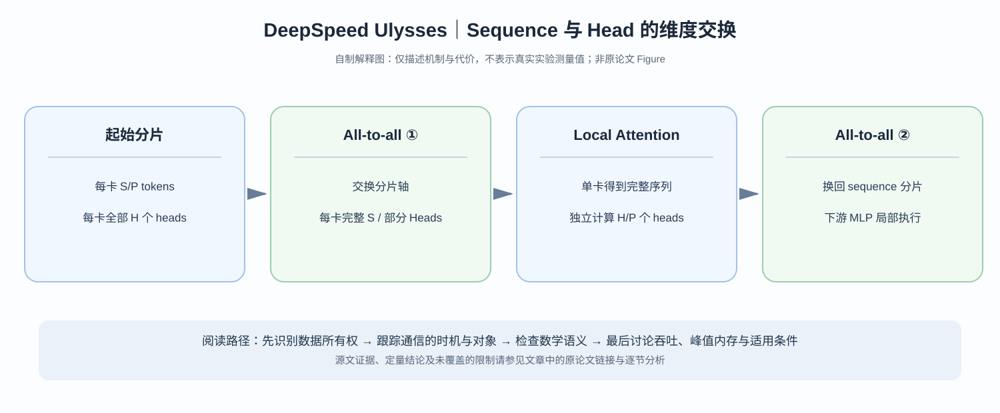

# DeepSpeed-Ulysses：两次 All-to-all 怎样将 Sequence Sharding 换成 Head Sharding？

> **论文**：Jacobs 等，[DeepSpeed Ulysses: System Optimizations for Enabling Training of Extreme Long Sequence Transformer Models](https://arxiv.org/abs/2309.14509)，2023；[作者技术详解](https://github.com/deepspeedai/DeepSpeed/blob/master/blogs/deepspeed-ulysses/README.md)。
> **类型**：C · Sequence Parallelism。核心问题：如何在全局精确 Attention 的条件下，将每卡序列长度降低、又减少 KV 的循环转发次数？

## 阅读导航

[Ring Attention](C005-ring-attention.md) 固定本地 Query，跨设备环形传播 KV；Ulysses 利用**不同 Attention heads 能独立计算**的性质，将张量的**分片轴**从序列换成 head，计算后再换回来。

*自制解释图，非论文 Figure。与 [DeepSpeed 官方图示和解释](https://github.com/deepspeedai/DeepSpeed/blob/master/blogs/deepspeed-ulysses/README.md) 对照。*

## 一、把每个 GPU 的 shape 写出来

标准多头自注意力输入：

$$
X\in\mathbb R^{B\times S\times H},\quad H=n_hd_h.
$$

共有 $P$ 个 sequence-parallel ranks，各负责 $S/P$ tokens。Q/K/V projection 后：

$$
Q_r,K_r,V_r\in\mathbb R^{B\times(S/P)\times n_h\times d_h}.
$$

单 GPU 上现在有**所有 heads，但只看见一部分 tokens**。对全局 Attention 而言，每个 Query 应与全序列 Key 交互，仅有本地序列块不够。

## 二、第一次 All-to-all：把分片轴交换

以 $S=8192,H=1024,n_h=16,P=4,d_h=64$ 为例。

初始每卡：

$$
Q_r:[B,2048,16,64].
$$

将 $16$ 个 heads 分为 $4$ 组，跨设备执行 All-to-all，使每个 GPU 收齐自己负责的 heads 在**完整 $S$** 上的 Q/K/V：

$$
\boxed{
Q'_r,K'_r,V'_r:
[B,8192,4,64].
}
$$

前后元素数相同：

$$
2048\cdot16\cdot64=8192\cdot4\cdot64.
$$

这不是复制四份，而是让不同 GPU 负责不同 heads 的完整序列计算。现在每 GPU 可独立完成：

$$
O'_r=\operatorname{softmax}
\left(\frac{Q'_rK_r'^\top}{\sqrt{d_h}}\right)V'_r.
$$

它可以在本地调用合适的 [FlashAttention](../../A/10-gpu-operators/A055-flashattention.md) kernel；All-to-all 并不改变注意力的数学目标。

## 三、第二次 All-to-all：还原布局给下一层

计算完成后，每个 GPU 拥有全序列上部分 heads 的结果：

$$
O'_r:[B,S,n_h/P,d_h].
$$

而 Transformer 的输出 projection、MLP、残差常希望每个 GPU 拥有一段 tokens 的**完整 hidden**。再做一次 All-to-all：

$$
\boxed{
O_r:[B,S/P,n_h,d_h].
}
$$

于是这一层回到了 sequence-sharded 的形态。理解 Ulysses 的核心不是背 API，而是看清两次通信前后的 tensor shapes。

## 四、为什么 per-rank 通信与 $S/P$ 成正比？

一次输入侧重分布 Q/K/V，另一回程重分布 O。按 tensor elements 量级估算：

$$
V_{\rm comm,rank}\sim
\frac{(3+1)BSH}{P}.
$$

因此论文讨论的通信量级是：

$$
\boxed{O(BSH/P).}
$$

若将 $S$ 与 $P$ 按相同比例放大，**每 rank**的此项传输体积在理想模型下可保持近似不变。注意：不是总集群通信始终不变，也不是实际 All-to-all wall-time 必然常数——bisection bandwidth、消息启动成本与拥塞都可能改变结果。

与 Ring 逐轮传播 KV 不同，Ulysses 只在 Attention 的两侧做布局切换；其优劣必须结合硬件网络和 kernel 的吞吐比较。

## 五、为什么 Head 数会限制并行度？

上例要求每 GPU 至少有整数个 head。最直接的均匀分片满足：

$$
P\le n_h,\qquad n_h\bmod P=0.
$$

若 Q heads 只有 8 个却想用 32 ranks 这样分配，就无法“每 GPU 计算 0.25 个 head”。在 GQA/MQA 中 KV head 数比 Query head 数更少，实现还可能有重排、复制或限制，不能把标准 MHA 的 shape 推导无条件套用。

## 六、实验与科学边界

论文报告在其比较协议下，可支持约 4 倍长的输入序列，并在部分模型/配置获得最高约 2.5 倍吞吐收益。但要问实验是否还同时改动了 ZeRO-3、batch、FlashAttention 或 sparse kernel；它们会影响 system performance 的归因。

论文的“支持更长 sequence”是**算力与显存上可运行**，不是验证模型在百万 tokens 内都能有效理解与回忆信息。

真正的学术贡献是把**数学上彼此独立的 heads**映射成一场数据分布轴交换。这条结论并不需要幻想 Attention 被近似成局部窗口。

下一篇 [DistFlashAttn](C011-distflashattn.md) 则沿 [Ring Attention](C005-ring-attention.md) 方向继续研究：在 causal、KV 通信与训练反向的情况下怎样优化负载和 IO。

**原始资料**：[论文](https://arxiv.org/abs/2309.14509)、[DeepSpeed 作者解读](https://github.com/deepspeedai/DeepSpeed/blob/master/blogs/deepspeed-ulysses/README.md)。
