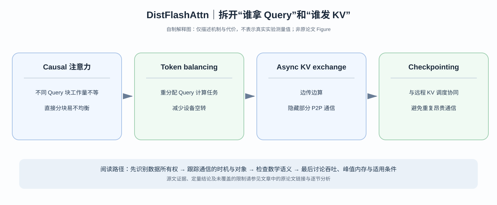

# DistFlashAttn：分布式 FlashAttention 为什么不能简单复制 Ring？

> **论文**：[DistFlashAttn: Distributed Memory-efficient Attention for Long-context LLMs Training](https://arxiv.org/abs/2310.03294)，Li 等，COLM 2024；[正式会议论文](https://openreview.net/forum?id=pUEDkZyPDl)。
> **类型**：C · 长上下文训练系统。核心问题：环形传送 KV 已经让训练能使用多张卡，为什么设备仍会不均衡、通信阻塞和反向重计算放大？

## 阅读导航：从 Ring 的正确性走到性能

先读 [Ring Attention](C005-ring-attention.md) 的按块 online softmax，再读 [DeepSpeed-Ulysses](C010-deepspeed-ulysses.md) 的 All-to-all 维度交换。三者都力图让**精确长上下文训练**能跨设备执行，但它们组织每个 rank 的 Query ownership 与 KV transport 的方式不同。

*自制解释图，非原论文 Figure。原作者图和性能图见 [COLM 正式论文](https://openreview.net/forum?id=pUEDkZyPDl)。*

## 一、Causal Attention 使“各 GPU 分到一样多 token”不等于计算均衡

因果自注意力的一个 Query 位置 $i$ 只允许看到 Key 位置 $j\le i$。完整密集注意力矩阵的有效部分是三角形而非正方形：

$$
M_{ij}=
\begin{cases}
0,&j\le i,\\
-\infty,&j>i.
\end{cases}
$$

假设总序列 $S$，分 $P$ 个连续 token blocks。若 rank 0 负责最前面的 Query，它只需访问很短的历史；rank $P-1$ 负责最末尾的 Query，则需要看全序列的大部分 KV。

在等长切分下，rank $r$ 的有效 QK pairs 近似为：

$$
C_r\approx
\left(\frac SP\right)^2
\left(r+\frac12\right).
$$

这里忽略 block 边界整数离散性，假定从 $r=0$ 编号、每块等长。这个式子来自：当前 $S/P$ 个 Query 都看到前面 $r$ 个完整块，外加本地 block 的下三角约半个平方。于是后面的设备拥有更多有效计算任务。

### 一个四 GPU 的直观例子

令每 block 有 $c$ 个 tokens，$P=4$：

$$
C_0:C_1:C_2:C_3
\approx0.5:1.5:2.5:3.5.
$$

最大负载约为最小的七倍。即使 Ring KV 分布方式完全正确，**最忙 GPU**也可能决定一轮结束时间。仅“把 tokens 平均分配给 GPU”并不是足够好的 workload balancing。

这也解释了为何本文的第一项设计是 **token-level workload balancing**，而不仅仅是简单地加快网络带宽。

## 二、重新安排 Query 的责任，不等于改变 Causal Mask

DistFlashAttn 让不同设备承接更均衡的有效 Query/Key interactions。可以把靠前、计算量轻的 query positions 与靠后、计算量重的位置以合适映射组合，在每 GPU 的工作量中平衡上下三角区域。

但数学约束仍然是：

$$
O_i=\sum_{j\le i}\alpha_{ij}V_j,
\qquad
\alpha_{ij}=
\frac{e^{q_i k_j^\top/\sqrt{d_h}}}
{\sum_{l\le i}e^{q_i k_l^\top/\sqrt{d_h}}}.
$$

改变执行位置不能改变 $j\le i$ 的语义。如果系统把 Query 重新排列，必须依靠原始绝对位置的 mask、恢复索引和梯度回写来保持输出与预设 attention 一致。

这也是为什么**token-level balancing** 的正确性要求高于简单把 GPU 任务表画得均匀：要确保没有漏算有效 pair，也没有误算未来 Key。

## 三、Overlap KV communication：什么时候发送不阻塞 GEMM？

对于一个 KV block，发送时间：

$$
T_{\rm send}\simeq V_{\rm KV}/B_{\rm net}.
$$

与本地 Query block 计算时间：

$$
T_{\rm compute}\simeq W_{\rm QK/PV}/F_{\rm effective}.
$$

如果发送下一块与处理当前块能异步交叠：

$$
T_{\rm stage}\gtrsim
\max(T_{\rm compute},T_{\rm send})
$$

可比串行相加更短。但若 block 小、causal mask 删除大量计算、网络带宽低，就可能出现：

$$
T_{\rm send}>T_{\rm compute},
$$

这时通信会暴露在关键路径上。尤其**负载均衡之后**部分 GPU 的 compute time 发生改变，调度应与通信重叠一起优化，不能分别假定二者独立达到最优。

## 四、为什么 Gradient Checkpointing 会影响远程 KV 的网络成本？

常见 activation recomputation 方案仅在 forward 保存少量 checkpoints，在 backward 前重新执行 forward 恢复中间状态。单 GPU 上这主要交换 GPU FLOPs 与 HBM bytes。

分布式 exact Attention 情况不同。某个 Q block 的 forward 重算，可能又要经过远程 KV blocks：

$$
\text{重新计算 Attention}
\Rightarrow
\text{再次访问远程 K/V}
\Rightarrow
\text{额外网络通信}.
$$

因此常规的 activation checkpoint policy 若只算“少保留多少激活”，会忽略重计算造成的第二轮跨设备 KV 访问。

本文提出的**rematerialization-aware gradient checkpointing** 正是在训练执行和远程数据生命周期层面重新权衡：保存哪个统计量或边界状态、什么时候重算、是否可以重用跨卡访问，必须放进同一份调度成本模型。

不能把“FlashAttention 自身 backward 会做 recomputation”与“分布式 checkpoint 必须重新传 KV”混为一件事；前者研究 GPU SRAM/HBM，后者还牵涉 network communication。

## 五、原始实验支持到什么程度？

论文在 Llama-7B 及变体上评估约 **32K–512K** 长度的训练，作者报告在特定系统对照下相对 Ring Self-Attention、Megatron-LM+FlashAttention、Ring Attention 和 Ulysses 获得不同程度性能优势。

应特别注意其摘要里的对比不是同一 baseline：对不同系统分别报告了**可训练序列长度倍率**与**速度倍率**。不要从若干上限数字挑最大值，拼接成“同一条件下同时提升 8 倍长度与 5.6 倍速度”。

原论文对 Ring Attention 的性能对比还涉及不同实现细节、block 大小与 checkpoint 方案；如要做正式硬件 benchmark，需要锁定相同模型、global batch、设备、dtype 和 FLOPs 统计口径。

## 六、这篇论文对系统研究真正有价值的地方

它让我们明白：**算法正确性**、**静态工作量分配**、**跨卡通信**和**反向重算**是四个不同层次。

- Ring Attention：首先建立 blockwise exact attention 与 KV circulate 的可执行机制。
- Ulysses：用 sequence/head sharding 交换实现低通信量的另一设计点。
- DistFlashAttn：针对 causal 矩阵的不均衡，进一步优化 load balancing、overlap 与 checkpoint-aware transfer。

全文价值不是多一条速度排名，而是教会我们问：

> 谁负责哪些有效的 $QK^\top$ tiles？那些 tiles 需要从谁那里取得 K/V？如果反向再执行，数据还要再搬一次吗？

下一站会切换**训练系统**到**在线推理系统**：[PagedAttention / vLLM](C012-vllm-pagedattention.md) 研究动态请求生成时 KV cache 的存储碎片，而不是跨 GPU 训练的 KV transmission。

**原始资料**：[COLM 2024 论文](https://openreview.net/forum?id=pUEDkZyPDl)、[arXiv 2310.03294](https://arxiv.org/abs/2310.03294)。
