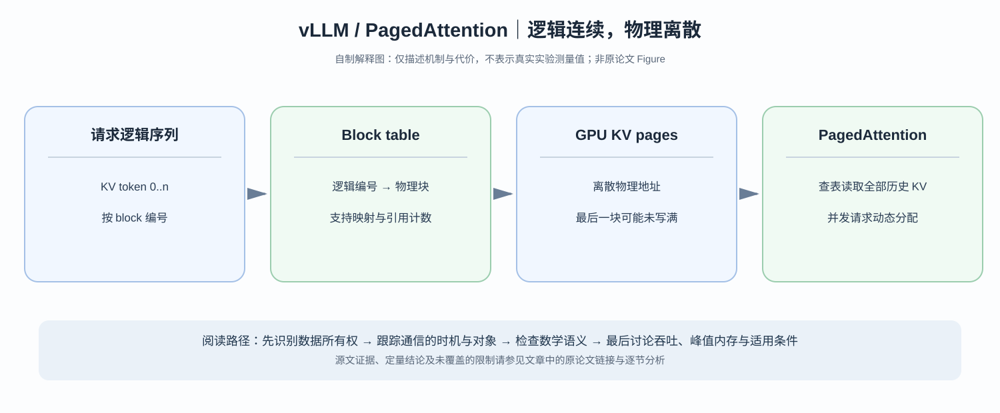

# vLLM / PagedAttention：推理过程中为什么不该为每个请求预留连续的 KV Cache？

> **原论文**：Kwon 等，[Efficient Memory Management for Large Language Model Serving with PagedAttention](https://arxiv.org/abs/2309.06180)，SOSP 2023；[ACM 正式论文 DOI](https://doi.org/10.1145/3600006.3613165)，[作者团队官方技术介绍](https://vllm-project.github.io/2023/06/20/vllm.html)。
> **类型**：C · 在线推理系统与 KV Cache 内存管理。**核心问题**：权重固定、请求长度不可预测的自回归生成服务，为何不能直接给每个请求分配一条连续的显存区域？

## 阅读导航：从训练内存管理来到推理内存管理

之前读过 [ZeRO](C002-zero.md) 与 [ZeRO-Infinity](C009-zero-infinity.md)，知道训练显存会被 parameters、gradients、optimizer states、activations 占满；在推理侧，gradients 和 Adam states 通常不存在。现在的动态状态变成**每个请求不断增长的 KV Cache**。

[DeepSeek-V2 / MLA](../../B/05-moe-complete-llm/B008-deepseek-v2.md) 通过降低每 token 缓存的状态维度缩小 KV 总容量；PagedAttention 解决的是另一维问题：**KV 逻辑序列虽然连续，物理显存可否不连续？**

*自制解释图，非原论文 Figure。可与 [vLLM 作者官方文章的图示](https://vllm-project.github.io/2023/06/20/vllm.html) 对照。*

## 一、为什么 KV Cache 是动态的？

在自回归 Transformer 解码时，第 $t$ 个新 token 的 Query 要与历史所有 token 的 Key/Value 做 attention。为避免每次 decode 重跑全部历史 K/V projection，系统把每层历史 tokens 的 K/V 缓存在显存。

以标准 MHA、每 token 两套 K/V 缓存为例，近似：

$$
M_{\rm KV}(t)
=
2Ltn_hd_h\,b_{\rm dtype},
$$

其中 $L$ 为层数、$n_h$ 为 KV heads 数、$d_h$ 为单 head 维度、$b_{\rm dtype}$ 为每元素字节数。

例如 $L=32,n_h=32,d_h=128,$ FP16：

$$
M_{\rm KV}(t)
=2\cdot32\cdot t\cdot32\cdot128\cdot2
=524288t\text{ bytes}.
$$

即 1 token 约 0.5 MiB 的 KV。若 $t=2048$，单请求 KV 约 1 GiB；如果同时有 32 个请求，理想实占就能达到约 32 GiB，还未计权重与 workspace。

注意不同模型的 GQA、MQA、MLA 与 KV quantization 会改变每 token 实际成本，上式不是所有现代模型的通用实测。

最难管理的是**长度未知**：请求 prompt 和输出总 token 数可能差很大，还可能提前停止、beam fork 或并行生成。

## 二、提前分一大块连续区域会浪费在哪里？

假设服务系统给每条请求保守预留最大长度 $T_{\max}=4096$ tokens 的 KV 空间，可实际请求只生成到 512。

它的**预留容量与实际需要**之比：

$$
\frac{4096}{512}=8.
$$

浪费并不意味着显存数据真的写满了，而是**预留/内部碎片导致其他请求无法使用这些可用容量**。再加上请求结束引发的物理地址空洞，传统连续分配还可能形成外部碎片。

因此在线服务的关键指标不只是每 token 的 bytes，还包括：

$$
\text{KV 实用字节}
\;/\;
\text{KV 已分配字节}.
$$

单请求的预留策略如果让这个比率持续很低，就会减少可同时运行的请求数量，从而降低服务吞吐。

## 三、PagedAttention 的核心：逻辑连续，物理离散

设每个 KV block 容纳 $B_k$ 个 tokens。例如取 $B_k=16$：

逻辑序列第 $t$ 个 token 属于：

$$
\text{logical block}=\left\lfloor\frac t{B_k}\right\rfloor,
$$

$$
\text{offset}=t\bmod B_k.
$$

每个请求维护 block table，将**逻辑 block 编号**映射到显存中的某个**物理 KV block 地址**。比如：

| 逻辑 block | 0 | 1 | 2 | 3 |
|---|---:|---:|---:|---:|
| 物理 block ID | 42 | 7 | 109 | 16 |

这些物理 block 无需在 HBM 中相邻。Attention kernel 根据 block table 读取对应 K/V，逻辑上仍然等价于读取连续的历史 token KV。

这套思想借鉴了操作系统的 paging，但不能照字面将 GPU cache 当作常规 CPU 虚拟内存替代品：PagedAttention 的逻辑表格、kernel 索引和内存分配由推理 runtime 协同完成，不意味着由 OS page fault 自动接管 KV。

## 四、为什么这种方案显存浪费主要出现在最后一块？

如果一条请求实际有 $t$ tokens，按固定块大小 $B_k$ 需要：

$$
N_{\rm blocks}
=\left\lceil \frac{t}{B_k}\right\rceil.
$$

申请的物理容量等于 $N_{\rm blocks}B_k$ tokens 对应的空间。未用部分最多为：

$$
0\le
N_{\rm blocks}B_k-t
\le B_k-1.
$$

所以 PagedAttention 的内部浪费主要集中于请求的**最后一个部分未满 block**，而不是整条序列按最大长度预留。在忽略 block table、allocator 和其他 workspace overhead 的情况下，单请求的空间利用率是：

$$
\eta
=
\frac{t}{B_k\left\lceil t/B_k\right\rceil}.
$$

例如 $t=33,B_k=16$：

$$
N_{\rm blocks}=3,\quad
\eta=\frac{33}{48}\approx68.75\%.
$$

虽然这个很短的请求浪费仍明显，但当 $t$ 很长时，不满 16-token 尾块的比例通常很低。官方博客报告其实测中 KV 显存浪费可降低到约几个百分点；这是具体 workload 上的结果，不能说理论上永远小于 4%。

## 五、共享 KV Cache：为什么还要有引用计数与 Copy-on-write？

同一个 prompt 可以派生多个采样分支（例如 parallel sampling / beam search）。它们最初的 prefix tokens 相同，Key/Value 也相同，没理由为每个分支立即复制一份完整 prefix KV。

PagedAttention 允许多个逻辑请求的 block tables 指向相同物理 KV blocks，并使用引用计数管理共享。若有 $k$ 个分支、共享 $t$ 个 prefix tokens，连续复制的 prefix 大致需 $kM_{\rm KV}(t)$，而共享方案接近：

$$
M_{\rm shared-prefix}
\approx
M_{\rm KV}(t)
+
M_{\rm branch-specific}.
$$

真正需要更新共享物理块中的内容时，使用 **Copy-on-write** 分离分支，防止一个请求写入影响另一个请求。

这不是改变解码输出分布的数学近似，而是**相同历史缓存的内存所有权共享**。若请求的计算图、位置编码或注意力策略不同，不能盲目认为 prefix KV 可共享。

## 六、为什么吞吐与调度密切相关？

给定有限 HBM，能够同时在 GPU 上运行的请求数量受到 KV cache memory 约束。

若有效使用率提高，同样的 KV memory budget 可以容纳更多真实活跃 token。continuous batching 可以持续把新请求合入一个不断变化的 decode batch，而非等上一整批全部结束。

于是系统 throughput 受：

- KV block allocator 与回收速度；
- 每轮 active sequences 和 token 数；
- PagedAttention kernel 访存效率；
- prefill/decode 的计算/带宽比例；
- request scheduler 是否合理；

共同决定。

因此“PagedAttention 提升吞吐”并不意味着一个单独 Attention kernel 的 FLOPs 必然比 contiguous KV 更少。论文的重要收益来自**更高显存利用率允许更大有效 batch**。

## 七、原始实验到底支持什么？

SOSP 2023 论文报告在其指定 workload、延迟约束和比较系统上，vLLM 相对 FasterTransformer、Orca 等基线能得到约 **2–4 倍**的服务吞吐改进。应检查模型规模、输出长度分布、采样模式、prefix sharing 场景与 latency 限制；不能当成今天任何模型上的普适倍率。

作者官方文章特别强调浪费来自 fragmentation 和提前预留的动态 KV 空间。它没有声称解决所有 GPU 推理瓶颈：长 prefill、模型权重过大、跨节点流水和 kernel 低效依然可能决定性能。

## 八、从 PagedAttention 回到 MLA、GQA 与推理系统整体

**KV Cache 状态大小**和**KV Cache 的物理管理**是不同的两层设计：

- [GQA](../../A/04-efficient-attention/A020-gqa.md)：用更少 KV heads 让每 token 的缓存状态变小。
- [DeepSeek-V2 / MLA](../../B/05-moe-complete-llm/B008-deepseek-v2.md)：用压缩 latent 和 RoPE 解耦改变缓存表示。
- **PagedAttention**：用块表、按需分配与共享减少 KV allocation 的空间浪费。

这三种机制并不互相取代。它们解决的分别是**张量语义/表示规模**与**运行时物理存储管理**。

对系统论文最值得记住的一句话是：

> 静态模型参数的分片与训练状态迁移，不等于动态推理请求的 KV 空间管理。动态长度、分支共享、请求中止和调度，要求把“逻辑上的连续 KV”与“物理上的非连续显存”彻底分开。

**来源**：[SOSP 2023 论文](https://arxiv.org/abs/2309.06180)、[ACM DOI](https://doi.org/10.1145/3600006.3613165)、[vLLM 官方机制说明](https://vllm-project.github.io/2023/06/20/vllm.html)。
