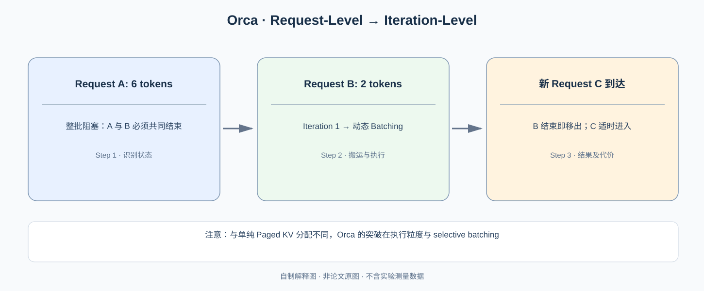

# Orca：为什么生成服务必须按“每轮 Token”而不是按“整个请求”调度？

> **原论文**：Yu 等，[Orca: A Distributed Serving System for Transformer-Based Generative Models](https://www.usenix.org/conference/osdi22/presentation/yu)，OSDI 2022。**类型**：C · 大模型在线服务系统。核心不是新 Attention 公式，而是 **iteration-level scheduling + selective batching**。

## 从 vLLM 回到“请求究竟是什么”

### 从原始 Figure 1 看出为什么“只换调度器”还不够

[Orca OSDI 2022 原始论文 §2 与 Figure 1](https://www.usenix.org/system/files/osdi22-yu.pdf) 将一个生成请求拆为 **Initiation Iteration**（处理整个 Prompt）及后续每次仅输入新 Token 的 **Increment Iterations**。如果传统 Batching 把整个请求生命周期绑定在一个 Batch 内，而 A 要输出 6 Token、B 要输出 2 Token，则 B 结束后仍可能占着批处理生命周期，后到达的 C 也必须等待 Batch 全部结束才能加入。

Iteration-level Scheduling 的调度点位于**每一次模型迭代之后**：本轮结束即可移除已完成请求并让待处理请求加入下一轮。但这时仍有一个张量形状的问题：即使 A/B/C 在同一轮执行，它们的历史长度和 Attention KV 不同。对需要按请求历史维度处理的 Attention，强行 Padding 到所有请求最长长度会浪费算力和缓存；对没有请求历史维度依赖的 FFN/Linear 等算子，仍应合并 Batch 复用模型 Weight。

这就是作者称为 **Selective Batching** 的第二项必要设计：有些 Operator 以请求为单位执行，其他 Operator 仍然跨请求并行。不是把所有计算拆成独立请求，更不是“Attention 不能并行”——Attention 可以在每个请求内部以其合法 Key 长度优化，只是不应该盲目复制同样尺寸的 Padding Batch。

### 以三个请求手算浪费与收益边界

若三个请求历史长度分别为 4、16、32，简单 Padding 到最长 32，Attention 需要处理的 Key Slot 是 $3\times32=96$；按各自真实长度只需 $4+16+32=52$，理想少了 44 个无效 Slot，约 **45.8%** 的 Key 位置。这个计数不等于完整 Attention Kernel 的 45.8% 实测加速——请求级 Launch、Tensor Core 形状、模型 FFN 和调度重叠仍会占用时间。

作者在 OSDI 2022 的端到端服务实验报告对 FasterTransformer 特定配置最高 36.9× 吞吐优势；这一巨大倍率同时来自 Request Scheduling、Batch 利用率和执行系统差异，不能将它转写为 Selective Batching 这一个操作独立带来的提升。Figure 1 验证模型迭代语义，端到端实验才支持吞吐。

[上一篇 vLLM / PagedAttention](../01-distributed-training/C012-vllm-pagedattention.md) 告诉我们，多个请求长度不同、不断增长的 KV Cache 无须物理连续存储。然而内存装得下，并不意味着 GPU 调度得合理。假设服务同时收到两个请求：A 需要继续生成 6 个 Token，B 只需要 2 个。如果把它们作为一个不可改变的 batch 一口气执行完，B 很早已经结束，却可能仍在等待 A 完成，之后到达的 C 也难以进入当前批次。

传统深度学习 inference 常习惯 **request-level batching**：收集固定数量请求 → 执行 → 全部结束后返回。它适合一次 forward 就能得到结果的分类，却不自然适合生成。生成任务的完成时间不确定，而且每轮只追加很少的 Token。这是 Orca 进入论文的问题起点。

*自制解释图，非原论文 Figure。原论文的调度时间线与系统结构请见 [OSDI 官方论文](https://www.usenix.org/conference/osdi22/presentation/yu) 中的设计图；示意图只说明所有权变化，不用图中槽位长度代表测量时间。*

## 一、先算清请求级调度究竟浪费什么

设一个 decode iteration 的平均耗时为 $\tau$，批次内请求 i 需要生成 $n_i$ 个 Token。在纯串行模型下，每条请求需要 $n_i\tau$；固定 batch 的系统是否使某请求提前完成还要取决于返回逻辑与执行引擎。

Orca 关注的是两类 *head-of-line blocking*。其一是**已完成请求仍受最长请求限制，完成返回不及时**；其二是**刚来的请求要等本批全部完成才能得到执行机会**。注意多请求 batching 仍然有很大价值：各请求一起走同一个 GPU GEMM，可能提高利用率。直接让每个请求独占计算流并非解决之道。

真正要改的不是“是否 batch”，而是 **batch 的成员是否允许每一步改变**。

在 iteration-level scheduling 中，scheduler 每次仅要求执行引擎处理当前参与请求的**一个 decode iteration**，然后重新检查完成、新到达、内存与调度优先级。

举例：

| 轮次 | 参与批次 | 迭代后发生什么 |
|---|---|---|
| 1 | A、B | A/B 各产生 1 Token |
| 2 | A、B | B 达到结束条件，立即移出 |
| 3 | A、C | C 此时已到达，被允许进入 |
| 4 | A、C | A 与 C 继续独立维护各自状态 |

这只是解释性假设，实际 admission 还受 KV memory、batch size、模型并行组和已到达 request 的状态制约。Orca 的思想是每轮使新的批次成员集合：

$$
\mathcal B_{t+1}
=
\left(\mathcal B_t\setminus\mathcal F_t\right)
\cup \mathcal A_t,
$$

其中 $\mathcal F_t$ 是已结束请求集合，$\mathcal A_t$ 是本轮被允许进入的新请求集合。这个集合公式是辅助解释，非原论文的 scheduler 形式定义。

## 二、为什么不能将所有算子“无脑一起 Batch”？

Transformer 算子执行一个新 Token 时可以分成**序列长度无关的操作**与**受单请求历史长度影响的操作**。

对一个 decode Token，典型线性投影：

$$
Q=XW_Q,\quad K=XW_K,\quad V=XW_V
$$

可以把多请求的当前 Token rows 组合成一个 Batch 一起做矩阵乘法。对它们来说，每个请求输出维度一致；这有利于 GPU 利用率。

但 Attention 需要读取请求 $i$ 的历史：

$$
O_i(t)=
\operatorname{softmax}
\left(\frac{q_i(t)\,K_i(1{:}t)^\top}{\sqrt d}\right)
V_i(1{:}t).
$$

各请求长度和 KV 地址不同。若强行 padding 到本批最长长度 $L_{\max}$，浪费近似为：

$$
R_{\rm padding}
=
1-\frac{\sum_i L_i}{|\mathcal B|L_{\max}},
$$

注意这只是 pad 的**张量长度比例**，实际 FLOPs 取决于 kernel 如何跳过 padding、使用什么注意力布局。

Orca 的 **selective batching** 思路是对可以一起批处理的操作进行 batch，对 Attention 等有不同 request-specific state 的操作保持适合它的执行方式。重点是**选择哪些算子批处理**，而非每一个 Transformer 层都用相同的 batching 策略。

以长度 $L_A=1024,L_B=64$ 为例，纯 padding 到 $1024$ 的历史长度时：

$$
R_{\rm padding}
=1-\frac{1088}{2048}
\approx46.9\%.
$$

这是一个足够让人警觉的数值：固定长度矩阵看起来整齐，却在 Attention 中处理了很多无意义的位置；而当前 Token 的 MLP 仍可对 A/B 合并执行。

## 三、迭代调度如何接入 Model Parallelism？

Orca 并不只有一个单 GPU queue。原论文面向非常大的 Transformer，执行引擎需要在模型并行服务器之间管理同一个 iteration 的任务：

$$
\text{Scheduler}
\;\to\;
\text{批次/迭代计划}
\;\to\;
\text{模型并行 workers}
\;\to\;
\text{输出 / 更新状态}.
$$

关键是要保证各个 model-parallel workers 在同一时间消费的是**兼容的批次顺序**。如果 GPU 0 将请求 C 插入 batch，但 GPU 1 仍在使用旧的 A/B 索引，Attention cache 和计算结果便会错位。因此 scheduler 具有全局协调的语义，不能靠各卡独立插入请求。

从 [Megatron-LM](../01-distributed-training/C004-megatron-lm.md) 一路研究到这里，应该区分 **pipeline training scheduler** 与 **autoregressive serving scheduler**：训练有 forward/backward 依赖和梯度同步；推理只有 forward 以及持续增长的 KV。两者虽然都谈流水线，但数学正确性约束不同。

## 四、Orca 与 PagedAttention 到底谁解决谁的问题？

**Orca**：解决 *何时* 执行哪批请求、怎么按迭代重组 batch，以及不同算子的选择性批处理。

**PagedAttention / vLLM**：解决 *在哪里* 给不同长度的请求存 KV、如何按需分配 block 与共享 prefix。

一个调度器即使允许 C 插队，如果 GPU memory 因为 KV 预留和碎片化已经占满，也不能真正添加 C；一个完美的分页 allocator 如果执行批次永远不变化，也不能消除新请求等待。现代系统需要两者同时成立。

## 五、实验与作者论证边界

OSDI 2022 论文在 GPT-3 175B 的系统环境与给定对照条件下，报告对 FasterTransformer **同延迟水平约 36.9 倍吞吐提升**。这个倍率主要支持论文的具体 batch/scheduling 实现对**其选定系统配置**有很大作用；不能说“iteration scheduling 对今天任何 GPU 比任何服务端都快 36.9×”。

阅读原论文时最值得核对的是 **request arrival rate、生成长度分布、batch 数量和 latency percentile**。静态分类模型的 throughput 指标不能直接搬到生成服务；而“吞吐更高”如果伴随长尾请求显著延迟，也不一定符合业务目标。

论文论证路线是：传统 request-level batching 为什么不适合 *unknown-length generation* → iteration-level scheduling 怎样允许细粒度进入/离开 → selective batching 为什么补充了计算有效性 → model-parallel deployment 与实测。这个顺序说明：**调度语义与算子批处理不是同一项贡献**。

接下来进入 [Sarathi-Serve](C014-sarathi-serve.md)：Orca 可以每轮调整 batch，但一个超长 prompt 的 **Prefill** 仍可能占住 GPU，使已经在 Decode 的请求停顿。如何限制每轮计算量，才是下一道题。

**原论文与后续**：[OSDI 2022 正式论文](https://www.usenix.org/conference/osdi22/presentation/yu)、[vLLM / PagedAttention](../01-distributed-training/C012-vllm-pagedattention.md)、[Sarathi-Serve](C014-sarathi-serve.md)。
