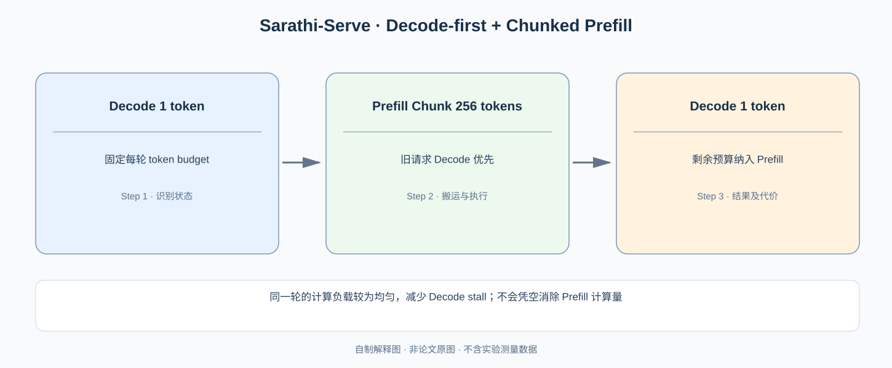

# Sarathi-Serve：为什么把 Prefill 切块，就能减少 Decode 的排队抖动？

> **原论文**：Agrawal 等，[Taming Throughput-Latency Tradeoff in LLM Inference with Sarathi-Serve](https://www.usenix.org/conference/osdi24/presentation/agrawal)，OSDI 2024。**类型**：C · 在线服务调度。核心设计是 **chunked-prefills + stall-free scheduling**，不是改变 Transformer 结构。

## 一、Orca 的迭代级调度还缺少什么？

从 [Orca](C013-orca.md) 继续：我们已允许请求在不同 decode iteration 动态加入、退出；而 [vLLM / PagedAttention](../01-distributed-training/C012-vllm-pagedattention.md) 又让动态 KV 分配更可控。现在出现两种迥异的 forward workload：

- **Prefill**：一次输入长 Prompt，GPU 要处理成百上千个 Token，GEMM 计算工作量较大，能更好利用 Tensor Core。
- **Decode**：每条请求每轮只生成一个 Token，但要读取历史 KV，尤其在低并发和长上下文时通常受到带宽影响。

若在某一轮 batch 中突然插入有 $L=8192$ Token 的 Prefill，原来每轮只需处理 16 个 decode tokens 的请求也可能要等这一轮处理完 8192 Token 的 prefill，造成 **time-between-token (TBT) / TPOT 抖动**。

*自制解释图。原论文的请求时间线与 Token budget 示例请见 [OSDI 官方页面](https://www.usenix.org/conference/osdi24/presentation/agrawal) 中 Figure 7 / Algorithm 3。*

## 二、把长 Prompt 切块，为什么还能算出相同的 Attention？

令提示词序列为 $x_1,\ldots,x_S$，对于 Causal Transformer，第 $i$ 个位置的输出仅依赖前缀：

$$
h_i^{(\ell)}
=f_\ell\left(h_{\le i}^{(\ell-1)};\theta_\ell\right).
$$

对于一个长度 $S$ 的 Prompt，可按 $C$ 个 Token 一块分：

$$
[1,C],[C+1,2C],\ldots .
$$

当计算第二个 Chunk 时，缓存第一个 Chunk 的 K/V；这样第 $C+1$ 个 Token 仍然能访问所有 $\le C+1$ 的 Key/Value，而不是只能在自己的 Chunk 内做局部 Attention。采用正确的 absolute/rotary position、causal mask 和 KV 更新顺序时，chunked prefill 是对**执行切分**，并不通过丢弃历史 token 来降低 Attention 定义的可见范围。

例如 $S=1024,C=256$：

$$
n_{\rm chunks}=\left\lceil\frac{1024}{256}\right\rceil=4.
$$

Attention 的总 token-pair 计算并未神奇地变成线性；在不同 Chunk 内对历史 K/V 仍要计算。它改变的是**长 Prefill 的计算何时进入哪些 iteration**。

### Chunked Prefill 和滑动窗口 Attention 不是同一技术

滑动窗口仅允许每个 Query 看最近 $W$ 个 Key，改变数学可见范围。Chunked Prefill 只是先算一部分，再基于历史 KV 继续；在正确实现下仍是 exact causal attention。这个差别决定它能否不重新训练直接应用原模型。

## 三、每轮设置 Token Budget，旧请求为什么不被长 Prompt 阻塞？

设 GPU 在一次调度 iteration 中允许的**最大计算 Token Budget**为 $B$；已经运行的 Decode 请求共有 $D$ 个，每个本轮需处理 1 Token。调度器先保留：

$$
T_{\rm decode}=D.
$$

可供 Prefill 的剩余预算：

$$
\boxed{T_{\rm prefill}\le \max(0,B-D).}
$$

若有 $D=20,\ B=256$，最多纳入约 $236$ 个 prefill tokens。一个 Prompt 长度 1500，不再作为一次 1500-token 的巨大 prefill 进入，而分散到后面多个 iteration；每一轮旧 decode 请求先拿到一个 Token 的执行机会。

这是对原论文 **decode-first / stall-free scheduler** 的概念抽象，具体 admission 还需考虑 KV memory、prefill 阶段已完成的块、不同请求相对优先级以及离散 block/kernel 颗粒度。

可以把一次迭代的选择写成：

$$
\mathcal B_t=
\underbrace{\mathcal D_t}_{\text{优先容纳 running decode}}
\;\cup\;
\underbrace{\mathcal P_t^{(\le B-|\mathcal D_t|)}}_{\text{用剩余预算装 prefill chunks}}.
$$

固定每轮大致总 Token 工作量还有额外价值：当使用 Pipeline Parallelism 时，某一 stage 不会突然得到非常重的一轮，而其他 stage 等待；**批次计算形状更均匀**，更有利于减少 pipeline bubbles。但这不是严格恒定执行时间，因为 Prefill/Decode 的算术强度和 attention 历史长度都不同。

## 四、为什么说“没有 Stall”是有条件的？

一旦 $D\ge B$，运行中的 decode tokens 已经用光调度预算，新的 prefill 只能继续等待。如果网络拥塞、GPU 极忙或者极端长序列历史 KV 超过缓存预算，Decode 延迟仍可能升高。因此“stall-free”是相对传统 Prefill 对现有 Decode 的**人为长时阻塞**，不是数学保证 TPOT 永远固定。

另一个重要取舍：较小的 Chunk 有利于 Decode 的稳定低延迟，却把一段长 Prefill 拆成更多次 Kernel 调用并增加运行时调度。过小 chunk 可能导致 GPU compute utilization 下降；过大 chunk 则重新引入 decode stall。最优 $B$ 依赖服务 SLO、请求长度分布、GPU 与 pipeline depth。

### 与 DistServe 有何原则性差别？

Sarathi-Serve 仍让 Prefill 和 Decode 使用**同一批或同一组 GPU**，通过 Scheduler 的颗粒度做时间复用。[DistServe](C015-distserve.md) 则直接给两阶段配置**不同 GPU 池**，用空间隔离消除干扰，但必须搬运 KV 状态。

## 五、原论文到底证明了什么？

OSDI24 给出了在指定 tail latency constraint 下的 serving capacity 对比：单张 A100、Mistral-7B 案例提高约 **2.6×**，双 A100、Yi-34B 案例最高 **3.7×**，采用 Pipeline Parallelism 的 Falcon-180B 配置最高约 **5.6×**。这些对比对应各自的模型、基线、长度分布和 SLO；不应把最大的倍率写成“所有配置提升五倍”。

注意实验测量的是**受时延约束的可服务负载**，不是只测空闲 GPU 上一次 forward 的 kernel latency。适当地 chunk prefill 可能使原本在严格 TPOT 下不能接收的更多请求进入，从而增加总吞吐，但这并不表示每个 Prefill 必然完成得更快。

作者在论文中先用 Prefill 与 Decode 的单轮执行时间差制造“为何调度被卡住”的情境，再引入 Token budget 和 stall-free scheduling，最后考察 pipeline throughput。最值得注意的论证是：**服务调度应按当轮工作量而非只有请求数量约束**。

**依赖与下一跳**：[Orca](C013-orca.md) → [Sarathi-Serve](C014-sarathi-serve.md) → [DistServe](C015-distserve.md)。[原论文 OSDI24](https://www.usenix.org/conference/osdi24/presentation/agrawal)。
