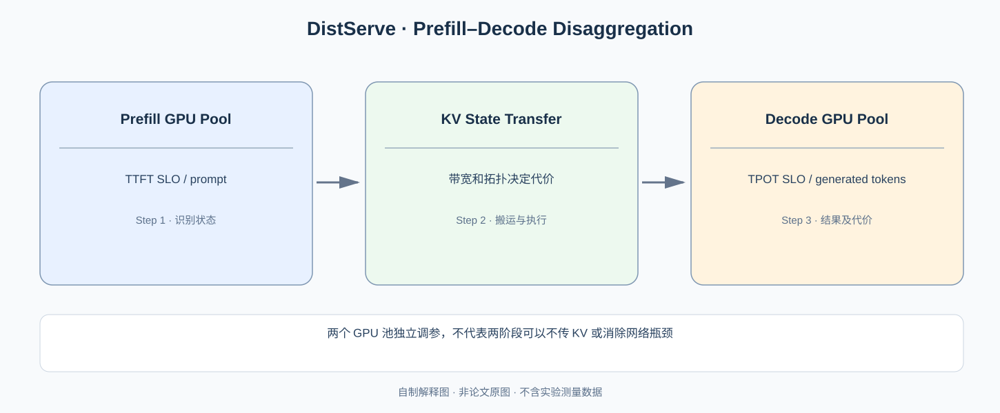

# DistServe：Prefill 与 Decode 为什么值得放到不同的 GPU 池？

> **原论文**：Zhong 等，[DistServe: Disaggregating Prefill and Decoding for Goodput-optimized Large Language Model Serving](https://www.usenix.org/conference/osdi24/presentation/zhong-yinmin)，OSDI 2024。**类型**：C · 分离式推理服务。关键目标是**同时满足 TTFT 和 TPOT 的 Goodput**，而不是单纯最大化每秒 Token。

## 一、同一 GPU 上的两个阶段在争夺什么？

### 从原论文 Figure 2 读出两种方向的相互干扰

[DistServe OSDI 2024 arXiv:2401.09670 §2.3 Figure 2](https://arxiv.org/pdf/2401.09670) 分别测量在一批 Decode 任务中插入一个 Prefill、以及在 Prefill 中插入一批 Decode 的情形。前者的观察对象是 Decode TPOT 延迟恶化：一个长度较大的 Prefill 会占用整轮 GPU 执行时间，Decode 无法按其原本短步节奏及时输出 Token。后者则使 Prefill TTFT 因共享 GPU 竞争而上升；原文明确提示这两项指标之间存在 Trade-off。

若优化目标只设“GPU Token/s 最大”，批处理可以偏向长 Prefill 来填满计算单元，却导致交互请求的 TPOT 很差；若优先保证每个 Decode Step，可能让新的长 Prompt TTFT 超标。因此 DistServe 改用同时满足两个阶段服务目标的 **Goodput**，不等于传统累计 Token Throughput。

形式化地，设第 $i$ 条请求的 TTFT 为 $t_i^{\rm first}$，第 $j$ 个输出 Token 的时间差为 $t_{ij}^{\rm gap}$，两个服务阈值分别为 $\tau_f,\tau_p$，则用于理解的合规计数是

$$
G=\frac1{\Delta t}\sum_{i\in\text{completed during }\Delta t}
\mathbf1\left[t_i^{\rm first}\le\tau_f\ \land\
\operatorname{TPOT}_i\le\tau_p\right].
$$

这是为说明 Goodput 定义的教学表达，实际论文里的 TPOT 统计口径、Percentile/SLO 条件和到达率需据其 Evaluation 配置理解。它区分“完成很多请求”和“完成且满足交互延迟的请求”。

分池之后仍有一个不可隐藏的下界：Prefill GPU 算出长度 $S$ 的 KV 后，必须把相应状态交给 Decode GPU。若迁移为 $M_{\rm KV}$ Byte、有效链路带宽 $B_{\rm eff}$，网络传输下界为 $M_{\rm KV}/B_{\rm eff}$。把两阶段放到不同服务器可能消除 GPU 资源干扰，却带来网络排队与传输；所以原论文同时做 Phase Placement 和资源/并行度优化，不是随便给两种 GPU 分组就得到更高 Goodput。

从 [Sarathi-Serve](C014-sarathi-serve.md) 知道可以将一个长 Prefill 切分进多个 Iterations，限制 Decode 的等待。但 Prefill 偏计算，Decode 偏带宽，它们对硬件资源与并行策略的最佳选择仍可能不同。

一个模型服务请求包含：

$$
\text{Prompt}
\xrightarrow{\rm Prefill}
\text{首个 Token}
\xrightarrow{\rm Decode\ iteration}
\text{后续 Tokens}.
$$

系统层通常记录两项延迟：

- **TTFT（Time to First Token）**：从请求进入系统到首个输出 Token 返回，包含 queue、Prefill 和首次输出路径。
- **TPOT（Time Per Output Token）**：后续 Token 的平均时间（有时使用 TBT/ITL 作为相近但不完全相同指标）；需要留意评估中是否包含首个 Token 或采用百分位定义。

当 Prefill/Decode 混合在一个 GPU 池时，为 Prefill 选择的 batch/TP 参数可能不适合 Decode；反之，为 Decode 的 TPOT 约束保守限制 Prefill，也可能浪费 GPU compute。

*自制解释图，非原论文 Figure。请结合 [OSDI 论文](https://www.usenix.org/conference/osdi24/presentation/zhong-yinmin) 中的 GPU 资源划分和网络拓扑图理解。*

## 二、空间隔离为什么可以减少干扰？

DistServe 将系统分成：

$$
\mathcal G_P:\text{ Prefill GPUs},
\qquad
\mathcal G_D:\text{ Decode GPUs}.
$$

只在 $\mathcal G_P$ 执行 Prompt 计算，在 $\mathcal G_D$ 执行后续 Token 生成。一条请求完成 Prefill 后，需要把该请求产生的 **KV Cache 和必要运行状态** 传给 $\mathcal G_D$。这意味着两阶段可以分别选择最合适的 GPU grouping、parallelism 和 batching policy。

这个设计真正隔离的是一类 GPU 计算资源争用：

$$
T_{\rm hybrid\ iteration}
\not=
T_{\rm prefill\ isolated}+T_{\rm decode\ isolated}
$$

的固定简单关系；当混合调度扰乱持续生成时，TPOT 可能显著增加。分离后，Decode 不必等待来自 Prefill 同池的大块计算才能开始自己的迭代。

但“无互相干扰”也不是字面上完全零干扰：如果两 GPU 池共享存储或互联，KV 传输与其他请求仍可能相互竞争网络资源。

## 三、Goodput 和 Throughput 为什么不是一个指标？

假设服务器一秒实际完成 100 个请求，但其中只有 60 个在合同要求的 TTFT/TPOT 约束内完成。若业务明确只计合格完成，则：

$$
\text{Throughput}=100\ \text{requests/s},
$$

$$
\text{Goodput}=60\ \text{SLO-satisfying requests/s}.
$$

可以一般性地定义：

$$
G(\lambda)=
\lambda\Pr\big[
\operatorname{TTFT}\le S_P
\;\land\;
\operatorname{TPOT}\le S_D
\big],
$$

其中 $\lambda$ 是实际接受并执行的到达速率，$S_P,S_D$ 是业务 SLO，概率对请求长度与到达分布取平均。具体文献中的 Goodput/attainment 判定可能采用 percentile target 和比例门槛，读实验应以原论文定义为准。

因此一个系统通过把很多请求一拥而上使吞吐更高，但如果大多数请求输出卡顿，Goodput 可以更差。DistServe 优化的不是单纯 **peak token/s**，而是给定 SLO 的可服务请求速率。

## 四、分离之后必须支付什么代价？

如果采用 FP16 KV，标准 MHA 的一个请求上下文长度为 $S$，每层 $n_{kv}$ 个 KV heads、head size $d$、总 $L$ 层，则一次阶段交接需要传输的 KV 量级：

$$
\boxed{M_{\rm KV}=2LSn_{kv}d\cdot b_{\rm dtype}}.
$$

例如：$L=32,S=2048,n_{kv}=8,d=128,b_{\rm dtype}=2$：

$$
M_{\rm KV}
=2\cdot32\cdot2048\cdot8\cdot128\cdot2
=268435456\ {\rm bytes}\approx256\ {\rm MiB}.
$$

这说明单条请求的一次 KV 交接就可能相当可观。具体模型若采用 MLA、KV quantization、跨 TP shard 传输，尺寸会不同。阶段迁移时还需考虑消息数量、序列化、不同 GPU grouping 的重分片等成本。

于是可以写一个工程候选条件：

$$
\text{减少的 GPU 混合干扰代价}
>
\text{新增的 KV 迁移与排队代价}.
$$

这不是定量证明，而是架构决策必须测量的交换。论文因此提出根据带宽拓扑联合决定 **Prefill/Decode 如何放置**。如果需要跨越低带宽节点互联搬一个很长的 KV，就可能抵消收益；若两个池部署在高速相连的 GPU 组上，就更有机会兑现解耦。

## 五、为什么两个池能用不同并行配置？

Prefill 长矩阵运算的计算形状与 Decode 的单步访问不同。Prefill 可能偏向提高 GEMM 吞吐的 TP/Batch 组合，而 Decode 关注 KV 容量与每步延迟；二者用同一个 TP/PP degree 不一定最佳。

设共有 $N$ 张 GPU，给 Prefill 分配 $N_P$ 张，Decode 分配 $N_D$ 张：

$$
N_P+N_D=N.
$$

选择时要满足两边的工作负载稳定性：

$$
\rho_P<1,\qquad \rho_D<1,
$$

这里 $\rho_i$ 为相应处理池的有效利用率/负载比，是**队列理论的近似讨论**而非论文公开的优化器精确约束。若一边 GPU 太少，就会产生长队，即使另一边仍空闲也没法轻松替它执行阶段任务。

所以 disaggregation 能**解耦两阶段参数选择**，同时新增**容量规划、KV 传输和阶段间背压**问题。

## 六、实验与证据边界

OSDI 2024 论文在多种模型、应用和 SLO 下报告：与所选最佳比较系统相比，DistServe 在保持超过 90% 请求满足延迟条件的场景中，可支持 **7.4×** 请求速率，或者在某些对照中满足 **12.6×** 更严格的 SLO。两种数字对应不同评价角度，不能合并成“同时快 7.4 倍且时延缩短 12.6 倍”。

更不能把 Goodput 倍率当成两个 GPU 池里每个 Token 的 GEMM 计算速度提升。变化来自分阶段资源配置、干扰隔离与放置优化，必须在真实 SLO 下比较。

接下来读 [Splitwise](C016-splitwise.md)：既然两个池的计算特征不同，**为什么还都必须使用同一代/同一种 GPU？** Splitwise 把研究目标拓展到硬件价格、功率与系统成本。

**原始论文**：[OSDI 2024](https://www.usenix.org/conference/osdi24/presentation/zhong-yinmin)；[Sarathi-Serve](C014-sarathi-serve.md)、[Splitwise](C016-splitwise.md)。
