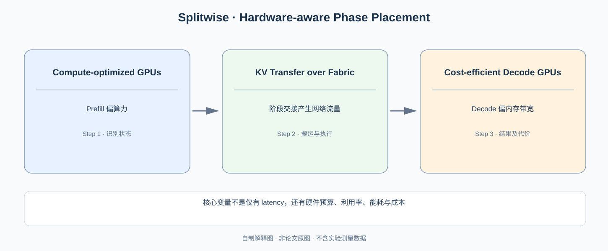

# Splitwise：Prefill 和 Decode 的瓶颈不同，为什么要用同一种 GPU？

> **原始论文**：[Splitwise: Efficient Generative LLM Inference Using Phase Splitting](https://www.microsoft.com/en-us/research/publication/splitwise-efficient-generative-llm-inference-using-phase-splitting/)，Patel 等，ISCA 2024。**类型**：C · 异构部署与硬件成本系统。与 [DistServe](C015-distserve.md) 相比，本篇重点是**不同阶段的价格/功耗/算力与硬件选型**。

## 一、阶段分离之后还存在一个设备采购问题

[DistServe](C015-distserve.md) 已经把 Prefill 和 Decode 分给不同 GPU 池，通过移动 KV 消除同池干扰。但如果两个阶段用同样昂贵的 GPU，可能不是成本最优。Prefill 需要处理完整 prompt，许多 GEMM 计算密度较高；Decode 每个请求每轮生成少量新 Token，往往更受 KV/权重访存与 GPU 实际吞吐利用率影响。

*自制解释图，非论文 Figure。数据流和原始硬件功率对比请见 [ISCA 正式论文入口](https://www.microsoft.com/en-us/research/publication/splitwise-efficient-generative-llm-inference-using-phase-splitting/)。*

先写 Roofline 上界：

$$
P_{\mathrm{achieved}}\le\min(P_{\mathrm{peak}}, I B_{\mathrm{HBM}}),
\qquad I=\frac{\mathrm{FLOPs}}{\mathrm{bytes}}.
$$

它告诉我们：提高峰值 Tensor Core FLOP/s，并不保证低算术强度的 Decode 获得同比收益。反过来，成本更低、峰值算力较弱的 GPU，只要 HBM 容量/带宽适当，可能更适合一些 Decode 负载。不过不能一概说“所有 Prefill 都 compute-bound，所有 Decode 都 bandwidth-bound”；Batch size、上下文长度、Attention 和模型大小决定实际瓶颈。

## 二、从性能比较进入资源成本模型

假设硬件类型 $h$ 的单位时间成本为 $c_h$，Prefill、Decode 设备数分别为 $N_{P,h}$ 与 $N_{D,h}$。一个设计目标是：

$$
\min \sum_h (N_{P,h}+N_{D,h})c_h+C_{\mathrm{network}}
$$

并满足 workload arrival rate $\lambda$ 对应的 TTFT/TPOT 与服务吞吐要求。上式是**帮助分析的抽象成本模型**，非作者求解器的原样代码。由于硬件类型不同，阶段算力上限与内存限制也不同。

如果系统只在现有同构 GPU 上调度，能减少一部分干扰，却无法利用**阶段与不同代际 GPU 的性价比差别**；这就是 Splitwise 与仅做分池的差异。

## 三、为什么“KV 交接”可能让异构方案变得不划算？

与 DistServe 一样，Prefill 产生的 KV 需要送往 Decode Pool。对于普通 MHA/GQA，阶段移动的数据量可粗略估计：

$$
M_{\mathrm{KV}}
=2LSn_{kv}d_h b_{\mathrm{dtype}}.
$$

跨 GPU 链路搬运下界：

$$
T_{\mathrm{migration}}\gtrsim \frac{M_{\mathrm{KV}}}{B_{\mathrm{eff}}},
$$

还要考虑 GPU grouping 的重分片、序列化和网络争用。对小 prompt，网络启动开销可能吃掉分离收益；对长 prompt，KV volume 增大可能令非本地 GPU 传输成为瓶颈。原论文优化 network library 与 cluster organization，就是把这个代价纳入整机方案，而不是仅靠替换卡型。

**构造一个非论文数字例子**：硬件 A 每小时成本是 B 的两倍；Prefill 在 A 上吞吐为 B 的 2.5 倍，Decode 只为 B 的 1.1 倍。仅按这个假设，Prefill 更可能选择 A，Decode 可能选择 B。真实部署还要看 KV 容量、SLO、硬件库存、网络和功率。

## 四、如何正确解释论文的吞吐和成本数字？

### 直接用原论文 Table I 验算“更贵的 GPU 不一定更划算”

在 [Splitwise ISCA 2024 / arXiv:2311.18677 第 1 页 Table I](https://arxiv.org/pdf/2311.18677)，作者列出 A100、H100 的参考硬件指标：H100 计算峰值约为 A100 的 **3.43×**，HBM 带宽为 **1.64×**，两者容量均为 **80GB**，标称功率从 400W 增到 700W，而机器租用成本在该表的采购/价格假设中从约 $17.6/h 到 $38/h（约 2.16×）。

如果某个 Prefill Workload 处于纯算力瓶颈，理想相对每美元吞吐收益可示意为 $3.43/2.16\approx1.59$；若某个 Decode Workload 主要受 HBM 带宽限制，那么理想化每美元吞吐反而可能是 $1.64/2.16\approx0.76$。这两项只是 Roofline 假设下的**比值练习**，并不等于作者实测任一完整模型的真实价格性能；它已经清晰展示了为什么同一代加速器升级对两个阶段的经济价值并不相同。

### 异构搬运该怎样进入 TTFT 与 TPOT 的公式？

Prefill Pool 将 Prompt 的全部历史 KV 交给 Decode Pool。对于形状为

$$
K,V:[L,S,H_{\rm kv},d_h],
$$

每元素 $b$ Byte，则缓存数据量为 $2LSH_{\rm kv}d_hb$。假设 $L=32,S=4096,H_{\rm kv}=8,d_h=128,b=2$，一次历史 KV 迁移约为

$$
2\times32\times4096\times8\times128\times2
=536{,}870{,}912\ \text{Byte}\approx512\ \text{MiB}.
$$

如果跨机有效带宽为 25 GB/s，单传输时间下界约 21.5 ms，还没有算排队、网络启动、反序列化和重分片。这个例子是基于公式的教学计算，不是 Splitwise 论文特定服务器的测量。分离阶段能降低资源竞争，但不能让这 512 MiB 的状态凭空不经网络转移。

原论文 **Figure 1** 把用户 Prompt → 首次并行 Prefill → 后续串行 Token Generation 的时序画出来；**Table I** 解释两种 GPU 的成本/硬件特性。只有最终集群规模的吞吐/费用实验才能证明“同等 SLO 下 1.4× 吞吐、20% 降成本”，不能用 Table I 的原始 TFLOPs 比例直接计算系统获益。

作者报告在其比较方案中最高 **1.4× 吞吐并降低 20% 成本**；另一种固定成本/功率预算对照下，最高 **2.35× 吞吐**。**两组结果属于不同约束实验，不能叠加**。它们是 *whole-cluster* 的经济性与系统性能结论，不能归因给某一种 GPU 的单层 kernel 更快。

论文先表征 Prefill/Decode 的不同算力与功率特性，再说明同构部署对某一阶段过度配置的浪费，最后提出分离与传输优化。值得学到的因果链是：

$$
\text{阶段负载形状}
\longrightarrow
\text{硬件瓶颈}
\longrightarrow
\text{异构 GPU 选择}
\longrightarrow
\text{迁移/排队成本}
\longrightarrow
\text{吞吐与经济性}.
$$

要读更下层的内存与调度，返回 [DistServe](C015-distserve.md)。下一篇 [SGLang](C017-sglang.md) 将转到一个完全不同的重复工作来源：**多个用户 Prompt 的公共 Prefix**。

**原论文入口**：[ISCA 2024](https://www.microsoft.com/en-us/research/publication/splitwise-efficient-generative-llm-inference-using-phase-splitting/)。
