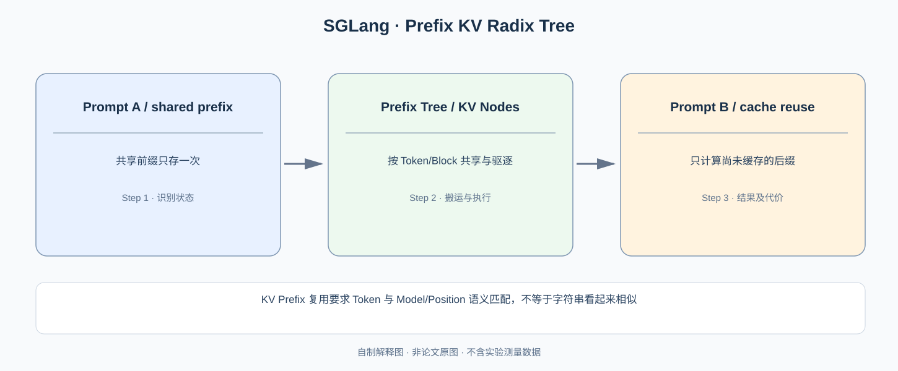

# SGLang：为什么多个请求共享 Prefix 时，KV Cache 应该组成 Radix Tree？

> **原始论文**：Zheng 等，[SGLang: Efficient Execution of Structured Language Model Programs](https://proceedings.nips.cc/paper_files/paper/2024/hash/724be4472168f31ba1c9ac630f15dec8-Abstract-Conference.html)，NeurIPS 2024。**类型**：C · 结构化语言模型程序与推理运行时。本篇两条主线：**Prefix KV 的 RadixAttention**，以及**前端程序与约束生成的联合执行优化**。

## 一、Paging 已经解决地址碎片，为什么仍然需要共享？

在 [vLLM](../01-distributed-training/C012-vllm-pagedattention.md) 中，Block Table 让单请求 KV 的逻辑 Token 顺序与物理地址分离。但三条独立的多轮 Prompt 可能都包含相同的 System Prompt、工具描述和 Few-shot Examples：

~~~text
Request A: [System][Tools] + [Question A]
Request B: [System][Tools] + [Question B]
Request C: [System][Tools] + [Question C]
~~~

这不是一条请求内部的显存碎片问题，而是**跨请求重复计算**。只要公共 Prefix 对应完全相同的 Token、位置、模型权重和前向语义，它产生的 K/V 可以复用；不能因为三条 Prompt 的后缀不同就迫使主干重算三次。

*自制解释图。原论文中的前缀树管理与结构化执行例子见 [NeurIPS 正式论文](https://proceedings.nips.cc/paper_files/paper/2024/hash/724be4472168f31ba1c9ac630f15dec8-Abstract-Conference.html)。*

## 二、为什么不是 Hash 全部 Prompt？

若缓存以**完整 Prompt** 的 Hash 为键，A 和 B 的 Hash 不同，尽管它们有大量共同前缀却都未命中。若缓存每个前缀字符串的 Hash，会产生大量索引和生命周期管理负担。

Radix Tree（压缩前缀树）将公共 Token 序列存为一条节点路径，后缀从分叉处延展：

~~~text
root
 └─ [System][Tools]  ← shared KV prefix
    ├─ [Question A] ← A suffix
    ├─ [Question B] ← B suffix
    └─ [Question C] ← C suffix
~~~

设 Prompt 长度 $S$，可复用的公共前缀长度为 $P$，不再需要为每条请求重新生成该前缀的 KV：

$$
\text{new prefill}=
\text{compute tokens }(P+1,\dots,S)
\quad\text{using cached }KV_{1:P}.
$$

注意第 $P+1$ 个 Query 仍然需要 Attention 到之前的 Prefix。减少的是**重复 Prefix 的前向工作与 KV 副本**，而不是更改 Causal Attention 的可见范围。

缓存的正确定义必须包含：Token ID 一致、位置/Attention mask 一致、模型与 Adapter 版本兼容，且引用中的物理 KV blocks 不能被回收。若 Prompt 中出现图片或不同的 LoRA 权重，单凭文本相同可能根本不满足缓存条件。

## 三、为什么缓存树还需要影响调度顺序？

若 GPU 队列有请求 A、B、C，而 A 和 C 共享非常长的 Prefix，调度器可能优先安排已有 KV 可用的请求，从而提高 cache hit ratio。但强行总是优先相似请求会造成没有公共 Prefix 的任务一直等待。由此产生**缓存命中率、队列公平性、KV 容量/驱逐成本**之间的权衡。

可以将一次请求的算子量粗略拆成：

$$
T_{\mathrm{prefill}}
=
T_{\mathrm{cache\ lookup}}
+
T_{\mathrm{uncached\ suffix}}
+
T_{\mathrm{attention\ to\ prefix}}.
$$

这是结构性解释，不代表作者给出的端到端时延拟合公式；实际上 Attention、GEMM、调度互相重叠，不能逐项简单相加。Prefix 复用后，Scheduler 更容易决定把哪条请求送到哪张 GPU，某些时刻 KV cache 热度比单纯的请求先后顺序更重要。

## 四、原论文为什么不只是“另一个 KV Cache 框架”？

SGLang 还提供程序式前端，表达 Prompt、生成、并行、分支与结构化输出。例如：

~~~text
构造公共 system prompt
  → 生成推理
  → 根据输出分支
  → 并行生成多个候选
  → 汇总并执行最后一次生成
~~~

程序结构暴露给运行时后，runtime 有机会发现重复前缀、分支共享和约束生成。针对 JSON 等结构化生成，论文还研究**压缩有限状态机（compressed FSM）**以减少 constrained decoding 的额外执行成本。它与 RadixAttention 是两个不同机制，不能把所有加速都归因给缓存。

## 五、实验结论的归因边界

### 原论文 Figure 1 先把 SGLang 拆成前端语言与后端系统

[SGLang 原文 Figure 1（arXiv:2312.07104v2，PDF 第 2 页）](https://arxiv.org/pdf/2312.07104) 明确画出 Client Language Primitives → Interpreter → Runtime 的执行关系。右侧 Backend 包含 **RadixAttention（§3）**、**Compressed Finite State Machines（§4）** 与 **API Speculative Execution（§5）**，它们不是一个统一的“共享 KV Cache 算法”。编写 SGLang 的 LM Program 只是表达哪些生成/分支/并行调用存在；Runtime 才根据其依赖、Token 前缀与输出约束选择具体优化。

这解释了为什么用户已经使用 [PagedAttention](../01-distributed-training/C012-vllm-pagedattention.md) 后仍可从 RadixAttention 受益：Paged KV 解决内存块碎片化与块表寻址，Radix KV 解决**跨请求共享公共 Token Prefix**和 Prefix 的生命周期。二者是两个正交的系统问题。

### 用一个五请求的 Radix Tree 复算前缀复用与 LRU

假设请求 A、B、C 共享长度为 100 的系统前缀，并分别有 20、30、10 个新的 Token；请求 D、E 的前缀不相同。没有跨请求 KV 复用时，A/B/C 的 Prefill 总输入长度是 $120+130+110=360$；有公共前缀一次计算和多请求复用，理论上需要为这三条请求构建的**唯一 Token 状态数**是 $100+20+30+10=160$，节约 200 个前缀 Token 的重复计算。这里没有宣称 GPU Prefill FLOPs 严格按 360:160 同比例降低，因为不同长度的 Attention/调度/Batch 有非线性执行成本。

再假设 A 和 B 结束，但 C 的 KV Prefix 仍被引用：运行时不能为了给 D/E 腾出空间就立即驱逐共享前缀，否则会破坏 C 的请求状态。RadixAttention 的缓存策略要区分**活跃引用锁定**和**未使用节点的 LRU 淘汰**。读 [原论文 Figure 3](https://arxiv.org/pdf/2312.07104) 的连续九步缓存变化时，应关注：哪些节点被新请求插入、哪些节点仍被活动请求引用、哪些节点在容量不足时被驱逐。这张图是数据结构与算法语义，不是最终 6.4× 吞吐的测量曲线。

如果跨请求缓存使用相同 Token ID，但模型版本、LoRA Adapter、Position Encoding 或多模态输入有所改变，KV 也不一定兼容。**结构上拥有同一个 Token 前缀**不自动保证可跨模型权重共享缓存，这一约束是防止所谓 KV Cache “命中却输出错误”的第一道工程防线。

### 压缩 FSM 为什么又是独立的优化？

对于强制输出 JSON 的场景，普通 FSM 每次只约束下一个 Token；如果连续多个确定文字片段具有唯一合法路径，可把多个确定状态压缩并在一次推理中处理更长的连续路径。即使根本没有共享 Prefix，Compressed FSM 仍可能加速约束生成；反之，纯自由文本对话没有这种确定路径，FSM 部分的收益可能接近零。

因此对 SGLang 论文实验至少分离三个因子：公共 Prefix 比例、输出 Grammar 的确定程度、前端程序是否多轮有分支。作者报告最高 6.4× 属于组合工作负载的结果，不能把它单独当作 Radix Tree 的收益证明。

NeurIPS 2024 论文报告在结构化语言模型程序、多轮 Chat、Agent、JSON、RAG 等应用中最高约 **6.4× 吞吐提高**。如果请求没有共享 Prefix，则 Prefix caching 的收益会降低；如果生成没有结构约束，则 FSM 优化不应带来同样效果。因此它是**前端程序语义、缓存管理和运行时调度组成的系统结果**。

论文从“LLM 程序执行是多次相依调用”出发，再证明前端显式控制流能为运行时带来优化机会，最后展示缓存/约束解码。读到这里，应能分清：
**[vLLM](../01-distributed-training/C012-vllm-pagedattention.md) 解决单请求 KV 物理布局，SGLang 强调跨请求/程序调用共享 KV 与执行调度。**

下篇 [FlashInfer](C018-flashinfer.md) 再往下探：当 KV 确实是非连续 Page、各请求长度还不同，Attention GPU Kernel 怎么跑得好？

**原始论文**：[NeurIPS 2024](https://proceedings.nips.cc/paper_files/paper/2024/hash/724be4472168f31ba1c9ac630f15dec8-Abstract-Conference.html)、[arXiv 2312.07104](https://arxiv.org/abs/2312.07104)。
