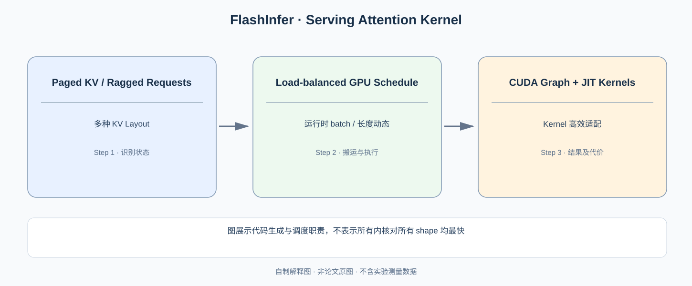

# FlashInfer：KV Cache 形状每轮都变，GPU Kernel 为什么还能用 CUDA Graph？

> **原始论文**：Ye 等，[FlashInfer: Efficient and Customizable Attention Engine for LLM Inference Serving](https://proceedings.mlsys.org/paper_files/paper/2025/hash/dbf02b21d77409a2db30e56866a8ab3a-Abstract-Conference.html)，MLSys 2025。**类型**：C · GPU Kernel 与动态服务执行引擎。

## 一、FlashAttention 解决的是哪一层问题？

[FlashAttention](../../A/10-gpu-operators/A055-flashattention.md) 通过分块在线 Softmax 避免写出 $S^2$ Attention Matrix。但在线服务还有一组专属难点：请求数每步变化、各请求上下文长度不同、KV Cache 可能采用 [PagedAttention](../01-distributed-training/C012-vllm-pagedattention.md) 的非连续物理 Page，Prefill 与 Decode 的矩阵形状更截然不同。

*自制解释图，非论文原图。原论文的 KV Layout、CUDA Graph 与 Kernel Scheduling 设计见 [MLSys 2025 正式版](https://proceedings.mlsys.org/paper_files/paper/2025/hash/dbf02b21d77409a2db30e56866a8ab3a-Abstract-Conference.html)。*

连续 KV 的第 i 条请求可以表示为 $K_i\in\mathbb R^{L_i\times n_{kv}\times d_h}$。分页后，取第 j 个 Token 的物理地址要先查：

$$
p_i(j)=\operatorname{block\_table}_i[\lfloor j/B\rfloor],
\qquad o(j)=j\bmod B.
$$

其中 B 是每个 KV Page 中的 Token 容量。逻辑 Attention 没变，Kernel 却需要处理 **Page 索引读取与长度不规则**。如果简单地给每个请求一组固定 SMs，长请求可能占住 GPU，其余 SMs 却空闲。

## 二、为什么 CUDA Graph 和动态调度会冲突？

CUDA Graph 倾向重用已经捕获的 Launch 与执行图，以减少 CPU 为每轮 Kernel Launch 付出的固定开销。然而下一轮可能从 8 条请求变成 37 条，每条有效 Page 数也不同。若每轮根据任务重新生成复杂 Graph，CPU 开销会重新出现；若用最大尺寸填充，则会做大量无效工作。

因此需要分开两个对象：

- **可预先捕获/复用的执行形态**；
- **每轮变化的请求长度、Page Table 与实际分片任务元数据**。

FlashInfer 设计可与 CUDA Graph 兼容的负载均衡调度，让每轮通过动态元数据分配 Query/KV 工作，又尽量重用静态执行基础。这并非宣称所有 Memory Addresses 永远静态，更不是 CUDA Graph 自动解决请求长短不均衡。

## 三、可组合 KV Format 与 JIT 的价值是什么？

普通连续布局、Paged KV、不同 Attention masks、Head 数、不同位置编码与精度，对内存访问和 Kernel Specialization 有不同要求。FlashInfer 通过 **block-sparse/composable KV 表示与 customizable attention template** 将布局适配和 Kernel 算术结合，并允许通过 JIT 编译专用 Kernel。

从理解角度可划分三层：

$$
\underbrace{\text{Attention 数学定义}}_{\text{QK / mask / Softmax}}
\quad\big|\quad
\underbrace{\text{KV 物理布局}}_{\text{连续 / Paged / 稀疏索引}}
\quad\big|\quad
\underbrace{\text{GPU 执行安排}}_{\text{CTA / warp / split-K / Graph}}.
$$

只改变第二层不应改变第一层的数学值，但可能要求第三层完全不同。如何在运行时选策略，是这篇系统论文超出 FlashAttention 原始 tile 证明的核心。

### 为什么 kernel 更快不代表每个请求更快？

假设一次 decode step，Attention kernel 只占总时间 30%，其余 70% 是 GEMM/MLP/Sampling/Runtime。假设 Attention 快 2 倍，Amdahl Law 预测的总体加速至多：

$$
S=\frac1{0.7+0.3/2}\approx1.176.
$$

这是**教学假设**，非原论文硬件读数。它说明我们需要分别测 kernel-level latency、TPOT、端到端请求吞吐与显存占用。

## 四种 Decode 工作量为何对应不同 GPU Kernel 路径？

设同一个 Batch 里两条请求的 KV 长度分别是 128 与 8192，Query 每条只有一个新 Token。若直接对两个请求平均分配 1 个 CTA，短请求很快完成，长请求还要持续扫描大量 KV 页面；部分 SM 将闲置。另一种做法是对长请求的 KV 按 `split-KV` 分块，让多个 CTA 各自计算一段 Partial Attention，最终再正确合并 Softmax 统计量。

对分块 $b$ 计算局部最大 $m_b$、归一化分母 $l_b$、加权 Value 和 $o_b$，要合并不同 Block 的 Attention，不能仅对局部 Softmax 输出做平均。令全局最大 $m=\max_bm_b$，则

$$
l=\sum_b e^{m_b-m}l_b,\qquad
o=\frac{\sum_b e^{m_b-m} l_b\,o_b}{l}.
$$

这是在线 Softmax 跨块合并的核心代数约束。若简单使用 $o=(o_1+o_2)/2$，对不同分块的 Logits 尺度不一致时会得到错误的输出。FlashInfer 的 Page Table 和 Split-KV 调度都必须在**不改变 Attention 数学语义**的基础上运行。

### CUDA Graph 不是“变量长度全部变成常量”

Graph Capture 固定的可以是 Kernel 启动形态与用于读取索引的元数据地址，而每轮的 `kv_indptr`、`kv_indices`、`qo_indptr` 等请求长度与 Page Layout 信息可以更新为新的值。以两个请求的 `kv_indptr=[0,2,10]` 为例，分别拥有 2 和 8 个物理 KV Page。下一轮增加了请求时，运行时需要更新 Indptr 和对应 Buffer Capacity，不能因为上一轮 Graph Capture 过便继续解释成只有两个请求。

一个正确的服务实现必须把 Buffer Capacity、Index 本身和有效序列长度区分清楚。固定尺寸 Buffer 内的数据更新可以与 Graph Capture 相容；超出容量时仍需额外分配/重新规划。**“Graph-compatible”不等于“所有地址和动态结构完全不变”**，也不保证所有 Batch/Head Shape 都落在同一优化 Kernel。

## 为什么 Figure 和系统 Benchmark 是不同层证据？

[FlashInfer MLSys 2025 正式论文](https://proceedings.mlsys.org/paper_files/paper/2025/hash/dbf02b21d77409a2db30e56866a8ab3a-Abstract-Conference.html) 的方法示意说明可组合 KV Layout、Scheduler 与 CUDA Graph 协作；系统 Benchmark 的 Inter-token Latency / Prefill Throughput 则需要对照同 GPU、Batch、KV Cache Layout、Paged Block Size、Head Dimension 等条件。单层 Attention Kernel 从 10 μs 降到 5 μs 若只占整步 30%，根据 Amdahl 上界，总步时延仅从 100 μs 降到 85 μs——不能宣称“Kernel 快两倍，所以每个用户快两倍”。

更严格的复现需要两个模型规模、两个 KV Length 和至少两组 Head Count，在相同动态请求分布下分别报告 CUDA Graph on/off、Split-KV on/off 与 Kernel Specialization 的端到端运行时间。没有这些变量，无法断定论文改进来自哪条系统路径。

## 四、原论文实证边界

### Figure 1 的左半边与右半边为什么必须分开理解？

[FlashInfer arXiv:2501.01005 PDF 第 2 页 Figure 1](https://arxiv.org/pdf/2501.01005) 左半边是 KV Cache 统一格式：Page Table、Radix Tree、稀疏 Mask 等不同上层抽象映射至统一 Block-Sparse 表示；右半边则是 Kernel/JIT 编译与 Runtime Load-Balanced Scheduler。编译阶段输入包括 Attention Variant、Task、KV Layout 等静态规格；运行阶段持续读取请求长度等动态信息。不能把“JIT 编译后生成了一个 Kernel”误说成“这个 Kernel 自己不用任何请求元数据即可适应任意 Batch”。

### 为什么动态长度会让固定 CTA 分配策略崩溃？

考虑同一批两条 Decode 请求，分别需要读取 $L_1=128$ 与 $L_2=8192$ 个 KV Token，若每条恰好分配一个 CTA，长任务的扫描工作量是短任务的 64 倍，其余 CTA 很快空闲。将长请求分成每段约 1024 个 KV Token 的子工作，会形成 8 个可并行处理的块；再加短请求 1 个块，就有 9 个工作单元可安排到 GPU CTA 队列中。

但是分块产生的输出不能相加后除以 8：每个子块独立 Softmax 有自己的 Maximum $m_b$ 与分母 $l_b$。必须按照前文的在线 Softmax 合并公式重新加权，才保留原始注意力数学定义。这说明 Load-Balancing 算法不是单纯的任务抢占；正确结果还依赖**可结合的 Attention Reduction Operator**。

若下游使用 CUDA Graph Capture，在 Graph 中的 Launch Grid、Workspace 地址应足够稳定，而请求长度分配表可以在同一块预分配 Metadata Buffer 中更新。若需要的工作单元数超过现有容量，就应通过重新规划/分桶处理，而不是静默丢弃后半段 KV。

**证据对齐**：Figure 1 说明编译、存储与调度的职责划分，正文 Scheduler Algorithm 验证如何按长度分配工作；论文的不同 Paged/Long-Context/Parallel Generation Benchmark 才检验真实 Kernel 与服务延迟。原文的 29–69% ITL 降低、28–30% Long Context 改善、13–17% Parallel Generation 改善分属不同测试设置，不能作为同一请求的串联加速因子。

论文在所选 inference engine 与 compiler baseline 上报告约 **29–69% 的 Inter-token latency 降低**，某些 Long-context 测试约 **28–30% 延迟降低**，Parallel Generation 工作负载约 **13–17% 加速**。这三个区间是不同实验工况，不能直接相加或认为任何 kernel 都有相同改进。

若研究 C++/CUDA 工程实现，应特别检查 Kernel 按 Q-length、KV-length、head 数如何选择 CTAs、是否复用 CUDA Graph、request 长度变化时 split-KV 的 balance。原文完整 Figure 及测试条件见上面的 MLSys 入口。

下篇 [Punica](C019-punica.md) 再加入一个新变化：同一个 Batch 内请求共享基础模型，却拥有**不同 LoRA Adapter**。这不是 KV 布局能独立解决的问题。

**依赖**：[FlashAttention](../../A/10-gpu-operators/A055-flashattention.md) → [vLLM/PagedAttention](../01-distributed-training/C012-vllm-pagedattention.md) → [SGLang](C017-sglang.md) → [FlashInfer](C018-flashinfer.md)。
