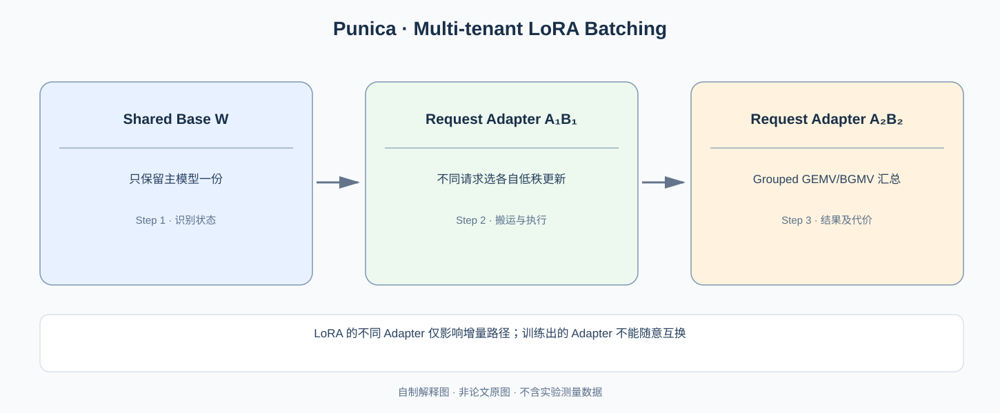

# Punica：不同请求使用不同 LoRA，为什么还能共享一次大模型矩阵计算？

> **原论文**：Chen 等，[Punica: Multi-Tenant LoRA Serving](https://proceedings.mlsys.org/paper_files/paper/2024/hash/054de805fcceb78a201f5e9d53c85908-Abstract-Conference.html)，MLSys 2024。**类型**：C · 多租户模型服务。

## 一、不能把“不同 Adapter”当成“不同完整模型”

假设模型有一份巨大公共权重 $W\in\mathbb R^{d_o\times d_i}$，每个租户 $u$ 有自己训练的 LoRA 增量：

$$
\Delta W_u=B_uA_u,
\qquad
A_u\in\mathbb R^{r\times d_i},
\quad
B_u\in\mathbb R^{d_o\times r},
\quad r\ll \min(d_i,d_o).
$$

对第 u 个请求，列向量输入 $x_u$ 的输出：

$$
\boxed{y_u=Wx_u+B_u(A_ux_u)}.
$$

可以看出公共基座 $Wx_u$ 可以 batch，而第二项按请求选 Adapter。若每个租户独占一份完整 $W+\Delta W_u$，显存放大主要来自重复主模型。Punica 正是把 **共享 Base** 和 **不同 Adapter 增量** 分开执行。

*自制解释图，原始 SGMV Kernel 与 Serving Architecture 见 [MLSys 正式论文](https://proceedings.mlsys.org/paper_files/paper/2024/hash/054de805fcceb78a201f5e9d53c85908-Abstract-Conference.html)。*

## 二、不同 LoRA 为什么不直接凑成普通 GEMM？

同 Batch 三个请求的 Adapter IDs 为 $A,B,A$，则：

$$
Y_{\mathrm{base}}=XW^\top
$$

可以一次计算，但增量分别是：

$$
\Delta y_1=B_AA_Ax_1,\quad
\Delta y_2=B_BA_Bx_2,\quad
\Delta y_3=B_AA_Ax_3.
$$

如果按租户拆成多个小 batch 处理，各 Adapter 子批很小，Decode 时容易产生大量小规模 GEMV，GPU Launch 和 occupancy 都不理想。

Punica 的 **SGMV（Segmented Gather Matrix-Vector Multiplication）** 使同一个 Kernel 能让不同 Request Rows 从不同 Adapter 索引中选择需要的权重，统一处理批次里的 LoRA 增量。它并不是说所有 Adapter 参数拼成同一个普通 Dense 矩阵然后毫无索引差异。

在运行时，调度器还要决定 Adapter 是否已驻留、是否需要从主机加载、哪些请求共享同一 GPU 以及 KV Cache 是否仍有足够容量。因此其完整问题是：

$$
\text{Shared Base Weight}
+\text{Per-request Adapter Placement}
+\text{Dynamic Batch}
+\text{KV Capacity}.
$$

## 三、显存账本为什么很诱人？

若基础模型需 $M_W$ 字节，单 Adapter 为 $M_A$，共有 k 个租户：

$$
M_{\rm naive}\approx kM_W,
$$

$$
M_{\rm shared}\approx M_W+kM_A+M_{\rm KV}+M_{\rm workspace}.
$$

上式只是概念比较（可能存在 base replicas 和多精度缓存），但当 $M_A\ll M_W$ 时，差距是结构性的。服务仍需注意 Adapter 切换的 IO，特别是冷 Adapter 多、GPU KV Cache 很满时，装载一个新的 Adapter 可能造成尾延迟和驱逐压力。

## 四、不同 Adapter 的 Prefix KV 可以共享吗？

**不能仅因为 Prompt 文本相同就共享。** Adapter 如果修改了 Attention 或上游 MLP，中间 Hidden/Key/Value 可能与另一个 Adapter 不同。即使两个请求的 Token IDs 完全一样，其 KV Cache 也未必等价。

这与 [SGLang](C017-sglang.md) 的 Prefix caching 是重要交界：多租户 Prefix Cache 的正确命中键需包含与实际前向计算相容的**模型/Adapter 身份**与位置信息。

## 五、实测收益来自什么工况？

原论文报告在多租户 LoRA workload 和其比较系统中最高约 **12× 吞吐提升**，并报告每 Token 约 **2ms 的附加时延**这一测试条件下的系统代价。不能推导所有 Adapter 都只增加 2ms，也不能把此倍率推广到单租户普通 Decode。

最大的相对收益通常来自：租户很多、单个租户请求稀疏、公共 Base 大、重复基座副本很浪费。论文的系统证明不仅有 SGMV 内核，还包括跨租户整合批次的 Scheduler。

从这里继续 [Speculative Decoding](C020-speculative-decoding.md)：接下来的加速不再利用不同请求之间的公共计算，而是在**同一个请求里预测多个未来 Token，目标模型一次并行验证**。

**原始来源**：[MLSys 2024](https://proceedings.mlsys.org/paper_files/paper/2024/hash/054de805fcceb78a201f5e9d53c85908-Abstract-Conference.html)。
