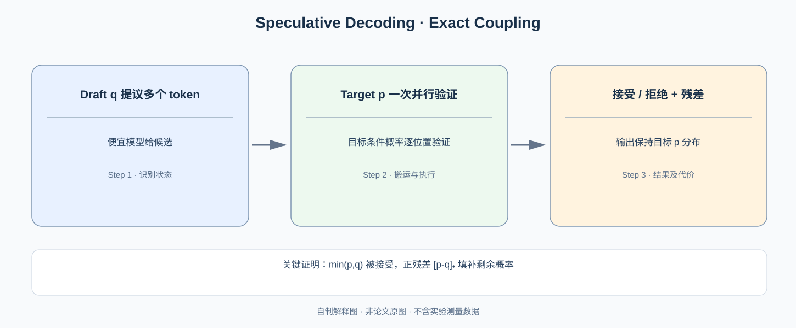

# Speculative Decoding：不改变目标模型采样分布，为什么还能一次生成多个 Token？

> **原论文**：Leviathan、Kalman、Matias，[Fast Inference from Transformers via Speculative Decoding](https://arxiv.org/abs/2211.17192)，ICML 2023（公开早期版本标题也见 *Speculative Execution*）。**类型**：A · 采样算法与计算重排。本篇的核心不是“拿小模型猜，大模型认”，而是**用严格概率校正让并行验证后的 Token 仍服从目标分布**。

## 一、解码为什么慢：串行长度还是单步算力？

设目标自回归语言模型的下一个 Token 条件分布为：

$$
p(x_t\mid x_{<t}).
$$

生成 $T$ 个 Token 需要逐步计算：

$$
x_1\sim p(\cdot\mid x_{<1}),\quad
x_2\sim p(\cdot\mid x_{\le1}),\dots
$$

目标模型在生成第 t 个 Token 之前不知道第 t-1 个 Token 的采样结果，因此无法直接对这 T 个未知条件分布一次执行常规 Decode。

但 Transformer 如果**事先给定了候选 Token 序列**，可以使用 Causal Mask 在一次 forward 内并行计算每个候选位置的目标概率。这给出了第一性突破点：

> 较小的 Draft 模型先猜几个 Token，昂贵的 Target 模型再一次并行验证这些候选；若采样算法允许准确地修正错误，能够减少 Target 的串行调用次数。

*自制解释图，非论文 Figure。原算法的模型调用顺序和伪代码见 [Leviathan 等 ICML 2023 原文](https://arxiv.org/abs/2211.17192)。*

## 二、先解决最关键的单 Token 问题

令目标模型给出分布 $p(x)$，Draft 模型给出分布 $q(x)$。从 $q$ 中采样候选 $Y$ 后，要决定是否接受。

一个常见但错误的直觉是“Target 在 $Y$ 上的概率大，就直接接受”；这样实际输出分布可能被 Draft 提案偏向扭曲。

正确的接受概率：

$$
\boxed{
a(Y)=\min\left(1,\frac{p(Y)}{q(Y)}\right).
}
$$

这里假设 $Y\sim q$，仅需在 $q(Y)>0$ 的位置计算比值；$q(Y)=0$ 的 Token 根本不会被 Draft 抽到。拒绝时，再按**目标减去 Draft 后的正残差**采样：

$$
\boxed{
r(x)=\frac{\max(0,p(x)-q(x))}
{\sum_z\max(0,p(z)-q(z))}.
}
$$

如果 $p=q$ 且没有拒绝事件，残差分母为 0 不影响执行，因为根本不需要残差采样。正残差有非零总质量时这个分布可正常归一化。

为什么会是这个形式？把一切抽象说法取消，直接证明**最终输出分布不变**。

### 精确性证明：接受部分 + 拒绝后补足 = 目标分布

对于任意 Token $x$，被 Draft 提出且被接受的概率：

$$
\Pr(X=x,\mathrm{accept})
=q(x)\min(1,p(x)/q(x))
=\min(p(x),q(x)).
$$

定义整体接受率：

$$
\alpha=\sum_x\min(p(x),q(x)).
$$

拒绝事件发生概率：

$$
\Pr(\mathrm{reject})=1-\alpha.
$$

注意：

$$
\sum_x[p(x)-q(x)]_+
=1-\alpha,
\quad [u]_+=\max(0,u).
$$

因此拒绝后残差采样输出 $x$ 的**非条件**概率为：

$$
\Pr(X=x,\mathrm{reject})
=(1-\alpha)\frac{[p(x)-q(x)]_+}{1-\alpha}
=[p(x)-q(x)]_+.
$$

两项相加：

$$
\begin{aligned}
\Pr(X=x)
&=\min(p(x),q(x))+[p(x)-q(x)]_+\\
&=\boxed{p(x)}.
\end{aligned}
$$

最后一步可以分别检查 $p(x)\le q(x)$ 与 $p(x)>q(x)$ 两种情况。这就是 Speculative Decoding 的根本正确性：**任何 Draft 提案都可经过校正恢复精确目标分布**（在给定概率计算与理想采样实现假设下）。

### 手算例子：拒绝并不是“重跑 p”

设词表只有 A/B：

$$
p(A)=0.8,\quad p(B)=0.2,
$$

$$
q(A)=0.5,\quad q(B)=0.5.
$$

Draft 提议 A 时，$a(A)=1$；提议 B 时，$a(B)=0.2/0.5=0.4$。

接受概率分量：

$$
\min(p,q)=(0.5,0.2).
$$

剩余概率：

$$
[p-q]_+=(0.3,0),
$$

整体拒绝概率 $0.3$，拒绝时**必然采样 A**。最终分布：

$$
\Pr(A)=0.5+0.3=0.8,\qquad
\Pr(B)=0.2.
$$

如果拒绝后直接从 $p$ 重采样，则输出 A 的概率会变成 $0.5+0.3\times0.8=0.74$，错误。这个例子直接说明：**残差分布是必要的，不是实现细节。**

## 三、多个 Token 如何用一次 Target Forward 验证？

假设 Draft 逐个生成 $\gamma$ 个候选：

$$
\tilde x_1,\dots,\tilde x_\gamma
\sim q(\cdot\mid\text{prefix + 已提议的 Token}).
$$

Target 在一次 Causal Forward 中可对这些位置给出：

$$
p_1(\cdot),p_2(\cdot),\ldots,p_\gamma(\cdot)
$$

以及所有候选都被接受后，下一位置的目标概率。按顺序对各候选做上述接受–拒绝过程：

1. $j=1$ 开始，以 $\min(1,p_j(\tilde x_j)/q_j(\tilde x_j))$ 决定接受；
2. 一旦第 j 个失败，立刻从 $(p_j-q_j)_+$ 归一化后的残差采样一个 Token，**丢弃后续 Draft**；
3. 如果 $\gamma$ 个都被接受，还可以从 Target 在新增前缀上的下一个分布采样额外 Token。

为什么验证必须顺序停止？因为第 j 个 Token 一旦被替换，它后面的 Draft proposals 是在**错误的旧前缀**上条件生成，不能继续当作新前缀的合法样本。

对每个经过验证的位置，刚才的单 Token 证明都在其条件前缀下成立，由自回归条件概率链式法则，最终完整序列的采样分布等同于直接从 Target 采样。

## 四、为什么精确却可能不快？

如果 Draft 每次生成 $\gamma$ 个 Token 的开销相当大，Target 又必须跑一次验证，那总耗时可能高于普通 Decode。定义平均目标单步成本为 $T_P$，Draft 单步为 $T_Q$，验证一次的成本为 $T_V(\gamma)$。

一个便于理解的效率近似：

$$
\mathrm{Speedup}\approx
\frac{\mathbb E[\text{本轮提交 Token 数}]\,T_P}
{\gamma T_Q+T_V(\gamma)}.
$$

此式是系统的**简化分析模型**，尚未包括网络、KV 管理、调度与实际 kernel scaling。

若每位置独立并具有相同平均接受率 $\alpha$（这是解释性理想假设），本轮提交 Token 的期望数量为：

$$
\mathbb E[L]
=1+\alpha+\alpha^2+\cdots+\alpha^\gamma
=\boxed{\frac{1-\alpha^{\gamma+1}}{1-\alpha}}
$$

（当 $\alpha=1$ 时极限为 $\gamma+1$）。因此提高 $\gamma$ 并非总更好：期望提交量随接受率出现收益递减，而 Draft 成本一般继续增长。

单 Token 接受率还与两分布的 total variation 距离存在联系：

$$
\alpha
=\sum_x\min(p(x),q(x))
=1-\frac12\sum_x|p(x)-q(x)|.
$$

这一公式告诉我们：能否高效投机，本质上取决于**Draft 与 Target 对当前前缀的预测分布是否足够重合**，而不是只有 Draft 模型“足够小”。

## 五、实验与技术局限

原论文在 T5-XXL 等测试条件下报告约 **2–3 倍**的解码速度提升，同时采样分布保持一致；这不是任何 Target/Draft 配对都能达到的稳定倍率。

严格的“分布不变”针对算法所定义的 Target 分布。若工程上给 Draft 和 Target 使用不一致的 Temperature、Top-p/Top-k 后处理、Tokenizer、Position/Mask 语义，或者把精确拒绝改成启发式典型接受，则结果不一定满足该证明。

下一篇 [Medusa](C021-medusa.md) 试图减少额外独立 Draft 模型带来的维护与 Forward 开销；再下一篇 [EAGLE](C022-eagle.md) 则将候选生成搬到**特征空间**，但最终仍必须依赖精确验证规则才能保住 Target 分布。

**原论文**：[ICML 2023](https://arxiv.org/abs/2211.17192)。
