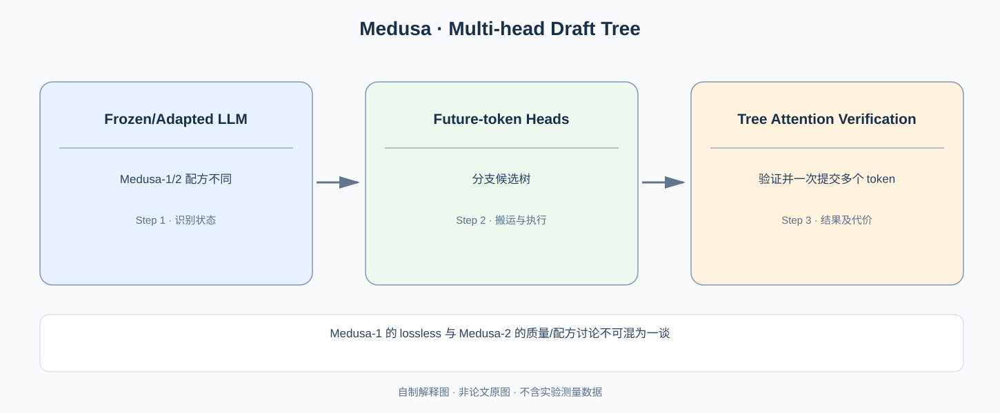

# Medusa：不用独立 Draft Model，多个未来 Token 的候选从哪里来？

> **原始论文**：Cai 等，[Medusa: Simple LLM Inference Acceleration Framework with Multiple Decoding Heads](https://proceedings.mlr.press/v235/cai24b.html)，ICML 2024。**类型**：A/C · 模型辅助生成与推理验证算法。本篇主要研究候选树、Tree Attention、Medusa-1/2 两类训练方案与采样质量边界。

## 一、为什么要替代独立 Draft Model？

在 [Speculative Decoding](C020-speculative-decoding.md) 中，便宜模型 q 生成候选，Target p 一次并行验证，接受–残差规则保证最终分布。其工程优势来自减少昂贵 Target 的串行 Forward 次数；但引入了一个额外模型，需要维护、部署、加载权重，并在每轮生成多个 Draft Tokens。

Medusa 的切入点是：**能不能只在 Target LLM 顶端增加几个轻量 Head，让主模型自身隐藏状态预测多个未来位置？** 这意味着候选不必先由一整个额外 Transformer 自回归生成。

*自制解释图。原论文中的 Medusa heads、Tree Attention、Tree Construction 和 Verification 图见 [ICML 2024/PMLR](https://proceedings.mlr.press/v235/cai24b.html)。*

## 二、普通 LM Head 为什么只能预测一个 Token？

对于最后一层隐藏状态 $h_t$，标准 Output Projection 给出：

$$
p(x_{t+1}\mid x_{\le t})
=\operatorname{softmax}(W_{\rm lm}h_t).
$$

这是下一个 Token 的分布。若想直接用同一个 $h_t$ 再预测 $t+2$，困难在于缺少**实际采样到的 $x_{t+1}$**：真正 Target 的第 $t+2$ 个分布应该是：

$$
p(x_{t+2}\mid x_{\le t},x_{t+1}).
$$

Medusa 为多个未来步建立额外预测 Heads，例如：

$$
q_j(x_{t+j}\mid h_t)
=\operatorname{softmax}(g_j(h_t)),\quad j=1,\dots,K.
$$

这里是说明性简写，实际 Heads 的输入、非线性层与训练损失以原论文结构为准。每个 Head 在不知道真实中间 Token 的情况下预测未来 Token，因此**越远的 Head 条件信息缺失越严重**，通常候选质量越难保证。

多个 Heads 可以一次产生若干未来位置的 Top-k 候选，但这些候选不是单一无歧义的合法自回归序列，需要组合成一棵 **candidate tree**。

## 三、候选树如何让 Target 一次并行验证多个路径？

假设两个未来位置 Head 都各给 2 个候选。组合可得到多个候选路径：

~~~text
prefix
 ├─ A
 │  ├─ C
 │  └─ D
 └─ B
    ├─ C
    └─ D
~~~

如果逐路径做 Target Forward，树分叉会造成许多重复 Prefix 计算。Medusa 用 **Tree Attention** 给每个树节点规定只可访问自己祖先路径的 Token，而不是与其它分支的并列候选互相 Attention。

将树节点展成一个可并行计算的序列后，为 Query 节点 $u$ 设计：

$$
M_{uv}=
\begin{cases}
0,&v\in\operatorname{Ancestors}(u)\cup\{u\},\\
-\infty,&\text{其他候选分支}.
\end{cases}
$$

这是 Tree-Causal Mask 的**解释性数学表示**。Target 在一次 Forward 中同时计算所有这些节点的条件分布；它们因为 mask 而不会从互相矛盾的未来分支读取信息。随后按照每条路径的验证规则，确定最多能提交多少前缀 Token。

注意这不代表 K 个 Heads 产生的全部候选都能被提交：只有构成合法同一条路径、并通过 Target 验证的 Token 才可进入最终输出。

## 四、Medusa-1 和 Medusa-2 究竟在什么地方不同？

这是论文最容易被粗略摘要混淆的内容：

- **Medusa-1**：冻结 Base LLM，训练新增的多个 Heads。原论文强调在配置正确验证过程时支持 lossless 推理加速；原来的主模型权重未改变。
- **Medusa-2**：联合微调 Base LLM 与 Heads，提高多个 Heads 对未来 Token 的预测质量，以获得更高接受长度/加速，但需要特殊训练配方尽量保持主模型质量。

因此不能从“Medusa-2 验证通过后输出质量较好”自动推导它严格保持**微调前原始 Base Model**的分布。若 Base 权重已经更新，新的 Target 模型本身就可能与原模型不同。

### Acceptance 策略也是一个单独的设计轴

[Speculative Decoding](C020-speculative-decoding.md) 有严格的 $\min(1,p/q)$ 接受加残差证明。Medusa 的系统还研究 **Typical Acceptance** 等策略来提高接受概率并尽量维持生成质量。其典型接受不是无条件等同于该概率精确校正。论文中的 *lossless* 场景、tree-based path 验证与典型接受工况必须分别标明。

判断任何 Medusa 变体是否严格保留 Target Sampling Distribution，要核对其实际验证与采样策略：例如 Greedy Decoding 的目标是保持 Argmax 路径，随机采样则需要正确的分布修正，不能把这两类等价性混为一谈。

## 五、为什么候选树越大未必越快？

若 Head 数 $K$、每 Head Top-k 分支数分别为 $b_i$，朴素候选树节点可能按 $\prod_i b_i$ 增长。大树在目标模型并行验证中也要消耗 FLOPs、Attention KV 与 Kernel Scheduling 开销。

一个服务侧简化模型是：

$$
\mathrm{Speedup}\approx
\frac{\mathbb E[\text{每轮被接受 Token 数}]\,T_{\rm target}}
{T_{\rm heads}+T_{\rm tree\ verify}}.
$$

如果扩树使接受 Token 平均数只增加一点，却让 Tree Verification 的计算变重，整体加速反而变差。这是**树宽、深度、校验成本与接受率**的联合优化，不是 Heads 越多越好。

## 六、论文结果与证据边界

ICML 2024 的原始实验报告：**Medusa-1 超过 2.2×** 的加速（满足对应无损条件），**Medusa-2 约 2.3–2.8×** 的加速区间；对照任务和评估协议以论文为准。它不能证明对所有模型、所有部署 batch、所有采样温度都能达到相同倍率。使用 Typical Acceptance 的实验要另行说明质量/等价性条件。

作者原论文从“独立 Draft Model 增加额外维护”切入，设计 Extra Heads，再为多候选引入 Tree Attention，最后给出两种训练变体。关键不是“一个头能猜多远”，而是**猜得准到值得 Target 一次检查多个节点**。

下一篇 [EAGLE](C022-eagle.md) 采取不同方案：不直接用同一隐状态独立猜 K 个未来 Token，而是研究**逐步回归特征空间**，并利用 shifted-token 解决特征预测的条件不确定性。

**原始论文**：[ICML 2024/PMLR](https://proceedings.mlr.press/v235/cai24b.html)；[Speculative Decoding](C020-speculative-decoding.md)。
