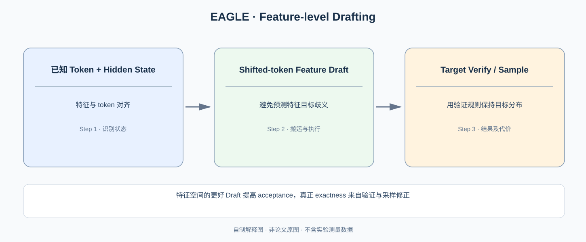

# EAGLE：为什么比直接猜未来 Token 更容易预测下一步的 Hidden Feature？

> **原始论文**：Li、Wei、Zhang、Zhang，[EAGLE: Speculative Sampling Requires Rethinking Feature Uncertainty](https://proceedings.mlr.press/v235/li24bt.html)，ICML 2024。**类型**：A/C · 特征空间投机生成算法。核心问题不是发明第二种精确采样公式，而是**怎样训练高质量、低开销的候选生成器**，并用 Target Verification 保证最终分布。

## 一、两个关于 Speculation 的第一性问题

### 原论文 Figure 2 与 Figure 3 验证的是不同主张

[EAGLE ICML 2024 原始论文（arXiv:2401.15077）Figure 2、3，PDF 第 2 页](https://arxiv.org/pdf/2401.15077) 中，Figure 2 的纵轴是 MT-Bench 非贪心生成（Temperature 1）下的 Speedup Ratio，横轴分别为 Vicuna 7B/13B/33B、LLaMA2-Chat 7B/13B/70B。图例区分 EAGLE、Speculative Sampling、DistillSpec 和 Vanilla；不能把其他只支持贪心的 Lookahead 的数据硬加入这组 Temperature=1 的对照。图中每个模型下的柱高是**整套 Draft + Target + 验证 Runtime** 的系统结果，不能直接证明特征预测误差比 Token 预测小多少。

真正解释 Feature Uncertainty 的是旁边 **Figure 3**：对当前已生成 Token “I”，其后可能采样到 “always” 或 “am”，这两枚离散 Token 所对应的下一特征 $f_{\rm always},f_{\rm am}$ 不同。若只拿上一特征 $f_I$ 去回归下一特征，两个分支会在 MSE 损失下互相平均，造成不可消除的条件不确定性；让 Draft 同时读取已经采样的候选 Token，就能更准确地预测该分支的下一状态。Figure 3 是因果动机和示意，后续的 Shifted-Token 具体训练消融才支持其真实效果。全文必须把**机制有效性**与**端到端速度收益**分开，不能仅根据 Figure 2 的 Speedup 声称唯一提升因素是 Feature-level Autoregression。

从 [Speculative Decoding](C020-speculative-decoding.md) 出发，算法正确性是：

$$
\Pr_{\rm final}(x)=p(x)
$$

（使用正确接受–残差校正，假设目标概率计算一致）。

加速效果由两件事决定：

$$
\text{Draft 足够快}\quad\land\quad\text{Draft 足够接近 Target}.
$$

如果 Draft q 很慢，减少 Target Forward 的收益会被吃掉；如果 Draft 与 Target 差很大，很多候选会被拒绝。于是**如何生成更好的 Draft**成为与采样精确性独立的研究问题。

[Medusa](C021-medusa.md) 用额外未来 Token Heads 直接猜多个候选；EAGLE 研究：Target 自己已经有连续的中间特征表示，是否能对该表征进行低成本自回归，生成更容易被 Target 接受的草稿？

*自制解释图，非原论文 Figure。第二倒数层特征、Token 的时间对齐方式与方法总图应对照 [ICML 2024/PMLR](https://proceedings.mlr.press/v235/li24bt.html) 的 EAGLE Diagram。*

## 二、Token-level 与 Feature-level Prediction 究竟差在哪？

在普通自回归模型中：

$$
h_t=f_\theta(x_{\le t}),\qquad
p(x_{t+1}\mid x_{\le t})=\operatorname{softmax}(W h_t).
$$

这里 $h_t$ 是模型较高层的 Hidden Feature；EAGLE 特别考虑**第二倒数层的特征**，而不是直接把最后的 Logits 变成新的 Draft 状态。

Token 是离散类别，单步输出存在多个概率候选。隐藏特征是模型在生成这些 Token 概率前的连续表示，可能含有对未来状态更有用的结构。作者的观察是：在特征空间做自回归，在其任务实验中比直接 Token 预测更容易得到可用的候选。

但这里藏着一个关键缺口：**下一步特征取决于下一步真实采样到什么 Token**。如果仅根据 $h_t$ 直接猜 $h_{t+1}$，会遇到不可消除的多模态不确定性。

### 一个一维例子理解为什么 feature uncertainty 不能凭训练变小

假设在当前上下文下，下一 Token A/B 的概率各 0.5。选择 A 后的下一特征为 $-1$，选择 B 后为 $+1$：

$$
h_{t+1}=
\begin{cases}
-1,&x_{t+1}=A,\\
+1,&x_{t+1}=B.
\end{cases}
$$

如果让模型只用 $h_t$ 回归 $h_{t+1}$，在 MSE 意义下最优值是：

$$
\hat h_{t+1}=\mathbb E[h_{t+1}\mid h_t]=0.
$$

可是实际下一状态永远不是 0。这里的平均化误差来自**没有条件化实际 Token**，不是简单增加训练步数就可以完全消掉的偏差。上述例子是教学构造，不是原论文数据。

EAGLE 的改造是将**提前一个位置的 Token**作为特征预测的输入条件，从而显式注入产生下一个特征所依赖的离散随机选择，减轻特征回归的歧义。

## 三、Shifted Token 为什么不是偷看未来？

关键是区分**Draft 已经生成的候选 Token**与**Target 尚未验证的真实最终 Token**。

EAGLE Draft 路径会先有可供条件化的候选 Token，再用它与前一隐藏状态预测下一特征。随后用该预测特征继续形成候选分布与后续 Draft。这个“Shifted”是把当前已选的候选 Token 与下一特征对齐，不是把原本未知的未来 Target Sample 提前泄漏进模型。

抽象步骤：

~~~text
已知前缀 / 已生成 Token
   ↓
Target 的可用上层 Feature + Draft Token
   ↓
小型 Feature Predictor 预测下一时刻 Feature
   ↓
生成下一步 Draft Token，再推进草稿树/序列
   ↓
Target Model 对候选并行 Verify + Correct Sample
~~~

这里特征预测器具体层结构、训练损失和 Token/Feature 的移位对齐要读原论文方法节，不能用这个教学流程代替实际模型实现。EAGLE 的技术贡献是**Feature Autoregression + Token Conditioning** 的组合。

## 四、为什么说 EAGLE “保持分布”，而不是 Feature Predictor 本身精确？

这是必须保持清楚的学术边界。

即使 EAGLE 训练出非常接近真实 Hidden State 的 Feature Predictor，它的输出仍可能存在误差。如果单纯把预测特征经过 LM Head 的结果直接当成 Target 分布采样，就不能保证采样与原模型一致。

EAGLE 依赖类似 Speculative Sampling 的 Target Verification / Acceptance 修正。对于 Target 分布 $p$ 与 Draft 分布 $q$：

$$
a(x)=\min(1,p(x)/q(x)),
$$

$$
r(x)\propto[p(x)-q(x)]_+,
$$

这样的正确修正才确保所提交 Token 保持目标分布。**候选生成得更好决定接受率和加速；验证校正决定概率正确性。** 把前者称为“精确 feature 回归”，或后者归因于 Feature Predictor 单独的数学性质，都不准确。

### Draft Quality 与模型质量不能混同

若 Target 是微调前模型，EAGLE 不需要改变 Target 权重即可作为加速附属模块；Draft 训练越好只是更有机会通过验证，不等于 Target 的推理质量本身提高。若部署时还改变 Temperature、Top-p 或 Top-k 后处理，必须确保验证使用与目标采样定义一致的分布。

## 五、原论文的结果如何表述？

ICML 2024 论文在 Vicuna、LLaMA2-Chat、Mixtral 8x7B Instruct 等模型，以及对话、代码、数学推理、指令任务中进行评估。对于 LLaMA2-Chat 70B，报告约 **2.7–3.5× 生成时延加速**、吞吐约翻倍，并保持 Target 的生成分布（对应正确的验证流程）。这些结果依赖特定 Draft Training、任务分布、Batch 与目标模型大小；不能推广为对所有现代 Serving Framework 必然快 3 倍。

与 Medusa 的对照也要保持证据边界：EAGLE 不只是“多头更多/更少”，而是换了一个**逐步草稿生成的状态表示**。对比必须包括 Draft 算力、接受长度、验证树大小与 GPU 平均 Token 延迟。

## 六、把推理服务与投机生成连接起来

相关技术分成四层，而不是多个互不相干的名字：

$$
\begin{aligned}
&\text{请求调度: Orca / Sarathi}\\
&\text{阶段放置: DistServe / Splitwise}\\
&\text{运行时与 kernel: SGLang / FlashInfer / Punica}\\
&\text{单请求生成: Speculative / Medusa / EAGLE}
\end{aligned}
$$

前三层主要改变**谁来执行、什么时间执行、哪些状态被复用**；最后一层开始改变**Target 每次 Forward 有机会提交多少未来 Token**，但不允许在声称 lossless 时暗中改变目标分布。

这也是你从模型研发走向推理系统工程时必须建立的分界：GPU Kernel 加速、Batching 速度、Goodput、Token Sampling Exactness，分别有不同的正确性和测量条件。

**继续阅读**：[Speculative Decoding：概率修正证明](C020-speculative-decoding.md) → [Medusa：多头候选树](C021-medusa.md) → [EAGLE：特征草稿](C022-eagle.md) → [EAGLE-2：动态树](C023-eagle2.md) → [EAGLE-3：多步草稿训练](C024-eagle3.md)。[原论文 ICML 2024](https://proceedings.mlr.press/v235/li24bt.html)。
