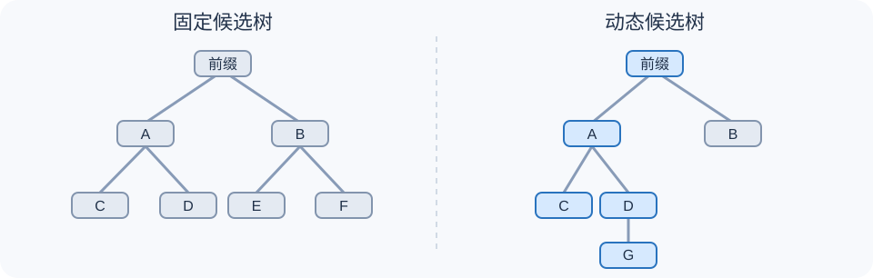

# EAGLE-2：为什么候选树的形状必须随上下文改变？

> **原始论文**：Yuhui Li、Fangyun Wei、Chao Zhang、Hongyang Zhang，[EAGLE-2: Faster Inference of Language Models with Dynamic Draft Trees](https://aclanthology.org/2024.emnlp-main.422/)，EMNLP 2024，7421–7432。**论文类型**：推理算法与执行系统。前置：[精确推测采样](C020-speculative-decoding.md) → [EAGLE 特征草稿](C022-eagle.md)；后续：[EAGLE-3](C024-eagle3.md)。

## 固定候选树，浪费在哪里？

普通 Target 自回归每一轮只提交一个新 Token；[Medusa](C021-medusa.md) 和 EAGLE 等方法将便宜 Draft 生成的候选展开成树，交给 Target 做一次并行验证。但“每层分几支”若预先写死，就相当于默认所有上下文都具有相同的不确定性。

例如在表达式“10+2=”后，某个后继候选可能明显更可信，另一个候选继续分叉的价值很小；而开放式续写可能有若干接近概率的分支。固定树既可能在容易的词上浪费并行验证位置，也可能在困难词上覆盖不足。

*自制解释图，非原论文 Figure：左边每层机械等宽分叉，右边优先扩展高价值路径，不代表实测候选概率。请对照 [论文 Figure 4（第 3 页）与 Figure 7（第 5 页）](https://aclanthology.org/2024.emnlp-main.422.pdf) 阅读。*

EAGLE-2 把难题明确成**候选预算分配**：给定有限次 Draft 扩展与有限个 Target 验证节点，应挑哪些分支？

## 从接受概率到能提前计算的路径分数

令 $q_u$ 表示 Draft 在某条已知前缀路径下，为节点 $u$ 的 Token 分配的概率，$p_u$ 是 Target 的同条件概率。单候选标准推测采样的接受概率为

$$
a_u=\min\left(1,\frac{p_u}{q_u}\right),\qquad q_u>0.
$$

注意 **$q_u$ 不等于 $a_u$**。如果 $q_u=0.9$、$p_u=0.09$，那么 $a_u=0.1$；而若 $q_u=0.2$、$p_u=0.3$，则 $a_u=1$。真正的 $p_u$ 只有执行 Target 才知道。

为了在尚未执行 Target 时分配树节点，论文先做了两个实验。**Figure 5** 显示节点接受率具有位置效应，但同一树位置在不同输入 query 下也有很大差异；**Figure 6** 显示实验所用 EAGLE Draft 的输出置信度与经验接受率存在较好的校准关系。于是用廉价的 $q_u$ 近似评估“路径值得继续探索吗”，不另训练一个树预测器。

设 $\mathcal P(u)$ 是从根节点到 $u$ 的路径，论文 §4.1 定义的全局路径价值可写成

$$
\boxed{\widehat V(u)=\prod_{v\in\mathcal P(u)}q_v}.
$$

沿途每条边都相当可信的分支，路径分数较大；中途只要出现一个很低的分数，整体就会降低。这是**排序启发式**，而非无条件精确的 Target 整条路径接受概率。尤其不应把它当作最终采样概率使用。

### 算一次就能看出为什么不只扩展最可能的父节点

假设 Draft 首层给出 A 与 B，分别 $q(A)=0.60,q(B)=0.25$；第二层为：

| 路径 | 子节点局部概率 | 路径价值 |
|---|---:|---:|
| A → C | 0.80 | $0.60\times0.80=0.48$ |
| A → D | 0.10 | $0.60\times0.10=0.06$ |
| B → E | 0.70 | $0.25\times0.70=0.175$ |
| B → F | 0.20 | $0.25\times0.20=0.05$ |

若再往后**只允许扩展两个节点**，选 A-C 和 B-E 比机械地扩展 A 的两个孩子更符合路径价值排序。这是教学构造，不是原论文的实际查询统计；真实速度还受 Draft Forward 开销与候选树布局制约。

## 扩展与重排是两次不同的选择

EAGLE-2 的论文 Figure 7 值得逐块读。其动态树工作分两阶段：

1. **扩展（Expansion）**：对当前最外层节点，选全局路径价值最高的 top-$k$ 作为下一次 Draft Forward 的父节点；每次生成一层新候选，再更新路径价值。这样不会把每一层的所有分叉指数式扩展。
2. **重排（Reranking）**：完成预定轮数的扩展后，放下“刚扩展的是谁”，从整个候选树中选全局分数最高的 top-$m$ 节点，作为本轮真正要交给 Target 的验证树。

为什么重排必要？为了生成更深的树，扩展阶段可能优先投入较深分支；但一些没有被扩展的浅节点仍然有更大的被接受机会。**扩展时值得探索，不代表最终值得占据 Target 验证预算。**

原论文 Figure 7 中绿色的是扩展产生的候选，蓝色是重排留下的验证候选；颜色语义不是“已被 Target 接受”。Figure 7 的 top-2 与 top-8 是演示性选择，不是对所有模型唯一正确的超参。

### 为什么重排不会随便留下一个“没有父亲”的孤儿？

对于 $0\le q_u\le1$：

$$
\widehat V(u)=\widehat V(\mathrm{parent}(u))q_u
\le \widehat V(\mathrm{parent}(u)).
$$

所以在**祖先优先处理并列分数**的前提下，按分数全局选取高价值节点天然保留其祖先链，组成一棵前缀封闭的树。若恰好出现分数相等，工程实现必须进行稳定 tie-break 或显式补齐祖先，不能任意拿一个子节点而丢掉父节点。

把最终候选树压平成节点 $u_1,\ldots,u_m$，并给 Target 建立树因果注意力 Mask：

$$
M_{ij}=
\begin{cases}
0,&u_j\in\mathrm{Ancestors}(u_i)\cup\{u_i\},\\
-\infty,&\text{其他情况}.
\end{cases}
$$

这与普通下三角序列 Mask 的差别是：**同层平行分支绝不能互相读取 Token**，不然验证出来的 $p$ 就不是原来目标路径的条件分布。共享祖先只处理一次，因此验证仍能利用并行计算节省工作量。

~~~text
已有上下文
  → Draft 多轮扩展：每轮只继续最有价值的 k 条当前前沿路径
  → 对整个候选池重新按路径价值排序，保留 m 个节点
  → 补齐祖先 / 按树祖先关系建立 Mask
  → Target 并行验证，按严格接受—拒绝和残差规则提交 Token
~~~

上述是概念伪代码。真实多分支验证的概率校正、缓存复用和候选节点去重应对照 [原论文第 4 节](https://aclanthology.org/2024.emnlp-main.422/) 与 [EAGLE 源码](https://github.com/SafeAILab/EAGLE)，而不是照这个流程省略正确性细节。

## 为什么树随上下文变化，不会破坏原模型分布？

这取决于**最终接受与校正环节**，不是路径价值的某种“神奇数学性质”。只要 Target 在真实祖先上下文下给出 $p$，且每一分支按兼容的严格推测采样规则验证并处理拒绝后的剩余概率，提前选哪些候选只改变计算预算与接受长度，不改变理论上的最终 Target 采样分布。

因此，绝不能用 $q$ 的分数直接代替 Target 接受概率，也不能在随机采样时粗暴地“拒绝 A 就直接输出 Draft 的 B”而声称 lossless。Temperature、top-p 等截断也必须在 Draft/Target 验证规则中严格一致。完整单候选数学证明参见 [C020](C020-speculative-decoding.md)。

同样，所谓 **EAGLE-2 无需额外训练** 的准确含义是：在已具备 EAGLE Draft 权重的基础上，树形调整不需要再训练一个模型；仍然要运行 Draft 和 Target。

## 数字、图片及证据边界

| 一手证据 | 主要说明 | 边界 |
|---|---|---|
| Figure 5（PDF 第 4 页） | 位置效应存在，且相同位置接受率随上下文显著变化 | 不否定位置效应 |
| Figure 6（PDF 第 4 页） | Vicuna 7B 场景下 Draft 置信度与经验接受率接近 | 不是所有模型都满足的数学恒等式 |
| Figure 7（PDF 第 5 页） | 全局价值、逐层扩展、最终重排和树 Mask 的完整关系 | 算法结构图，不是耗时测试 |
| Figures 1–2、Table 1 | 具体模型和温度下对不同推测方法的加速对照 | 不能把单请求 latency 倍数当高并发 goodput |

论文摘要报告若干实验设置下 **3.05–4.26×** 加速、相对 EAGLE 约 **20%–40%** 的改善；正文也有其它模型或温度下的结果。它们不是所有 GPU、Batch、Sequence Length 上的性能承诺。重现时应记录 Draft 与 Target 各自耗时、验证节点数、接受长度、Token/sec、显存与目标采样一致性，不能只记录“草稿接受率”。

## 下一步：动态树改善了资源分配，但草稿本身仍可能变差

EAGLE-2 完全沿用 EAGLE 的特征预测器。训练时输入接近 Target 真实 Feature，实际起草第二、第三步时却逐渐依赖自己预测的 Feature；多步累积误差仍然存在。即使树形分配更合理，这个训练—推理错位没有被树算法从根上解决。

接下来读 [EAGLE-3：直接预测 Token，并在训练时模拟多步草稿](C024-eagle3.md)，就能把“选哪些候选”与“怎么训练能连续预测的草稿”区分开。

**导航**：[Speculative Decoding](C020-speculative-decoding.md) · [Medusa](C021-medusa.md) · [EAGLE](C022-eagle.md) · [EAGLE-3](C024-eagle3.md) · [EMNLP 原文](https://aclanthology.org/2024.emnlp-main.422/)。
