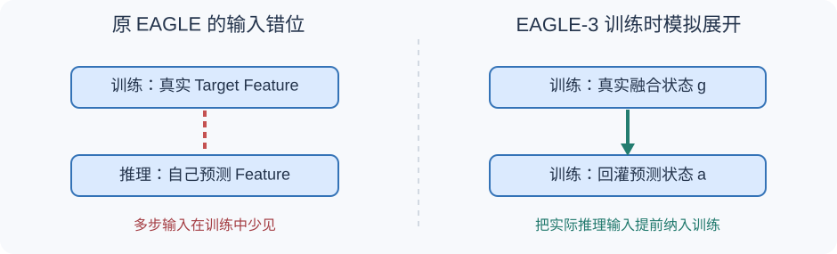

# EAGLE-3：为什么预测下一层 Feature 反而限制了更好的草稿模型？

> **原始论文**：Yuhui Li、Fangyun Wei、Chao Zhang、Hongyang Zhang，[EAGLE-3: Scaling up Inference Acceleration of Large Language Models via Training-Time Test](https://papers.neurips.cc/paper_files/paper/2025/hash/c7b5a35ea98b62512a869c19ea7b03cb-Abstract-Conference.html)，NeurIPS 2025；[作者公开版本 arXiv:2503.01840v3](https://arxiv.org/pdf/2503.01840)。**定位**：推测采样草稿模型的表示、训练与执行机制；沿用严格 Target 校正，可与 [EAGLE-2 的动态候选树](C023-eagle2.md) 组合。前置：[EAGLE 原始方法](C022-eagle.md)、[EAGLE-2](C023-eagle2.md)。

## 从 EAGLE 到 EAGLE-3：改变的不是“验证规则”，而是 Draft 应该学什么

[原始 EAGLE](C022-eagle.md) 的直觉很好：直接预测离散 Token 很困难；Target 的上层 Hidden Features 具有连续结构，不如让小草稿模块预测下一时刻的 Feature，再复用 Target LM Head 生成 Token 分布。

写成一个概念化目标，就是给模型同时施加：

$$
\mathcal L_{\mathrm{EAGLE}}
=\mathcal L_{\mathrm{token}}+\lambda_{\mathrm{fea}}\mathcal L_{\mathrm{feature}}.
$$

其中 $\mathcal L_{\mathrm{feature}}$ 要求 Draft 输出接近 Target 给出的“正确特征”，而 $\mathcal L_{\mathrm{token}}$ 才直接鼓励候选 Token 的预测正确。这里的 $\lambda_{\mathrm{fea}}$ 只是说明权重的抽象记法，不表示论文采用任意固定的同名超参。

**但部署时的真正目标根本不是“复原 Target 特征”**。Target 会在验证阶段修正 Draft 错误；Draft 的任务是以尽量少的代价，生成能被 Target 接受的 Token。一个向量即使远离 Target 的特征，只要经 LM Head 得到有用的候选分布，作为 Draft 也可能是好的。

EAGLE-3 的第一个判断是：当拟合特征成为额外约束时，增加训练数据并不一定能继续改善最终需要的候选质量。原文 **Figure 1（PDF 第 1 页）** 对比了原 EAGLE-2 与新方法的训练数据规模曲线：旧做法收益趋缓，新方法在实验范围内更受益于数据扩展。不要把它理解为一种对所有参数规模、数据分布普适成立的正式 scaling law。

*自制解释图，非原论文 Figure。左侧表示传统单步训练依赖 Target 真实 Feature，而实际多步起草依赖模型自身预测；右侧表示 EAGLE-3 在训练时回灌预测状态。原图请核对 [Figure 3（PDF 第 3 页）](https://arxiv.org/pdf/2503.01840)。*

## 训练时看真实状态，推理时看自己的预测：误差为什么会积累？

假设 Target 已处理真实前缀 $x_{\le t}$，给出真实高层特征 $f_t$。在 EAGLE 训练的单步样本上，输入可能是完整的真实特征历史：

$$
\hat f_{t+1}=D_\phi(f_{\le t},x_{\le t+1}).
$$

这里将上一时刻采样到的 Token 作为条件，是 [EAGLE shifted-token](C022-eagle.md) 用来处理随机选择不确定性的关键。数学式省略了嵌入层和具体移位对齐，仅标识“真实 Feature + 已知 Token 条件”。

但部署时，Target 尚未验证后续草稿。如果已经连着起草多步，下一步输入就变为

$$
\hat f_{t+2}=D_\phi(f_{\le t},\hat f_{t+1},
x_{\le t+2}^{\mathrm{draft}}).
$$

第一步的 $\hat f_{t+1}$ 可能与 Target 对该草稿路径真实计算的 $f_{t+1}$ 有偏差。随后输入偏离训练数据分布，导致再往后越难预测。**单步特征回归损失很小，不等于模型善于在“以自己的预测为上下文”的条件下连续生成。**

### 用一个小例子看分布偏移，而不必先懂全部 Transformer

想象某个简单预测器只在真实状态 $s=0$ 或 $s=1$ 上训练，损失很低。但第一次部署输出 $0.4$ 时，第二次需要处理训练从没见过的 $s=0.4$。它可能输出 $0.9$，第三次又会读入 $0.9$。这不是数值精度问题，也不能只靠增加原来相同分布的真实输入样本保证消除。

在序列模型里，这通常称作 **训练—测试输入分布偏移（exposure bias / distribution shift）**。EAGLE-3 不是第一次发现多步累积误差，但它把解决这个问题的方式与**取消特征拟合约束**绑在了一起。

## 第一个结构变化：融合 Target 不同层级的信息

单看靠近 LM Head 的最高层 Feature，主要能说明 Target 下一 Token 的预测情况；它不一定足以保留更远未来草稿所需的信息。EAGLE-3 由 Target 的低层、中层和高层特征构造统一状态。原文 Figure 5（PDF 第 4 页）的结构可以写成

$$
l_t,m_t,h_t\in\mathbb R^d,\quad
z_t=[l_t;m_t;h_t]\in\mathbb R^{3d},
$$

$$
\boxed{g_t=W_g z_t+b_g\in\mathbb R^d}.
$$

即先拼接，再由全连接层降回 $d$ 维（此处 $d$ 等价原文的 hidden-size $k$；若按 batch/sequence 展开，形状是 $[B,T,3d]\to[B,T,d]$）。

为什么不是简单平均三层 Feature？因为不同深度承载的信息尺度不同，且可能位于不同表征空间；用可训练线性映射学习组合，比强行按坐标平均更灵活。这是**合理的工程动机**，不是“低层一定表征词法、中层一定表征语法、高层一定表征语义”的普适定理。

在 Prefill 或 Target 上轮验证之后，这些真实特征可以被缓存和复用。进入后续草稿步骤，Target 还没处理新草稿 Token，$g_{t+1}$ 就暂时不存在，Draft 会以自己前一步输出的向量 $a_{t+1}$ 代替。**EAGLE-3 没有绕过这件事；它选择让训练覆盖这种输入。**

## 第二个结构变化：输出可以用于 Token 预测，不再必须伪装成 Target Feature

把上一轮 Target 可用的融合向量 $g$，与已采样 Token 的 embedding $e$ 组合，经输入全连接层和轻量 Decoder 生成 $a$，再接复用的 LM Head：

$$
u_t=W_{\mathrm{in}}[g_t;e_{x_{t+1}}]+b_{\mathrm{in}},
$$

$$
a_{t+1}=D_\phi(u_{\le t}),\qquad
q_\phi(x_{t+2}\mid\cdot)=
\mathrm{softmax}(W_{\mathrm{lm}}a_{t+1}).
$$

这是与 Figure 5 对齐的**概念化数据流**；完整索引、位置编码、Normalization 与 Decoder 的实际代码需对照论文/官方仓库。重点是 $a$ 只需能为草稿 LM Head 提供有效 Token 分布，**不再被一个特征回归目标强制拉近 Target 的真实 Feature**。

在下一次起草时，该 $a_{t+1}$ 又成为上下文中的一个替代状态；新的已采样 Draft Token embedding 继续加入。因此 EAGLE-3 的基础问题变成：如何让 Decoder 对真实 $g$ 和自己的 $a$ 两种来源都稳定工作？

## 核心训练技巧：Training-Time Test 不是拿验证集反复训练

论文称之为 **training-time test**，更准确的中文解释是“训练时模拟推理展开”，不是把独立测试集信息泄露进训练，也不是仅在每个训练样本上做一次 teacher forcing。

过程分三个层次：

1. **真实前缀训练**：用 Target 的真实多层特征融合得到 $g$，Draft 预测下一 Token，计算 Token 预测损失。
2. **第一次模拟展开**：把刚生成的草稿向量 $a$ 当成下一轮输入的一部分，继续预测后续 Token，并对这一步也施加训练信号；不能偷偷换回真实 Target Feature。
3. **继续展开并共享参数**：重复类似过程，让同一个 Draft Decoder 在混合真实特征与自身预测状态的上下文中更新。每条分支的注意力只可访问它所属的祖先路径。

原论文 **Figure 3** 对比了三个情形：原 EAGLE 有 Feature Loss，直接移除 Feature Loss 却不做模拟展开，以及移除 Feature Loss **同时**做 training-time test。中间方案尽管首 Token 接受率可能提高，多步接受率却因输入错位而塌陷；不能把 Figure 3 只看成“删掉一个 loss 就行”。

论文 **Figure 6（PDF 第 6 页）** 还展示了训练中自生成候选的树型因果 Mask。为什么必须设计 Mask？若把预测的多个候选直接当成一条普通序列，平行分支会看到彼此，等于让第二条候选误以为第一条候选已被采样——条件分布错了。对于每个 Query，正确的可见集合应该是其真实历史和**自己的**草稿祖先。

因此它与 EAGLE-2 有天然配合关系：**EAGLE-2 处理候选树如何分配；EAGLE-3 处理草稿网络如何学会在树上自己往前走。**

## 为什么严格采样分布仍能成立？

EAGLE-3 没有更新 Target 权重，也没有用草稿分布 $q_\phi$ 直接代替原模型分布 $p$。在 Target 验证后，仍须按 [严格推测采样](C020-speculative-decoding.md) 的接受—拒绝与残差校正执行；树型候选场景下还必须保证多分支条件概率一致。

$$
a(x)=\min\left(1,\frac{p(x)}{q(x)}\right),\qquad
r(x)\propto[p(x)-q(x)]_+.
$$

上式是单候选规则示意，多候选联合采样不能简单理解为对每个兄弟节点都独立套一次公式。草稿训练得更好只意味着更可能多接受几个 Token；**真正的“无损”来自 Target Verification 的规则，而不是 training-time test 的训练损失**。

此外，若部署使用 temperature、top-k、top-p 等采样设置，验证必须对目标的**实际采样分布**进行校正。不能因为论文称 lossless，就把概率实现的细节当作可省略。

## 如何正确阅读 EAGLE-3 的实验数据？

在作者公开的 [arXiv v3](https://arxiv.org/pdf/2503.01840) 中，Figure 1 测训练数据规模与收益趋势；Figure 4 对比不同轮次草稿的接受率；Figure 5/6 给出推理与训练结构；Table 1 比较 Vicuna、Llama 3.1/3.3 与 DeepSeek-R1-Distill 系列的多个任务。

特别值得注意：

| 指标 | 论文报告 | 正确解读 |
|---|---|---|
| 最大加速倍数 | 所测试情形下最高约 **6.5×** | 不是每个模型、任务、GPU 都获得 6.5× |
| 与 EAGLE-2 对照 | 特定实验中约 **1.4×** 的额外时延加速 | 需保持 Target、任务、温度、Draft 训练预算一致才可复核 |
| SGLang batch=64 | 吞吐约 **1.38×** | 吞吐与单请求 Token 延迟不是同一个指标 |
| Figure 4 不同轮次接受率 | 仅移除 Feature Loss 会造成第二步接受率明显降低；联合训练改进后续轮次 | 不能单看第一 Token 准确率判断多步推测加速 |

论文声明没有测试 405B、671B 等更大模型（§4 的计算资源限制），因此不能直接拿上述结果预测超大 MoE Target 的吞吐。多层 Feature 的采集和缓存也有内存、实现、版本适配成本，未必所有服务框架都同等合适。

### 一组建议真正测量的量

给同一个 Target、相同随机采样与工作负载，分别做：普通自回归、原 EAGLE、EAGLE-2 动态树、EAGLE-3 加同样动态树。记录 Draft 轮数与时间、Target 验证节点与时间、按深度分的候选接受率、每次校正后提交的平均 Token 数、端到端延迟、吞吐/Goodput、KV 与多层 Feature 额外显存。如此才能把**Draft 模型更准**、**动态树分配更好**和**服务侧 Batch/内核变化**的收益拆开。

## 从这一组论文建立完整技术链

[精确推测采样](C020-speculative-decoding.md) 解决“生成快但是概率不能错”；[Medusa](C021-medusa.md) 用多个未来 Token Heads 生成候选；[EAGLE](C022-eagle.md) 借助 Target Hidden Features 做特征草稿；[EAGLE-2](C023-eagle2.md) 把固定树改为随上下文变化的预算分配；**EAGLE-3 改的是草稿训练目标与训练输入的时序分布**。

这几步不是互相覆盖的同义技术：**正确性规则、候选生成器、树形搜索、训练方式、GPU 服务调度**分别在不同层起作用。继续沿着 {doc}`推理服务技术路线 </inference-serving/index>` 学习，可以再回到吞吐、Batch 与 SLO 层面考察它们的真实工程收益。

**原文快速查证**：[NeurIPS 2025 正式记录](https://papers.neurips.cc/paper_files/paper/2025/hash/c7b5a35ea98b62512a869c19ea7b03cb-Abstract-Conference.html) · [arXiv v3 PDF](https://arxiv.org/pdf/2503.01840) · [作者实现](https://github.com/SafeAILab/EAGLE)。
